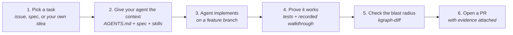

# Contributing to RobOS

**RobOS is a good place to learn context engineering by doing it on a real, public codebase.**

Context engineering is the work of deciding what an AI agent knows, when it knows it, and how you check what it did. It covers the instructions an agent reads, the knowledge it can look up, the skills it can run, and the evidence it has to hand back. Most people learn it on private projects nobody else can see. Here you learn it in the open, on an Apache-2.0 project, and every merged pull request is something you can link to.

If you're a student, a career-changer, or an engineer who wants a structured way into AI-assisted development, treat contributing here as a self-directed **context-engineering internship**: pick a track, ship small changes, get them reviewed, and come out with a public portfolio.

---

## Contents

- [Why intern here](#why-intern-here)
- [What you'll practise](#what-youll-practise)
- [Pick a track](#pick-a-track)
- [Your first week](#your-first-week)
- [How a contribution flows](#how-a-contribution-flows)
- [Prompts you can hand to your agent](#prompts-you-can-hand-to-your-agent)
- [Local setup](#local-setup)
- [Conventions](#conventions)
- [Commits and pull requests](#commits-and-pull-requests)
- [Getting help](#getting-help)

---

## Why intern here

- **The whole project is a context-engineering exercise.** RobOS is built by people steering coding agents (Claude Code, Codex, Antigravity, Copilot, Gemini CLI). The repo is full of the artifacts that make that work: [`AGENTS.md`](AGENTS.md), skills in [`.agents/skills/`](.agents/skills/), a knowledge graph in [`.robos/kgraphs/`](.robos/kgraphs/), and feature specs written as prompt contracts. You learn by reading and improving them.
- **Your work is public.** Commits, reviews and discussions are on GitHub under your name. That's a better reference than "I did a course."
- **Agents do the typing; you do the thinking.** You aren't expected to hand-write every line. You're expected to frame the task well, give the agent the right context, and prove the result works. That's the skill teams are hiring for now.
- **Feedback is built in.** Every pull request ships with test output and, for anything visible, a recorded walkthrough. Reviewers comment on how you scoped and verified the work, not just the diff.
- **The bar is clear.** Conventions are written down (this file and [`AGENTS.md`](AGENTS.md)), so you know what "done" looks like before you start.

There's no application, stipend or fixed start date. You set your own pace. If you want a structured plan or someone to check in with, ask in [Discord](https://discord.gg/6PjxzkHujE) and we'll help you pick work.

## What you'll practise

| Skill | Where you practise it in RobOS |
|-------|--------------------------------|
| **Writing agent instructions** | [`AGENTS.md`](AGENTS.md) and per-tool files (`CLAUDE.md`, `GEMINI.md`, `ANTIGRAVITY.md`). Tighten a rule, fix a stale one, and watch agents behave differently. |
| **Authoring skills** | [`.agents/skills/`](.agents/skills/): small, reusable `SKILL.md` playbooks such as `create-robos-app`, `report-issue` and `kgraph-diff`. Write a new one or make an existing one more reliable. |
| **Modelling knowledge for agents** | [`.robos/kgraphs/`](.robos/kgraphs/): JSON-LD packages checked against SHACL shapes. Describe a system once so an agent can find just the slice it needs. |
| **Writing specs as prompt contracts** | [`docs/ideas/specs/`](docs/ideas/specs/) and [`docs/issues/reported/`](docs/issues/reported/). Turn a vague idea into something any agent can pick up and finish. |
| **Verifying agent output** | E2E tests in [`packages/robos-test/`](packages/robos-test/), headless runs via `scripts/e2e-container.sh`, and narrated demo recordings. Learn to prove work instead of trusting it. |
| **Reviewing agent pull requests** | Read other people's PRs, check their evidence, and leave useful comments. |

## Pick a track

You don't have to choose up front, but it helps to have a focus for your first few PRs.

1. **Agent instructions and skills.** Improve `AGENTS.md`, fix a skill that agents misuse, or add a new skill for a task you keep repeating. Good first step: run an existing skill end to end and fix whatever confused the agent.
2. **Knowledge graph.** Add or correct entities in `.robos/kgraphs/`, run `kgraph-validate`, and use `kgraph-diff` to check the blast radius. Good first step: find an app whose graph entry is missing or out of date.
3. **Specs and issues.** Use the `report-issue` and `create-feature-spec` skills to turn a bug or idea into a task another contributor's agent can run. Good first step: reproduce an issue in `docs/issues/reported/` and sharpen its steps.
4. **Apps and tests.** Fix a bug or build a feature in one of the Electron apps in `packages/`, with a test and a recording to prove it. Good first step: an issue or spec that touches a single app.

## Your first week

A suggested path. Skip ahead if you're already comfortable.

1. **Read the context the agents read.** Skim [`AGENTS.md`](AGENTS.md), open two or three skills in `.agents/skills/`, and look at one package in `.robos/kgraphs/`.
2. **Run something.** Clone the repo, launch an app (`electron packages/dev-central`) and run the unit tests (see [Local setup](#local-setup)).
3. **Say hello.** Post in [Discord](https://discord.gg/6PjxzkHujE) with the track you're interested in. We'll point you at a starter task.
4. **Ship one small PR.** A doc fix, a sharper skill, a corrected graph node. Get it through review so you've seen the whole loop once.
5. **Write down what you learned.** Something in `AGENTS.md` or a skill that tripped you or your agent up is probably worth fixing for the next person. That fix is a contribution too.

---

## How a contribution flows



1. **Pick a task.** Browse [`docs/issues/reported/`](docs/issues/reported/) for bugs or [`docs/ideas/specs/`](docs/ideas/specs/) for features. If you have your own idea, write it up first with `report-issue` or `create-feature-spec` so anyone can run it.
2. **Give your agent the context.** Start your coding agent in your clone and point it at the task file. It should follow `AGENTS.md`. If it doesn't, that's a context problem worth fixing.
3. **Let the agent implement** on a branch named `fix/<slug>` or `feat/<slug>`. Stay in the loop: read what it changes and push back when it drifts.
4. **Prove it works.** Run the relevant tests, or `./scripts/e2e-container.sh` for the headless suite. For anything visible, record a walkthrough with the `record-demo` skill.
5. **Check the blast radius.** If you touched `.robos/kgraphs/`, run `kgraph-validate` and `kgraph-diff` against `main`.
6. **Open a PR** with the test output and recording linked. See the [checklist](#pull-request-checklist).

---

## Prompts you can hand to your agent

Copy one of these into Claude Code, Codex, Antigravity, Copilot or Gemini CLI. Reading why each step is there is a quick lesson in how to brief an agent.

### Fix a reported issue

```text
Resolve the issue in docs/issues/reported/ISSUE-<XXX>-<slug>.md.
Follow AGENTS.md.

1. Create a branch fix/<slug>.
2. Reproduce the issue using the steps in the spec, or with the relevant test
   in packages/robos-test/.
3. Make the smallest change in packages/<app-id>/ that fixes it. Keep the
   Electron security rules (contextBridge only; set userData before the
   single-instance lock).
4. Run the package tests or ./scripts/e2e-container.sh and confirm nothing
   else broke.
5. Commit as: fix(<app-id>): <what changed>.
```

### Implement a feature spec

```text
Implement the spec in docs/ideas/specs/<spec-slug>.md. Follow AGENTS.md.

1. Create a branch feat/<spec-slug>.
2. Update .robos/kgraphs/ with any new entities so they pass SHACL validation.
3. Implement the feature in packages/. For a new app, register its icon in
   packages/robos-icons/index.js and give it a debug port in
   packages/robos-lib/snapshot-cli.js.
4. Add tests under packages/robos-test/tests/ and run them headlessly with
   ./scripts/e2e-container.sh.
5. Record a narrated walkthrough with the record-demo skill.
6. Run kgraph-diff against main and confirm there are no unintended changes.
```

### Create a new app

Use the `/create-robos-app` skill, or:

```text
Build a new RobOS Electron app.
Name: "<App Label>"  ID: "<app-id>"  Purpose: "<one sentence>"

1. Create packages/<app-id>/ with package.json ("start": "electron ."),
   main.js (userData at ~/.config/robos/electron/<app-id>, single-instance
   lock, snapshot debug server), preload.js (contextBridge only),
   renderer/index.html, app.js and styles.css using the RobOS theme
   variables, <app-id>.desktop and a 48x48 icon.svg.
2. Register the icon in packages/robos-icons/index.js (alphabetical).
3. Add a debug port in packages/robos-lib/snapshot-cli.js.
4. Add tests in packages/robos-test/tests/<app-id>/.
```

### Improve or add a skill

```text
Improve the skill in .agents/skills/<skill-name>/SKILL.md.

1. Run the skill on a realistic task and note every point where the agent
   guessed, asked an avoidable question, or did the wrong thing.
2. Edit SKILL.md so those steps are explicit. Keep it short: say what to do,
   in order, and how to tell it worked.
3. Run the skill again on a fresh task and confirm the problems are gone.
4. Commit as: docs(skills): <what changed>, and describe the before/after in
   the PR.
```

### Update the knowledge graph

```text
Update the knowledge graph package .robos/kgraphs/<package-id>/package.jsonld.

1. Read the SHACL shapes in .robos/kgraphs/ first.
2. Make the change, keeping existing OSLC and Schema.org annotations.
3. Never store a credential in plain text; link it with robos:hasCredential.
4. Run kgraph-validate.
5. Run kgraph-diff against main and include the result in the PR.
```

---

## Local setup

RobOS is a monorepo of independent packages. There's **no root `package.json`**: each app in `packages/` has its own dependencies.

**You'll need:** Node.js 20+ and npm, a coding agent, and Docker for the headless test container. QEMU/KVM is optional, for the full appliance VM.

```bash
git clone https://github.com/nddipiazza/robos.git
cd robos

# Launch an app
electron packages/dev-central
electron packages/<app-id>

# Unit tests
cd packages/robos-test
npm install
npm run test:unit

# Full headless E2E suite in Docker (from the repo root)
./scripts/e2e-container.sh
```

---

## Conventions

These are enforced in review. [`AGENTS.md`](AGENTS.md) has the full list.

### Electron security

| Rule | Why |
|------|-----|
| Call `app.setPath('userData', ...)` before `requestSingleInstanceLock()` | Points each app at `~/.config/robos/electron/<app-id>` so lockfiles don't collide. |
| Use `contextBridge` and `ipcRenderer.invoke()` only | Never set `nodeIntegration: true` or `contextIsolation: false`. System calls go through validated IPC handlers. |
| Wrap requires of `/usr/local/share/robos/robos-lib/...` in `try/catch` | Lets apps fall back to local relative paths when run outside the VM. |
| Pass `--no-sandbox --disable-gpu --disable-dev-shm-usage` in VMs and containers | Chromium needs them in virtualised environments. |

### Theme

```css
--bg-primary: #0d1117;   /* main background */
--bg-card:    #161b22;   /* cards and sidebars */
--border:     #30363d;   /* dividers */
--accent:     #00bcd4;   /* RobOS cyan */
--accent-glow:#00e5ff;   /* interactive highlight */
--text-main:  #c9d1d9;   /* body text */
--text-muted: #8b949e;   /* captions and metadata */
```

### Icons

48×48 SVG in Lucide style: `stroke-width="1.5"`, `stroke-linecap="round"`, `stroke-linejoin="round"`. Use a palette colour: `#00bcd4` cyan, `#3b82f6` blue, `#22c55e` green, `#7c3aed` purple, `#f97316` orange or `#ef4444` red.

### Shared libraries

- `robos-lib/ai-json.js`: streaming AI JSON parser and repair (`parseAIJson`, `JSON_RULES_PROMPT`).
- `robos-lib/dom-snapshot.js`: debug server for DOM snapshots.
- `robos-lib/ai-agent.js`: one wrapper for invoking any AI agent.
- `robos-icons/index.js`: the SVG icon registry.

Load them with a fallback so apps also run outside the VM:

```js
let robosLib = null;
try {
  const paths = [
    path.resolve(__dirname, '..', 'robos-lib', 'ai-json'),
    '/usr/local/share/robos/robos-lib/ai-json',
  ];
  for (const p of paths) { try { robosLib = require(p); break; } catch {} }
} catch {}
```

---

## Commits and pull requests

### Conventional Commits

We follow [Conventional Commits](https://www.conventionalcommits.org/), scoped to the package you changed.

| Prefix | Use for | Example |
|--------|---------|---------|
| `feat:` | New feature, app or graph node | `feat(app-wizard): add Bevy game engine archetype` |
| `fix:` | Bug fix | `fix(dev-central): fix singleton lock collision on logout` |
| `docs:` | Docs, skills, `AGENTS.md` | `docs(skills): make record-demo pick the right display` |
| `refactor:` | Restructure with no behaviour change | `refactor(robos-lib): simplify AI JSON streaming parser` |
| `test:` | New or better tests | `test(kube-studio): add Helm release reconciliation test` |
| `chore:` | Maintenance, deps, tooling | `chore(deps): bump electron to 33.0.0` |

### Pull request checklist

1. **One thing per PR.** One issue, one spec, or one skill.
2. **Tests pass.** Include the output. For app changes, run `./scripts/e2e-container.sh`.
3. **Visible changes have a recording.** Link the walkthrough from `record-demo` (saved under `~/.robos/development/walkthroughs/<slug>/`).
4. **Graph changes are checked.** If you touched `.robos/kgraphs/`, include the `kgraph-diff` result.
5. **Say how you briefed the agent.** A sentence or two on the prompt, spec or skill you used helps reviewers, and it's the part of the PR that shows your context-engineering work.

---

## Getting help

- **[Discord](https://discord.gg/6PjxzkHujE)**: the quickest way to find a starter task, ask questions, or get a review.
- **[GitHub Discussions](https://github.com/nddipiazza/robos/discussions)**: design proposals, show-and-tell, and Q&A.
- **[GitHub Issues](https://github.com/nddipiazza/robos/issues)**: bug reports.
- **[Feature ideas](docs/ideas/)**: proposals and specs waiting for someone to run them.
- **[Roadmap](docs/roadmap.md)**: the bigger pieces of work coming up.
- **[rowbose.com/contribute](https://rowbose.com/contribute/)**: the short version of this page.
