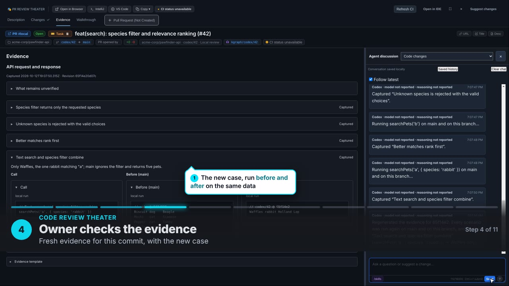

# RobOS

RobOS is a platform for working with coding agents. It combines a suite of desktop developer apps, a knowledge graph of your system, and a recorded run of every agent change, so you review evidence instead of a bare diff.

It is free and open source under the [Apache License 2.0](LICENSE). The current release is [v0.0.7](https://github.com/nddipiazza/robos/releases/tag/v0.0.7).

[Website](https://rowbose.com/) | [Documentation](https://rowbose.com/docs/) | [Future](https://rowbose.com/future/) | [Download](https://rowbose.com/download/) | [Releases](https://github.com/nddipiazza/robos/releases) | [Discord](https://discord.gg/6PjxzkHujE)

<p align="center">
  
</p>

*Code Review Theater showing before-and-after evidence for a branch an agent pushed. Recorded against a demo repository: GitHub, the agent and CI results are scripted stand-ins, while the repository, tests, diff and evidence are real.*

## What is in this repository

- **Desktop apps.** Electron apps covering the development lifecycle: planning, code review, git and issues, databases and API clients, Kubernetes, builds, documentation and eLearning. See the [app directory](https://rowbose.com/apps/).
- **Knowledge graph.** Services, contracts, databases, teams and work items stored as JSON-LD under `.robos/` and validated with SHACL. Two states of the graph (`main` and a feature branch) can be diffed to see what a change touches before it merges.
- **Agent harness.** Routes tasks to the agent CLIs you have installed (Claude Code, Codex, Copilot, Gemini CLI / Antigravity, Hermes), scans prompts for secrets and personal data, runs agents in disposable profiles, and captures test and UI evidence for review. No API keys are needed. An optional API mode can send quick requests to Anthropic, OpenAI, Gemini or a local Ollama server instead ([AI agents and API mode](https://rowbose.com/v1/ai-providers.html)).
- **Skills and plugins.** Skills and slash commands that let coding agents operate RobOS and work on this repository.
- **Appliance OS (optional).** An Ubuntu desktop image for QEMU/KVM with the whole suite preinstalled.

## Getting started

The installers on the [download page](https://rowbose.com/download/) set up the appliance OS. To use the apps on the machine you already have, run them from source. You need Node.js 20+ and Git, on macOS, Linux or Windows (WSL2).

```sh
git clone https://github.com/nddipiazza/robos.git
cd robos
scripts/dev-launch.sh pr-review
```

`dev-launch.sh` installs the app's dependencies on first run, then starts it. Run it with no argument to list the apps. On GNOME, `scripts/install-local.sh` adds the apps to the application launcher instead.

For the Ubuntu desktop setup, the VM image and per-platform notes, see the [installation guide](https://rowbose.com/v1/getting-started.html). To model another repository in a knowledge graph, see the [graph workspace guide](packages/robos-graph/WORKSPACES.md).

## How a change moves through RobOS

1. **Plan.** `task-planner` turns a request into tracked issues with acceptance criteria and test cases.
2. **Implement.** An agent (`task-implementer`) works on a branch, commits and pushes. It does not open the pull request.
3. **Review.** `pr-review`, also called Code Review Theater, shows the diff file by file, before-and-after evidence captured from real runs of the code, and a walkthrough where an agent demonstrates each checkpoint. IntelliJ IDEA and VS Code open from the same screen.
4. **Ship.** The reviewed description is published as a draft pull request, moved to ready once CI is green, then reviewed and merged. A CI failure on `main` files a follow-up task.

More on this in [Agent Governance & Review](https://rowbose.com/v1/agent-review-development.html) and [PR Review Theater](https://rowbose.com/v1/pr-review-theater.html).

### The apps

Each app is a directory under `packages/`, launched with `scripts/dev-launch.sh <package>`. A sample, not the full list:

| Area | Packages |
|---|---|
| Planning and tasks | `task-planner`, `task-implementer`, `task-board`, `issue-manager`, `dev-central` |
| Review and delivery | `pr-review`, `ci-monitor`, `deploy-tracker` |
| Architecture and graph | `robos-graph` (Knowledge Graph Explorer), `topology-manager`, `schema-studio`, `contract-studio` |
| Data and APIs | `db-manager`, `nosql-manager`, `rest-client`, `grpc-client`, `graphql-client`, `data-sources` |
| Infrastructure and secrets | `kube-studio`, `remote-execution-studio`, `pass-manager` |
| Agents | `agents-manager`, `agent-chat`, `mcp-manager` |

Every app has a page in [`docs/_apps/`](docs/_apps/) and an entry in the [app directory](https://rowbose.com/apps/).

## How it is built

The apps are Electron with plain JavaScript and no UI framework. Each package is independent: there is no root `package.json`, and each has its own `node_modules`.

An app looks like this:

```
packages/<app-id>/
  main.js          Electron main process; registers ipcMain handlers
  preload.js       contextBridge API exposed to the renderer
  renderer/        HTML, CSS and JavaScript for the UI
  package.json     the app's own dependencies
  icon.svg         app icon
  <app-id>.desktop launcher entry
```

- **IPC.** Renderers have no Node access. They call `window.<api>` from `preload.js`, which forwards to `ipcMain.handle` in `main.js`.
- **State.** Persistent data lives in `~/.config/robos/`.
- **Shared code.** `robos-lib` (prompt security, evidence capture, DOM snapshots, `.desktop` parsing), `robos-icons`, `robos-ui` and `robos-mcp-lib`. On the VM these are installed under `/usr/local/share/robos/` and required by absolute path, so apps wrap those requires in `try/catch`. See [AGENTS.md](AGENTS.md) for the details.
- **MCP servers.** Packages ending in `-mcp` expose the graph, IDE bridge, tasks and workspaces to agents over the Model Context Protocol.
- **Knowledge graph.** JSON-LD packages in `.robos/kgraphs/<package>/package.jsonld`, indexed by `.robos/kgraph.yaml`. The engine, SHACL validation, diffing and the `kgraph` CLI are in `packages/robos-graph/`. Inserts must pass SHACL validation; graph changes go through a propose-then-apply review. See [WORKSPACES.md](packages/robos-graph/WORKSPACES.md) and [INSPECTOR.md](packages/robos-graph/INSPECTOR.md).
- **Agent routing.** `robos-agent-client/harness-router.js` dispatches tasks to the agent CLIs found on your machine. One-shot requests go through `robos-lib/ai-agent`, which uses the active CLI, or the opt-in `robos-llm` API mode (LangChain.js) when the user turns it on.
- **Sandboxing.** `robos-profiled` gives each agent its own profile with a tmpfs-backed home directory and a display bridge for GUI runs.

It is built on existing standards instead of new formats: OSLC and JSON-LD for the graph, SHACL for validation, Backstage catalog files and the C4 model for topology, TypeSpec, OpenAPI and AsyncAPI for schemas and contracts, Pact for consumer contracts, Bruno files for API collections, and MCP for agent tooling.

### Repository layout

| Path | Contents |
|---|---|
| `packages/` | Apps, shared libraries and MCP servers, one directory each |
| `packages/robos-graph/` | Knowledge graph engine, SHACL validation, `kgraph` CLI and explorer app |
| `packages/robos-test/` | Unit and end-to-end tests |
| `.robos/` | This repository's own knowledge graph |
| `plugins/` | Skill marketplace for coding agents, and the IntelliJ IDEA plugin |
| `.agents/`, `.claude/`, `.antigravity/`, `.gemini/`, `.github/skills/` | Skills and commands in the form each agent reads |
| `docs/` | Documentation site (Jekyll), published at rowbose.com/v1/ |
| `site/` | Front site (Jekyll), published at rowbose.com |
| `infra/` | `docker/` for the containerized E2E runner, `desktop/` for the VM image build |
| `installer/` | Installer app for the appliance OS |
| `games/` | Godot games (a cRPG and a tabletop RPG) and their tooling |
| `scripts/` | Launch, install, build, release and docs tooling |

## Development

Requirements: Node.js 20+ and Git. Docker is needed for the containerized E2E runner, QEMU/KVM for the VM image, and JDK 17+ with Gradle for the IntelliJ plugin.

```sh
# Run an app
scripts/dev-launch.sh <package>

# Unit tests (no display needed)
cd packages/robos-test
npm install
npm run test:unit

# End-to-end tests in a container with a virtual display
./scripts/e2e-container.sh

# Inspect a running app's DOM
node packages/robos-lib/snapshot-cli.js <package> --text
```

Adding, renaming or removing an app touches several registries (desktop manager, icons, install scripts, the knowledge graph, docs). Use the `create-robos-app`, `rename-robos-app` and `remove-robos-app` skills, or follow the checklist in [AGENTS.md](AGENTS.md).

The documentation lives in `docs/` and `site/`. `scripts/build-docs.sh` builds both the way CI does (needs Jekyll and the gems in `docs/Gemfile`), and `node scripts/sync-app-docs.js` refreshes the per-app pages.

To build and run the VM image, see `infra/desktop/` (`build.sh`, `run.sh`, `clean.sh`).

## Skills

Skills are how coding agents operate RobOS: scaffolding apps, running the E2E harness, recording demos, querying and diffing the knowledge graph, and managing the VM. They are written once in [`plugins/robos/skills/`](plugins/robos/skills/) and installed in the form each agent reads (Claude Code, Codex, Antigravity, Copilot, Gemini CLI).

```sh
# Claude Code
claude plugin marketplace add ./plugins
claude plugin install robos

# Any agent: sync skills into this repository, or add --global for your user profile
./plugins/install.sh
./plugins/install.sh --target codex
```

- [plugins/README.md](plugins/README.md): install steps for each agent
- [Skills catalog](docs/skills/skills-catalog.md): every skill, its parameters and how it is verified
- [RobOS Skills](https://rowbose.com/v1/robos-skills.html) on the docs site

[AGENTS.md](AGENTS.md) is the reference for agents and contributors: architecture, conventions, the app registration checklist and known gotchas. `CLAUDE.md`, `GEMINI.md` and `ANTIGRAVITY.md` point to it.

## Documentation

- [Installation guide](https://rowbose.com/v1/getting-started.html)
- [System architecture](https://rowbose.com/v1/architecture.html)
- [SDLC knowledge graph](https://rowbose.com/v1/knowledge-graph.html) and [schemas](https://rowbose.com/v1/schemas.html)
- [Agent governance and review](https://rowbose.com/v1/agent-review-development.html)
- [App directory](https://rowbose.com/apps/)
- [Game development](https://rowbose.com/v1/game-development.html) and the [cRPG test guide](games/crpg-realm/AGENTS.md)
- [Roadmap](https://rowbose.com/v1/roadmap.html), [Why RobOS](https://rowbose.com/v1/why-robos.html) and [About](https://rowbose.com/v1/about.html)

## Contributing

Read [CONTRIBUTING.md](CONTRIBUTING.md) first. Commits follow [Conventional Commits](https://www.conventionalcommits.org/). Feature ideas are in [`docs/ideas/`](docs/ideas/) and reported problems in [`docs/issues/`](docs/issues/). Questions and proposals go to [GitHub Discussions](https://github.com/nddipiazza/robos/discussions), bugs to [Issues](https://github.com/nddipiazza/robos/issues), and conversation to [Discord](https://discord.gg/6PjxzkHujE).

## License

Apache License 2.0. See [LICENSE](LICENSE).

RobOS is pronounced "row-bose". The name comes from Robo in *Chrono Trigger*; the [About page](https://rowbose.com/v1/about.html) has the story.
