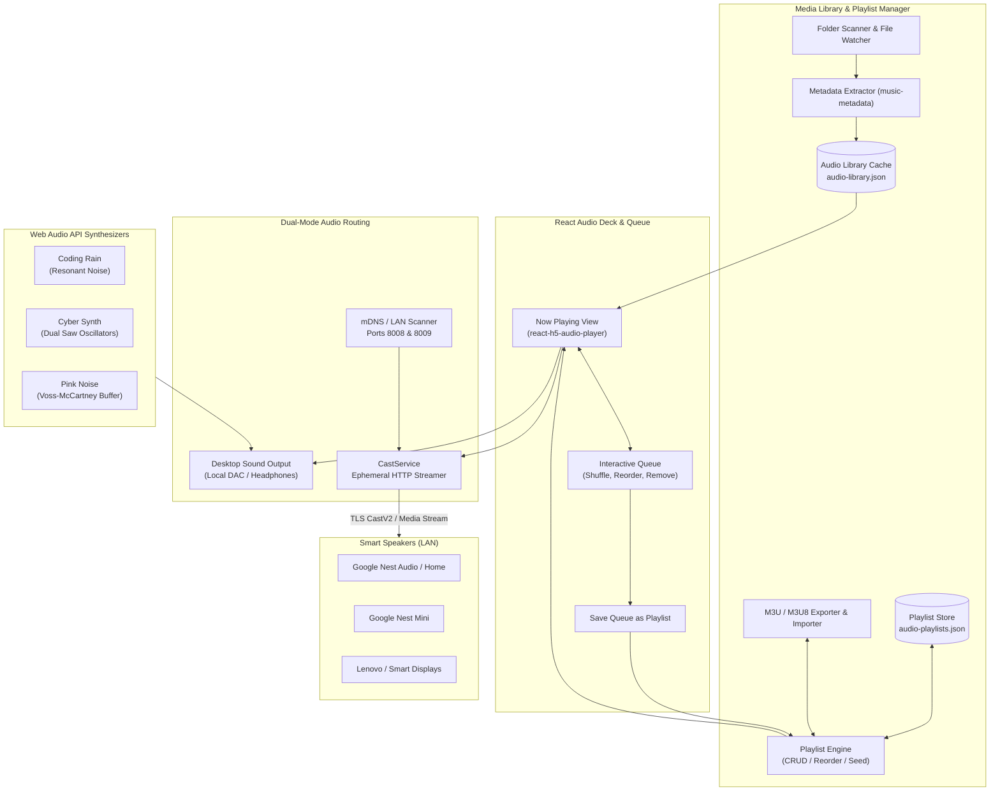

RobOS Audio Player provides high-fidelity audio playback for the developer workstation, complete playlist curation, and seamless zero-cloud audio streaming to physical Google Home and Nest smart speakers on the local network.

## Features

### 1. Custom Playlist Engine & Queue Management
- **Persistent Playlists**: Create, update, reorder, and delete custom playlists persisted in `~/.config/robos/audio-playlists.json`. Pre-seeded with curated defaults like *Favorites* and *Focus & Deep Work*.
- **Interactive Playback Queue**: Real-time queue bar with drag-and-drop ingestion, individual track removal (`✕`), queue shuffle (`🔀`), and single-click **Save Queue as Playlist** (`💾`).
- **M3U / M3U8 Import & Export**: Full compatibility with external media players via standard `#EXTM3U` and `#EXTINF` format export and import.
- **Media Library Cross-Linking**: Add any indexed track from the Media Library browser directly to existing playlists with the `📑 Playlist` button or quick-select picker.
- **Playlist Casting**: Broadcast entire playlists in order directly to any discovered Google Cast speaker or all speakers simultaneously with one click.

### 2. React H5 Audio Deck & Local Playback
- **High-Fidelity Deck**: Powered by `react-h5-audio-player` and `Howler.js` with progress scrubbing, time indicators, volume adjustments, and track artwork display.
- **Synchronized Visual Seeker**: When routing playback to external Cast speakers, local desktop audio is cleanly muted while the seeker and queue remain in live synchronization.
- **Multi-Format Support**: Comprehensive codec playback supporting MP3, WAV, OGG, FLAC, AAC, M4A, OPUS, and WMA.

### 3. Zero-Cloud Google Home / Cast Smart Speaker Streaming
- **Local TLS Streaming**: Casts audio directly across the local area network (`castv2` over port 8009 TLS) through an ephemeral, dynamic HTTP streaming server. Zero external cloud roundtrips or third-party audio subscriptions required.
- **Network Probing**: Automatic mDNS and eureka probing (`http://<ip>:8008/setup/eureka_info`) to discover Google Nest, Google Home, and Chromecast Audio devices on the local subnet.
- **Volume & Playback Control**: Centralized volume adjustment, pause, resume, individual speaker stop, and global `Stop All Speakers` controls.
- **Harmonic Test Chime**: Synthesizes and broadcasts an in-memory 16-bit PCM harmonic test chime to verify speaker connectivity.

### 4. Procedural Focus Soundscapes
- **Real-Time Web Audio Synthesizers**: Generates procedural ambient focus audio directly via the browser Web Audio API with zero external media files:
  - **Coding Rain**: Resonant bandpass-filtered noise mimicking rainfall.
  - **Cyber Synth**: Dual detuned sawtooth oscillators passing through an analog low-pass filter.
  - **Pink Noise**: Voss-McCartney noise buffer optimized for deep technical concentration.

### 5. Automated Inspection & DOM Snapshot Debugging
- **Snapshot Port**: Exposes automated DOM snapshot inspection and headless testing on port `19196`.

## Hardware Compatibility

The player automatically probes and connects to:
- Google Nest Audio & Google Home
- Google Nest Mini & Google Home Mini
- Lenovo Smart Clocks & Cast-enabled smart displays
- Chromecast Audio & Google Cast receivers

## Files & Configuration

- **App directory**: `packages/audio-player/`
- **Playlists storage**: `~/.config/robos/audio-playlists.json`
- **Library cache**: `~/.config/robos/audio-library.json`
- **Snapshot debug port**: `19196`
- **Ephemeral stream server**: Dynamic port on host LAN interface
