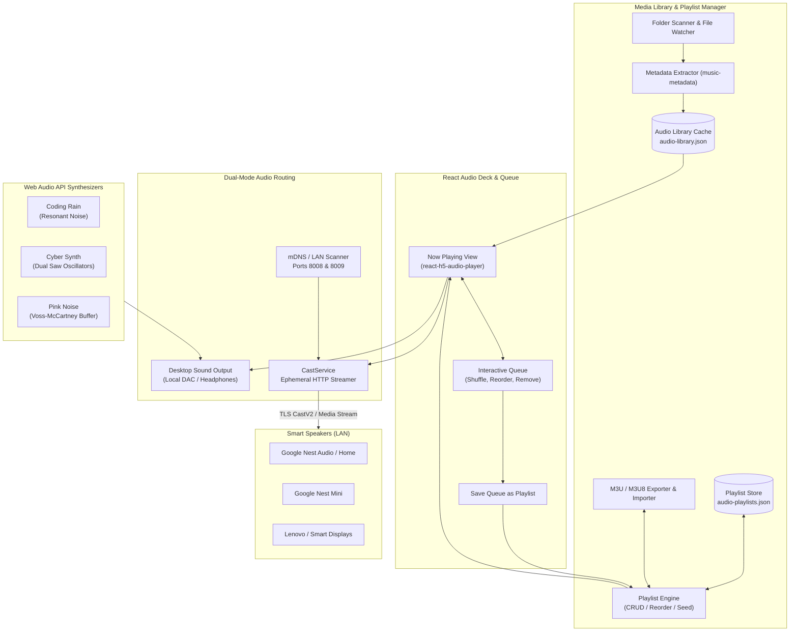

RobOS Audio Player provides high-fidelity audio playback for the developer workstation, complete playlist curation, and seamless zero-cloud audio streaming to physical Google Home and Nest smart speakers on the local network.

## Features

### Media Library Browser
- **Browse by category**: Albums, Artists, Songs, Genres, Decades and Composers, each with its own sort options and an A–Z jump rail for large lists.
- **Smart collections**: Loved, Recently Added, Recently Played and Most Played, driven by per-track play counts and ♥ marks stored in `~/.config/robos/audio-track-stats.json`. A play counts once a track has been heard for 30 seconds (or half of a short track).
- **Album, artist, genre, decade and composer pages**: artwork header, Play / Shuffle / Play next / Add to queue / Love all, disc-grouped track lists, "More by this artist", "Appears on" compilations and top artists per genre.
- **Smart album grouping**: groups by album-artist tag, or by folder when tracks have no album-artist tag. Untagged compilations stay together as *Various Artists*, `CD1`/`CD2` folders merge into one album, and two artists' "Greatest Hits" stay separate.
- **Search everything**: `Ctrl+F` searches titles, artists, albums, genres, composers and years. Every word must match (`beatles abbey`), and results are grouped into artists, albums, genres and songs.
- **Track lists made for playing**: double-click plays the list from that song. Click, `Ctrl`-click and `Shift`-click select several songs; `Ctrl+A` selects all and `Enter` plays the selection. Right-click or `⋯` for Play next, Add to queue, Add to playlist, Love, Go to album/artist, Track info and Show in file manager. Drag songs onto the Now Playing panel to queue them.
- **Cover art that persists**: embedded covers and `cover.jpg` / `folder.jpg` / `front.jpg` files next to the tracks are cached once per album under `~/.cache/robos/audio-player/art/`. Libraries indexed before this cache existed recover their art the first time it is shown.
- **Folder scope**: limit every view to a single library folder, or manage folders from *Sources → Folders*.
- **Built for 100,000-track libraries**:
  - Song lists, album grids, artist grids and A–Z sections are virtualized: only the rows on screen are in the DOM, however far you scroll.
  - Sorted and filtered views are memoized, so playback and notifications don't re-sort the library, and sort keys are precomputed.
  - Search runs on a deferred query so typing stays responsive.
  - Background scans merge tracks in O(batch) time, write the (compact) cache at most every few seconds, and send the renderer throttled progress and library updates instead of one per handful of files.

### AI Playlists & Virtual DJ
- **Describe it, your RobOS agent builds it**: *✦ AI Playlist* (Playlists tab, Library sidebar or the Now Playing panel) opens the shared `<robos-ai-textarea>` prompt. Describe the playlist ("an hour of upbeat 90s alternative for coding, end with something mellow") and pick how many songs. The agent picks and orders songs from **your own library**.
- **Choose the agent**: the shared `<robos-agent-selector>` (the same one PR Review uses) lists the agents in the RobOS provider catalog (AGY, Codex). It defaults to the first one that is installed and signed in, and you can also pick a model and reasoning effort. The choice is remembered and also drives the Virtual DJ. Requests run through `robos-agent-client/one-shot`: Codex in its read-only sandbox, AGY in print mode.
- **Scales to huge libraries**: up to 400 songs go to the agent in one call. Bigger libraries take two: the agent reads a summary (genres, decades, top artists) and answers with criteria, the player shortlists 400 matching songs locally, and the agent picks and orders from that shortlist.
- **Preview, then play or save**: rename the result, *Play* it right away or *Save playlist*; saved AI playlists keep their request and DJ script.
- **Virtual DJ between songs**: tick *Virtual DJ between songs* and describe your DJ ("a laid-back late-night jazz host with dry humour"). The agent writes an intro and a short line before each song, spoken with RobOS voice (Kokoro, Edge neural voices or Piper via `voice-prompt`'s `TTSEngine`) in the voice you choose. Choose how often the DJ talks: before every song, every other song, or now and then.
  - The DJ talks only between songs that end on their own, never when you skip.
  - Lines and audio are prepared while the current song plays, so the music doesn't wait.
  - *Skip* (or Play/Space) cuts the DJ short.
  - With a Cast speaker selected, the DJ is cast to it too.
- **DJ for any queue**: the 🎙 button in the Now Playing panel turns the Virtual DJ on for whatever is playing; the agent writes lines a few songs ahead.

### Now Playing Panel (VLC-style playlist)
- **Always visible**: the play queue is docked on the right of every tab, so you can switch tracks while browsing the library, playlists, cloud storage or speakers. Collapse it to a slim rail with the *Now Playing list* button.
- **VLC-style editing**: double-click or `Enter` jumps to a track, and the playing row is bold with a live indicator. Drag rows to reorder, `Delete` removes the selection, and clicking Title / Artist / Time sorts the queue. A filter box narrows long queues, and right-click gives Play next, Move to top/bottom and Remove.
- **Random & repeat**: random playback avoids repeats until the whole queue has played, and *Previous* walks back through what played. Repeat cycles through off, whole queue and current track.
- **Totals**: track count, total duration and time remaining. The queue, current position, random and repeat modes are restored on the next launch.
- **Transport everywhere**: the bottom bar has random, previous, play/pause, next and repeat buttons, a seek bar and a ♥ button. `Space` plays/pauses, `Ctrl+→` / `Ctrl+←` skip, and media keys / GNOME media controls work through the Media Session API.

### 1. Custom Playlist Engine & Queue Management
- **Persistent Playlists**: Create, update, reorder, and delete custom playlists persisted in `~/.config/robos/audio-playlists.json`. Pre-seeded with curated defaults like *Favorites* and *Focus & Deep Work*.
- **Interactive Playback Queue**: Real-time queue bar with drag-and-drop ingestion, individual track removal (`✕`), queue shuffle (`🔀`), and single-click **Save Queue as Playlist** (`💾`).
- **M3U / M3U8 Import & Export**: Full compatibility with external media players via standard `#EXTM3U` and `#EXTINF` format export and import.
- **Media Library Cross-Linking**: Add any indexed track from the Media Library browser directly to existing playlists with the `📑 Playlist` button or quick-select picker.
- **Playlist Casting**: Broadcast entire playlists in order directly to any discovered Google Cast speaker or all speakers simultaneously with one click.

### 2. React H5 Audio Deck & Local Playback
- **High-Fidelity Deck**: Powered by `react-h5-audio-player` and `Howler.js` with progress scrubbing, time indicators, volume adjustments, and track artwork display.
- **Synchronized Visual Seeker**: When routing playback to external Cast speakers, local desktop audio is cleanly muted while the seeker and queue remain in live synchronization.
- **Multi-Format Support**: Comprehensive codec playback supporting MP3, WAV, OGG, FLAC, AAC, M4A, OPUS, and WMA.

### 3. Zero-Cloud Google Home / Cast Smart Speaker Streaming
- **Local TLS Streaming**: Casts audio directly across the local area network (`castv2` over port 8009 TLS) through an ephemeral, dynamic HTTP streaming server. Zero external cloud roundtrips or third-party audio subscriptions required.
- **Network Probing**: Automatic mDNS and eureka probing (`http://<ip>:8008/setup/eureka_info`) to discover Google Nest, Google Home, and Chromecast Audio devices on the local subnet.
- **Volume & Playback Control**: Centralized volume adjustment, pause, resume, individual speaker stop, and global `Stop All Speakers` controls.
- **Harmonic Test Chime**: Synthesizes and broadcasts an in-memory 16-bit PCM harmonic test chime to verify speaker connectivity.

### 4. Procedural Focus Soundscapes
- **Real-Time Web Audio Synthesizers**: Generates procedural ambient focus audio directly via the browser Web Audio API with zero external media files:
  - **Coding Rain**: Resonant bandpass-filtered noise mimicking rainfall.
  - **Cyber Synth**: Dual detuned sawtooth oscillators passing through an analog low-pass filter.
  - **Pink Noise**: Voss-McCartney noise buffer optimized for deep technical concentration.

### 5. Automated Inspection & DOM Snapshot Debugging
- **Snapshot Port**: Exposes automated DOM snapshot inspection and headless testing on port `19196`.

## Hardware Compatibility

The player automatically probes and connects to:
- Google Nest Audio & Google Home
- Google Nest Mini & Google Home Mini
- Lenovo Smart Clocks & Cast-enabled smart displays
- Chromecast Audio & Google Cast receivers

## Files & Configuration

- **App directory**: `packages/audio-player/`
- **Playlists storage**: `~/.config/robos/audio-playlists.json`
- **Library cache**: `~/.config/robos/audio-library.json`
- **Play counts & loved tracks**: `~/.config/robos/audio-track-stats.json`
- **Cover art cache**: `~/.cache/robos/audio-player/art/`
- **Snapshot debug port**: `19196`
- **Ephemeral stream server**: Dynamic port on host LAN interface
