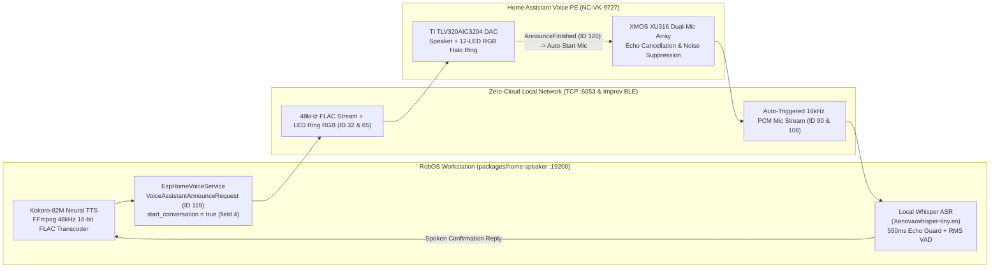

RobOS Home Speaker turns your workstation into a zero-cloud, two-way smart speaker intercom and voice-approval hub. It supports **Home Assistant Voice Preview Edition (`NC-VK-9727`)** as its #1 first-class hardware device alongside ESPHome voice satellites and Google Home / Nest speakers.

## Live Demo Video: Hands-Free Voice Approval (`"Is it okay to push to main?"`)

Watch RobOS Home Speaker ask a question out loud on the **Home Assistant Voice (`NC-VK-9727`)**, automatically open the speaker's microphone as soon as the question finishes (no wake word and no button press needed), transcribe the spoken answer locally with Whisper (`"Yes it is."`), and confirm out loud:

  <iframe width="360" height="640" src="https://www.youtube.com/embed/3ZCU7gsIodg" title="RobOS Home Speaker + Home Assistant Voice PE Two-Way Voice Approval Demo" frameborder="0" allow="accelerometer; autoplay; clipboard-write; encrypted-media; gyroscope; picture-in-picture; web-share" allowfullscreen style="border-radius: 12px; border: 1px solid #30363d;"></iframe>
  
<a href="https://www.youtube.com/shorts/3ZCU7gsIodg" target="_blank" rel="noopener">Watch on YouTube Shorts: https://www.youtube.com/shorts/3ZCU7gsIodg</a>

---

## Architecture Overview

---

## Key Features

- **Hands-Free Two-Way Voice Questions & Approvals (`start_conversation = true`)**: Ask the user a question out loud on the speaker (for example, *"What is your name?"* or *"Is it okay to push to main?"*) and automatically open the speaker's microphone the instant playback finishes—no *"Okay Nabu"* wake word or physical button press required.
- **Incoming from Speaker (Listen Mode)**:
  - **Record from Speaker Now**: Remotely open the speaker's microphone with one click from your computer.
  - **Wake Word & Center Button**: Also listens continuously for *"Okay Nabu"* or a press of the speaker's center button.
  - **Local Whisper Speech-to-Text**: Transcribes 16 kHz PCM audio from the speaker's dual-microphone array locally on your machine using `@xenova/transformers` (`Xenova/whisper-tiny.en`) with a 550 ms acoustic echo guard.
  - **Auto-Reply Out Loud**: Automatically speaks the response back on the speaker using Kokoro-82M neural TTS.
- **Add Smart Speaker Wizard**:
  - **#1 Featured Device**: Nabu Casa **Home Assistant Voice Preview Edition (`NC-VK-9727`)**.
  - **Bluetooth Wi-Fi Setup (Improv BLE)**: Scans for unprovisioned `ha-voice-pe-*` units over Bluetooth Low Energy (`00467768-6228-2272-4663-277478268003`) and provisions 2.4 GHz Wi-Fi credentials directly from Linux (`bluetoothctl`).
  - **Plain-English Cards**: Simple layman's descriptions with collapsible `▸ Show details` / `▸ Show technical details` sections.
- **Push-to-Talk Voice Walkie-Talkie**: Record voice notes on your desktop with a live waveform visualizer and broadcast them to any room.
- **Neural Text-to-Speech Intercom**: Synthesize natural announcements with Kokoro-82M (`af_heart`, `am_michael`, `am_adam`, `af_bella`, `af_nicole`, `bf_emma`) and Piper neural voices.
- **Instant Soundboard, Ambient Focus & Music Library**: Stream sound effects, procedural focus soundscapes, or tracks from RobOS Audio Player (`~/.config/robos/audio-library.json`), transparently transcoded to 48 kHz 16-bit mono FLAC for the `NC-VK-9727`.

---

## Screenshots

| Two-Way Voice Intercom & Listen Mode | Add Smart Speaker Wizard (`NC-VK-9727` #1) |
|:---:|:---:|
|  |  |

---

## Supported Hardware

1. **Nabu Casa Home Assistant Voice Preview Edition (`NC-VK-9727`)** — Featured #1 supported smart speaker & two-way voice satellite (ESPHome Native API `:6053`, 48 kHz FLAC streaming, 12-LED RGB Halo Ring control, XMOS XU316 dual-mic array, rotary volume dial, and Improv BLE Wi-Fi setup wizard).
2. **ESPHome Voice Satellites & Media Players (`:6053`)** — ESP32-S3-BOX-3, M5Stack Atom Echo, and custom ESPHome nodes.
3. **Home Assistant Media Player Bridge (`:8123`)** — Any `media_player.*` entity exposed via Home Assistant.
4. **Google Nest Audio, Nest Mini, Lenovo Smart Clocks & Chromecast Audio (`:8009`)** — Zero-cloud Google Cast streaming.

---

## Files & Ports

- App directory: `packages/home-speaker/`
- ESPHome Native API & Two-Way Voice engine: `packages/home-speaker/lib/esphome-voice-service.js`
- Speaker orchestration service: `packages/home-speaker/lib/speaker-service.js`
- CLI tool: `packages/robos-cli/robos-speaker`
- Snapshot debug port: `19200`
- Config cache: `~/.config/robos/home-speakers.json`
- Dedicated Wiki Guide: [Home Assistant Voice (`NC-VK-9727`) Two-Way Intercom Guide]({{ '/home-assistant-voice/' | relative_url }})
