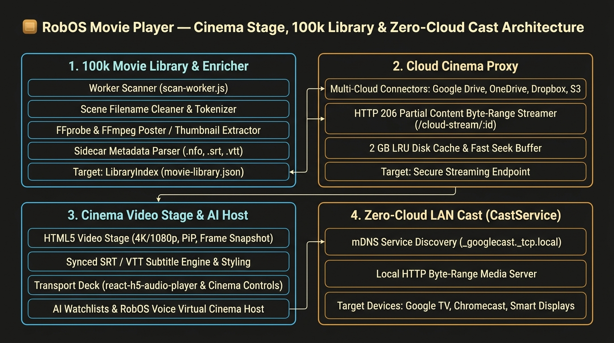
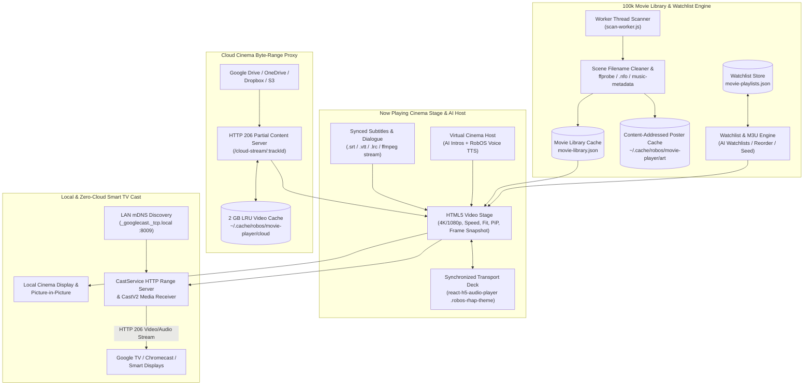

> **Full Interactive Walkthrough & Live Roku TV Tour:** See the flagship landing page at [`/movie-player/`](https://rowbose.com/movie-player/) (or [`/video-player/`](https://rowbose.com/video-player/)).

**RobOS Movie Player** (`packages/movie-player`) is the cinema and video companion to [RobOS Audio Player]({{ '/apps/audio-player/' | relative_url }}). It shares the exact same warm dark theater palette (`#15120f`, `#1c1814`, `#26211b`, `#e8a33d`, `#f1e9dc`) and multi-pane architecture, translating every audio player capability—100,000-item virtualized libraries, cloud byte-range streaming, AI playlists, a spoken Virtual Host, open-source metadata/artwork enrichment, procedural soundscapes, and zero-cloud Smart TV & Roku OS streaming—to movies, TV series, and video collections.

## Features

### 1. Cinema Video Stage & Synchronized Transport Deck (`Now Playing`)
- **Theater Video Viewport**: Plays `.mp4`, `.mkv`, `.webm`, `.mov`, `.m4v`, `.avi`, `.ogv`, `.ts`, `.m2ts`, and `.mpg` files locally or over HTTP byte-range streams.
- **Live On-Screen Closed Captions**: Renders active subtitle cues in a high-contrast amber-bordered theater caption pill directly over the bottom of the video stage (`CC On / Off`).
- **Stage Controls**:
  - **Playback Speed**: Cycle between `0.5x`, `0.75x`, `1x`, `1.25x`, `1.5x`, and `2x`.
  - **Aspect Fit**: Switch between `CONTAIN` (letterbox), `COVER` (fill frame), and `FILL` (stretch).
  - **Theater Mode & Fullscreen**: Expand the stage vertically (`Theater`) or double-click the video viewport for native fullscreen.
  - **Picture-in-Picture (`PiP`)**: Float the movie in an always-on-top Picture-in-Picture window while working in other apps.
  - **Frame Snapshot (`Frame`)**: Captures the exact current video frame at native resolution to a PNG in `~/Pictures/RobOS Movie Snapshots/`.
- **Synchronized Transport Deck**: Uses the `.robos-rhap-theme` transport bar (`react-h5-audio-player`) with 10-second jump steps, shuffle, repeat, and a **Screen Output** selector for one-click switching between local playback and LAN Google Cast TVs.

### 2. Synced Subtitles & Dialogue Panel
- **Multi-Format Subtitle Parser (`lib/lyrics.js`)**: Automatically discovers sidecar `.srt` (`SubRip`), `.vtt` (`WebVTT`), `.en.srt`, `.en.vtt`, or `.lrc` files beside any video, or extracts embedded subtitle tracks (`0:s:0`) on the fly via `ffmpeg`.
- **Interactive Transcript**: Highlights and auto-scrolls the current dialogue line as the movie plays. Clicking any line in the panel seeks the video (and any active Cast TV) directly to that timestamp.
- **One-Click Subtitle Import**: Load external `.srt`, `.vtt`, or `.lrc` files for any movie via the **Load .SRT/.VTT** button; imported captions are cached in `~/.cache/robos/movie-subtitles/<trackId>.json`.

### 3. 100,000-Movie Virtualized Library Browser
- **Browse by Cinema Category**: **Collections** (franchises, box sets, TV series), **Directors**, **Movies**, **Genres**, **Decades**, **Studios** (writers/composers), **Watchlist (Loved)**, **Recently Added**, **Recently Watched**, **Most Watched**, and **Folders**.
- **Scene Release Filename Cleaner (`cleanMovieFilename`)**: Automatically strips scene tags (`2160p`, `1080p`, `720p`, `4K`, `UHD`, `HDR10`, `BluRay`, `WEB-DL`, `WEBRip`, `x264`, `x265`, `HEVC`, `AV1`, `AAC`, `DTS`, release groups) while extracting the 4-digit release year, `SxxExx` season/episode numbers, resolution badges (`4K`, `1080p`, `720p`), and video codecs.
- **Content-Addressed Poster Cache**: Embedded cover art, folder posters (`poster.jpg`, `cover.jpg`, `fanart.jpg`, `folder.jpg`), and extracted video frames are hashed (`sha1`) into `~/.cache/robos/movie-player/art/` so 100,000 movies never hold image buffers in RAM.

### 4. AI Watchlists & Virtual Cinema Host (Optional AI)
- **✦ AI Watchlist (`src/AiPlaylist.jsx` / `lib/ai-playlist.js`)**: Describe a movie marathon, director retrospective, era, or mood (e.g., *"4K sci-fi double feature for a rainy night"* or *"short animated films under 20 minutes"*). Your configured RobOS agent picks and orders films from your indexed library, falling back to a deterministic local scorer when offline.
- **Virtual Cinema Host (`src/useVirtualDj.js`)**: The movie counterpart to the Audio Player's Virtual DJ. When enabled, the agent writes short 1–2 sentence cinema introductions a few movies ahead in the screening queue (in personas like *Classic Theater Host*, *Film Festival Curator*, or *Late-Night Drive-In*), spoken aloud between films with **RobOS Voice** (or cast to your Smart TV).

### 5. AI & Open-Data Movie Metadata / Poster Fixer
- **✦ AI Fix Metadata (`src/AiFixMetadata.jsx` / `lib/ai-metadata.js`)**:
  1. Cleans messy scene filenames and folder hierarchies (`Director/Collection/Movie (Year).mkv`).
  2. Reads Kodi/Jellyfin/Plex `.nfo` sidecar XML files (`<title>`, `<director>`, `<set>`, `<studio>`, `<year>`, `<genre>`).
  3. Probes video/audio streams with `ffprobe` for exact dimensions (`3840x2160` → `4K`), codec (`HEVC`, `AV1`, `H.264`), and duration.
  4. Extracts a representative video frame (at 10% runtime) via `ffmpeg` as a real thumbnail poster when no poster image exists, or synthesizes a warm cinema SVG poster.
  5. Optionally invokes your RobOS coding agent with `@skill(robos:fix-media-metadata)` and writes updated tags/posters back to local `.mp4`/`.mkv` containers via lossless `ffmpeg -c copy`.

### 6. Cloud Cinema Storage & Zero-Cloud Smart TV Cast
- **Metadata-Only Cloud Indexing (`lib/cloud-storage.js`)**: Indexes movies across Google Drive, Microsoft OneDrive, Dropbox, and S3 without downloading video bodies. On play or Cast, streams video on demand through a local HTTP `206 Partial Content` proxy (`/cloud-stream/:trackId`) backed by a configurable 2 GB LRU disk cache.
- **Zero-Cloud LAN Smart TV Streaming (`lib/cast-service.js`)**: Discovers Google TV, Chromecast, and Nest Hub displays via mDNS (`_googlecast._tcp.local`) and streams local or cloud movies directly over the LAN. Also includes the **Theater Lobby Clock Display** and **Cast Theater Ambient Soundscape** cards.

### 7. Tablo 4th Gen OTA DVR & 3-Row Roku OS Channel
- **Tablo 4th Gen LAN Client (`packages/robos-lib/tablo-client.js`)**: Discovers Tablo 4th Gen OTA DVR appliances on the LAN (`:8887`), signs REST requests with `HMAC-MD5` (`Authorization: tablo:<key>:<sig>`), and fetches sports events, series episodes, movies, and local news recordings alongside OTA guide channels (`47.1 WMSNFOX`, `15.1 WMTVNBC`, `27.1 WKOWABC`, `3.1 WISC-TV`).
- **Broadcast Recording Thumbnails + Live Frame Capture**: Caches 16:9 broadcast recording snapshots (`~/.cache/robos/tablo-images/`) and automatically captures a live 640×360 JPEG frame via `ffmpeg -frames:v 1` for active in-progress (`state: "recording"`) broadcasts.
- **Dual-Path Streaming & 3rd Roku Top Tab (`TABLO DVR`)**: Adds a 3rd top-level `TABLO DVR` tab to the 3-row Roku OS SceneGraph channel and `:19210/movie-player` portal, serving real-time `H.264/AAC` fragmented MP4 streams (`/api/tablo/stream`) to desktop players and rewritten native 60fps `MPEG-2/AC-3` HLS playlists (`/api/tablo/roku.m3u8`) to Roku TVs.

## Files & Configuration

- **App directory**: `packages/movie-player/`
- **Library cache**: `~/.config/robos/movie-library.json`
- **Watchlists storage**: `~/.config/robos/movie-playlists.json`
- **Watch counts & Loved marks**: `~/.config/robos/movie-track-stats.json`
- **Managed folders**: `~/.config/robos/movie-folders.json`
- **Poster art cache**: `~/.cache/robos/movie-player/art/`
- **Subtitles cache**: `~/.cache/robos/movie-subtitles/`
- **Cloud LRU video cache**: `~/.cache/robos/movie-player/cloud/`
- **Frame snapshots**: `~/Pictures/RobOS Movie Snapshots/`
- **Control API**: `~/.config/robos/movie-player-control.json`
- **Snapshot debug port**: `19214`
