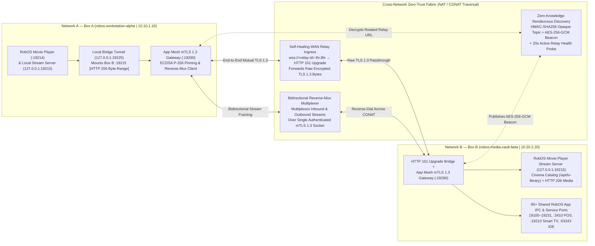

**RobOS Private Networks** (`packages/private-networks`, debug port `:19217`) links two or more RobOS machines across completely separate networks, symmetric NATs, or CGNAT with a single `robos-net://` invite token—requiring **zero cloud accounts, zero router port-forwarding, and zero root privileges**.

Built on `packages/robos-lib/app-mesh-engine.js`, every connection is end-to-end encrypted using **Mutual TLS 1.3 (`requestCert: true`)** with **ECDSA Prime256v1 (P-256) X.509 SHA-256 certificate fingerprint pinning**. Once linked, a persistent **Bidirectional Reverse-Mux** multiplexer allows both **Network A** and **Network B** to bridge each other's 95+ RobOS application IPC ports (`19100–19231`) and stream 1080p/4K video libraries directly between **RobOS Movie Player** instances (`:19215`) via HTTP 206 Byte-Range streaming.

---

## Architecture Overview




---

## Key Capabilities

### 1. 1-Step Mutual Enrollment (`robos-net://`)
A single `robos-net://` token contains the host node's random cryptographic `nodeId`, gateway port, optional WAN relay URL, X.509 SHA-256 certificate fingerprint, and a secret `enrollToken`. When Box A runs `join`:
1. Box A pins Box B's X.509 SHA-256 fingerprint locally.
2. Box A dials Box B over TLS 1.3 (`minVersion: 'TLSv1.3'`) and presents `enrollProof = HMAC-SHA256(enrollToken, nodeIdA + ":" + fingerprintA)`.
3. Box B verifies `enrollProof` in constant time (`crypto.timingSafeEqual`) and automatically pins Box A's client certificate—completing mutual enrollment in a single round-trip.

### 2. Self-Healing WAN Relay & Zero-Knowledge `AES-256-GCM` Rendezvous
When two RobOS machines sit on separate networks behind NAT or CGNAT without a shared overlay VPN:
- **End-to-End TLS 1.3 over HTTP 101 Upgrade (`ensureUpgradeBridgeServer`)**: The host starts a lightweight local HTTP 101 WebSocket Upgrade bridge in front of its TLS 1.3 gateway and allocates an outbound SSH relay (`wss://<relay-id>.lhr.life`). The relay only forwards raw TCP frames; **Mutual TLS 1.3 terminates strictly inside the RobOS gateway**.
- **20-Second Self-Healing Health Probe (`probeRelayHttpAlive`)**: Continuously probes the relay ingress and automatically respawns a fresh tunnel if the upstream relay drops or rotates its subdomain (`HTTP 502`).
- **Zero-Knowledge `AES-256-GCM` Rendezvous Discovery (`publishRendezvousBeacon` / `resolveLatestRendezvousRelay`)**: Whenever a relay subdomain rotates, the host publishes an `AES-256-GCM` encrypted beacon (`{ v: 2, iv, tag, ct }`) to an unguessable topic derived via `HMAC-SHA256(enrollToken, "robos-rv-topic:" + nodeId)`. No hostnames, LAN/Overlay IPs, node IDs, or plaintext relay URLs are ever exposed on the rendezvous channel.

### 3. Bidirectional `Reverse-Mux` Stream Multiplexing
Because Box A may also be behind strict NAT/CGNAT, `joinPrivateNetwork` automatically opens a persistent `reverse-mux` session (`attachStreamMux`) over the authenticated TLS 1.3 socket. Using a compact 9-byte binary frame protocol (`OPEN`, `DATA`, `CLOSE`, `PING`), Box B can dial Box A's local ports (`:19215` Movie Player, `:19100–19231` App IPC) back through Box A's outbound connection.

### 4. Cross-Network Movie Player Streaming (`:19215` &rarr; `:19225`)
Linking two machines automatically mounts the remote peer's **RobOS Movie Player** stream server (`:19215`) onto local port `127.0.0.1:19225` and writes `~/.config/robos/movie-player/active-peer-bridge.json`.
- **RobOS Movie Player** (`packages/movie-player`) auto-detects the active bridge (or lets you click **`+ P2P Peer`** in the Library Folders panel), imports the remote peer's video catalog (`/api/tv-library?all=1`), rewrites media URLs to `http://127.0.0.1:19225/media/...`, and streams 1080p/4K `.mp4`, `.mkv`, and `.webm` files with instant `HTTP 206 Partial Content` byte-range seeking.

---

## CLI & Desktop Usage

```bash
# 1. On Box B (Host): Start the Zero-Trust mTLS 1.3 Gateway, local :19215 video server, and WAN Relay
node packages/private-networks/cli.js host

# 2. On Box A (Remote Peer): Join Box B's Private Network and mount its video library on 127.0.0.1:19225
node packages/private-networks/cli.js join "robos-net://<INVITE_TOKEN>"

# 3. Query Box B's video catalog and test HTTP 206 byte-range streaming over the local mTLS bridge
curl -s "http://127.0.0.1:19225/api/tv-library?all=1" | jq .
curl -I -H "Range: bytes=0-65535" "http://127.0.0.1:19225/media/<STREAM_FILE>.webm"

# 4. Launch the Desktop GUIs
electron packages/private-networks
electron packages/movie-player
```
