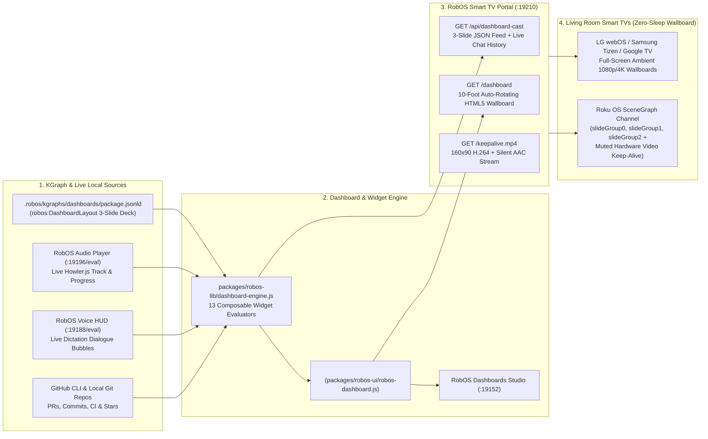

# RobOS Dashboards

**RobOS Dashboards** (`packages/robos-dashboards`) is a graphical dashboard studio, multi-slide wallboard rotation engine, and embeddable Web Component library built on the RobOS Knowledge Graph (`.robos/kgraphs/dashboards/package.jsonld`).

Every widget on a dashboard is a composable RobOS custom element (`<robos-widget-...>`) backed by [`packages/robos-lib/dashboard-engine.js`](https://github.com/nddipiazza/robos/blob/main/packages/robos-lib/dashboard-engine.js) and [`packages/robos-ui/robos-dashboard.js`](https://github.com/nddipiazza/robos/blob/main/packages/robos-ui/robos-dashboard.js). Dashboards run inside the desktop studio (`:19152`), embed inside any RobOS app via `<robos-dashboard>`, and cast to living-room Smart TVs via **RobOS Smart TV Studio** (`:19210/dashboard` and the native Roku SceneGraph channel).

---

## Architecture Overview

---

## Pre-Built 3-Slide Smart TV Wallboard Deck

RobOS Dashboards ships with a 3-slide rotating wallboard deck configured in `.robos/kgraphs/dashboards/package.jsonld` and `DEFAULT_SLIDESHOW`:

### Slide 1: Daily Engineering & Agent Ops (`daily-engineering-ops`)
- **My Open PRs (`github-prs-waiting`)**: Open pull requests waiting on review or ready to merge across configured repositories, alongside active issue counts.
- **GitHub Repo Activity (`github-repo-activity`, `showMainCi: false`)**: 30-day commit sparkline bar chart (`705` commits across 30 days) and the 7 latest commit messages on `main`.
- **Today's Schedule & Music (`calendar-today` + `audio-now-playing`)**: Today's calendar agenda synced with RobOS Google Calendar / Thunderbird CalDAV, paired with live playback state from **RobOS Audio Player** (`:19196/eval` + `~/.config/robos/audio-player/state.json`), verifying real Howler.js playback (`player.playing()`) before reporting a track as `PLAYING`.

### Slide 2: GitHub CI Status & App Popularity (`github-ci-popularity`)
- **CI Status in `main` & Release Pipeline**: Live workflow status across `Deploy docs to GitHub Pages`, `Household lifecycle`, `Native Windows EXE release`, and `Windows app suite`, plus the latest release tag (`v0.0.8`).
- **GitHub Stars, Forks & Community Pulse**: Hero counters for Stars, Forks, Watchers, and Release Asset Downloads, plus the chronological stargazer feed.
- **App Popularity: Clones, Traffic & Downloads**: 14-day Git clone chart (total clones and unique cloners), release installer breakdown (`.dmg`, `.exe`, `.AppImage`, `.deb`), and top discovery referrers.

### Slide 3: RobOS Voice Dictation — Most Recent Chats (`robos-voice-dictation`)
- **Full-Canvas Voice Dictation Stream (`<robos-widget-voice-dictation>`)**: Displays the most recent user voice prompts (`🎙 YOU`) and assistant responses (`🤖 ROBOS VOICE`) spoken or dictated through **RobOS Voice**.
- **Real-Time HUD Sync**: Queries the live RobOS Voice HUD debug server (`http://127.0.0.1:19188/eval`) to inspect `#chat-feed .dictation-bubble` DOM nodes directly while streaming, persists live updates to `~/.config/robos/voice-bubbles-live.json`, and merges historical prompts from `~/.config/robos/voice-prompts.json`.

---

## Complete 13-Widget Catalog

Every widget is registered in `WIDGET_CATALOG` (`packages/robos-lib/dashboard-engine.js`) and rendered by `<robos-dashboard>`:

| Widget Type | Custom Element Tag | Default Refresh | Data Source |
|---|---|---|---|
| `git-commits` | `<robos-widget-git-commits>` | `30s` | Local Git repositories (`git log`) |
| `calendar-today` | `<robos-widget-calendar-today>` | `60s` | RobOS Google Calendar / CalDAV & daily agenda |
| `agent-sessions` | `<robos-widget-agent-sessions>` | `10s` | Active Claude / Codex / Gemini / Copilot agent sessions |
| `github-prs-waiting` | `<robos-widget-github-prs-waiting>` | `45s` | GitHub CLI (`gh pr list`) & open issues |
| `github-repo-activity` | `<robos-widget-github-repo-activity>` | `60s` | GitHub commits, Actions workflows, stars, clones, and releases |
| `audio-now-playing` | `<robos-widget-audio-now-playing>` | `5s` | Live RobOS Audio Player (`:19196/eval` & `state.json`) |
| `voice-dictation` | `<robos-widget-voice-dictation>` | `4s` | Live RobOS Voice HUD (`:19188/eval`, `voice-bubbles-live.json`, `voice-prompts.json`) |
| `smart-tv` | `<robos-widget-smart-tv>` | `15s` | Paired LAN Smart TVs & portal status (`:19210`) |
| `smart-lights` | `<robos-widget-smart-lights>` | `15s` | LAN smart bulbs (WiZ, Hue, WLED, Kasa, LIFX, Govee) |
| `kgraph-summary` | `<robos-widget-kgraph>` | `60s` | Dual-state OSLC JSON-LD Knowledge Graph packages & SHACL status |
| `sprint-radar` | `<robos-widget-sprint-radar>` | `30s` | Sprint progress, velocity, and blocker radar |
| `vpn-status` | `<robos-widget-vpn-status>` | `10s` | Isolated `ip netns` VPN sandbox & kill-switch barriers |
| `custom-component` | `<robos-widget-custom>` | `30s` | Any custom `<robos-...>` element tag with JSON props |

---

## KGraph Card Layouts (`robos:DashboardLayout`)

Dashboards can switch dynamically between 6 canonical KGraph card layouts:
1. `layout-mission-control-3col` — **Mission Control 3-Column** (`repeat(3, minmax(0, 1fr))`)
2. `layout-hero-top-split` — **Hero Top + 2-Card Split** (full-width top card + 2 bottom cards)
3. `layout-sidebar-focus` — **Sidebar Focus (1/3 + 2/3)** (`1fr 2fr`)
4. `layout-quad-grid` — **Quad 2×2 Card Grid** (`repeat(2, minmax(0, 1fr))`)
5. `layout-tv-wallboard` — **10-Foot Smart TV Wallboard** (high-contrast 10-foot typography across 3 columns)
6. `layout-single-canvas` — **Single Full-Canvas Card** (dedicated single-widget view used by Slide 3 `robos-voice-dictation`)

---

## Smart TV Casting & Zero-Sleep Roku Keep-Alive

When casting to a Smart TV via **RobOS Smart TV Studio** (`:19210/dashboard` or native Roku OS sideloading):
- **Synchronized Multi-Slide Wallboard Rotation**: Both the HTML5 portal (`GET /dashboard`) and the native Roku SceneGraph channel (`slideGroup0`, `slideGroup1`, `slideGroup2` in `MainScene.xml` / `MainScene.brs`) rotate across all enabled slides in the deck on a configurable timer (`15s`–`30s`) or manually via the remote's **Left / Right** D-Pad buttons.
- **Zero-Sound Hardware Video Keep-Alive for Roku OS**:
  - Simulating ECP keypresses (`Lit_` or navigation keys) on Roku either triggers the firmware's menu navigation sound effects or fails to reset Roku's 20-minute `Idle` / screensaver / auto-power-off timer.
  - RobOS solves this cleanly by serving a tiny 160×90 H.264 + silent AAC MP4 stream at `GET /keepalive.mp4` (`packages/robos-lib/tv-engine.js`) and playing it inside a `1×1` muted (`mute="true"`) looping SceneGraph `<Video id="keepAliveVideo">` node in `MainScene.xml`. Because the Roku hardware media pipeline remains in active playback, Roku OS suppresses screensaver and standby indefinitely with **zero audio clicks**.
