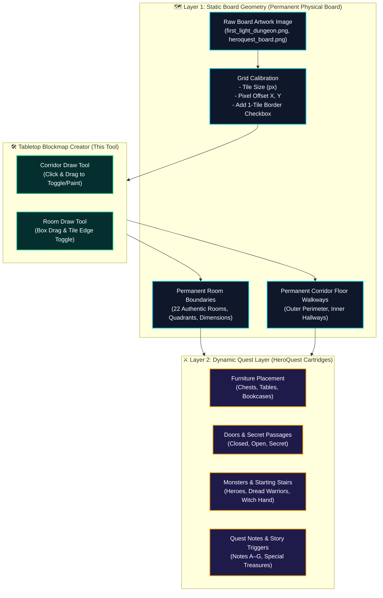

# RobOS Tabletop Blockmap Creator

The **Tabletop Blockmap Creator** is the dedicated visual calibration and level geometry authoring tool for RobOS tabletop dungeon games (HeroQuest, First Light, and custom dungeon crawlers). It allows developers and designers to take **any raw image** (scans, fan-made maps, hand-drawn grids) and transform it into a precision-calibrated, reusable static board blockmap.


## The Two-Layer Architecture

RobOS separates tabletop dungeon maps into two distinct architectural layers:



### 1. Layer 1: Static Board Blockmap (Permanent Physical Cardboard)
Layer 1 represents the immutable physical board. It never changes between quests:
- **Tile Size (`tileSize`)**: Exact pixel width and height of each square tile.
- **Image Offsets (`offsetX`, `offsetY`)**: Pixel shift from the artwork border to the grid origin.
- **1-Tile Border Option**: Standard perimeter corridor bounding the four edges of the board.
- **Static Rooms**: Permanent walls and dimensions `[x, y, w, h]` for each printed chamber.
- **Static Corridors**: Which grid tiles are walkable floor vs. solid void.

### 2. Layer 2: Dynamic Quest Layer (Adventures & Cartridges)
Layer 2 builds on top of Layer 1 to create specific quests and missions:
- Placed furniture (alchemist bench, weapons racks, tombs, throne)
- Door placements between rooms and corridors (open, closed, secret)
- Wall blocks placed in specific corridors to restrict player movement
- Wandering monsters, starting stairs, and story trigger notes

---

## Interactive Controls & Tools

| Control | Description |
|---|---|
| **Tile Size (px)** | Fine-grain stepper (`-1`, `-0.1`, `+0.1`, `+1`) and slider to match the underlying artwork's square tiles. |
| **Offset X & Y (px)** | Nudge buttons (`-5`, `-1`, `+1`, `+5`) to shift the grid origin to the exact top-left corner of the board artwork. |
| **Add 1-Tile Border** | Checkbox that activates and protects the standard 1-tile outer perimeter corridor. |
| **Corridor Draw Tool** | Click and drag the mouse across tiles to paint, erase, or toggle corridor floor squares. |
| **Room Draw Tool** | Click and drag a box selection to instantly define a room boundary `[x, y, w, h]`, or toggle tile edges. |
| **Save Board Map** | Writes the calibrated geometry directly into the active cartridge and system board registry. |

---

## Launching the Editor

You can launch the Tabletop Blockmap Creator directly from the command line:

```bash
# Launch with default board (HeroQuest: First Light Side A)
./games/tabletop-rpg/blockmap-creator.sh

# Or launch with any specific image or cartridge
./games/tabletop-rpg/blockmap-creator.sh heroquest_board.png
./games/tabletop-rpg/blockmap-creator.sh --cartridge=heroquest-fortress-fire-king
```
