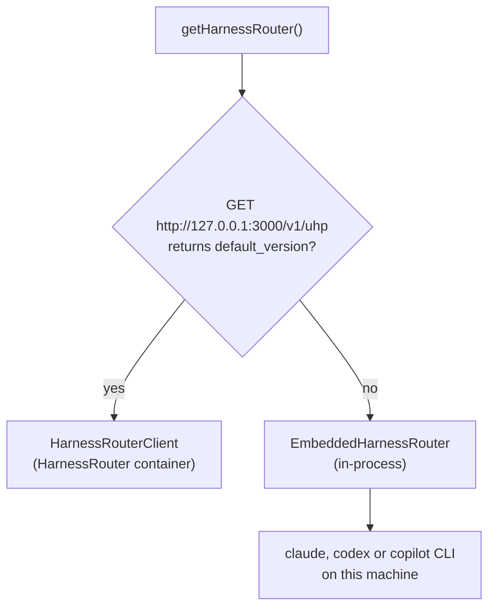

# Agent tiers
{: .no_toc }

What the "Agent Tiers & Prompt Optimization" settings do today, how RobOS routes a task to an agent CLI through the Unified Harness Protocol (UHP), and what is not built yet. Read this before you rely on tier-based model selection.
{: .fs-6 }

<details open markdown="block">
  <summary>On this page</summary>
  {: .text-delta }
1. TOC
{:toc}
</details>

{: .important }
Not built yet: automatic tier dispatch. RobOS has three settings called Tier 1, Tier 2 and Tier 3 model, but no app reads them. Nothing scores a task, picks a tier, escalates after a failure, or runs the agent in a RAM-disk sandbox. The parts that exist are the settings pane, two prompt helpers in the knowledge graph library, and the agent router described below.

## The Agent Tiers settings

Open **RobOS Preferences** from the app launcher and choose **Agent Tiers & Prompt Optimization** in the left sidebar. The source is [`packages/robos-preferences`](https://github.com/nddipiazza/robos/tree/main/packages/robos-preferences).


{: .robos-zoomable-img }

*Look at the three model fields and the Caveman and DSPy controls with their defaults.*

| Label | Key in `settings.json` | Type | Default |
|:---|:---|:---|:---|
| Tier 1 Model (Fast Utility & Local) | `tier1_model` | text | `claude-haiku-4-5` |
| Tier 2 Model (Workhorse Implementation) | `tier2_model` | text | `claude-sonnet-5` |
| Tier 3 Model (Frontier Deep Reasoning) | `tier3_model` | text | `o3` |
| Enable Caveman Prompt Compression | `enable_caveman` | checkbox | on |
| Caveman Compression Mode | `caveman_mode` | `standard`, `aggressive`, `extreme` | `standard` |
| Caveman Target Tiers | `caveman_target_tiers` | `tier1`, `tier1_and_tier2`, `all_tiers` | `tier1_and_tier2` |
| Enable Stanford DSPy Teleprompter Optimization | `enable_dspy` | checkbox | on |
| DSPy Teleprompter Optimizer | `dspy_optimizer` | `MIPROv2`, `BootstrapFewShot`, `COPRO`, `LabeledFewShot` | `MIPROv2` |
| DSPy Optimization Metric | `dspy_metric` | `shacl_validation`, `unit_tests_pass`, `ast_syntax_check`, `exact_match` | `shacl_validation` |
| Auto-compile DSPy Prompts on Save | `dspy_compile_on_save` | checkbox | off |

The model fields are free text. The defaults are whatever the code ships with, so change them to a model your agent CLI accepts.


{: .robos-zoomable-img }

*Look at Caveman Compression Mode set to extreme and the DSPy optimizer and metric changed from their defaults.*

Click **Save All**. RobOS merges the values into `~/.config/robos/settings.json` and shows "Settings saved successfully."


{: .robos-zoomable-img }

*Look at the green banner at the top of the section.*

On save, the code also tries to mirror the Caveman and DSPy toggles into the knowledge graph as two nodes, `urn:robos:agent:strategy:caveman-compression` and `urn:robos:agent:optimizer:dspy-teleprompter`. That mirror loads `robos-graph` from the Preferences process and, as the code is written, appears not to run. Treat `settings.json` as the only stored copy.

## Prompt helpers

Two methods on `SDLCKnowledgeGraphStore` in [`packages/robos-graph/lib/graph-store.js`](https://github.com/nddipiazza/robos/tree/main/packages/robos-graph) implement the "prompt optimization" half of the pane. No RobOS app calls either one outside the test suite, so the toggles above do not change what agents receive.

### Caveman compression

`applyCavemanCompression(text, { mode })` removes filler words with regular expressions. Backtick code (fenced blocks and inline code) is set aside and restored unchanged.

| Mode | Removes |
|:---|:---|
| `standard` | Phrases such as "please ensure", "please make sure", "could you", "in order to", "keep in mind that", greetings, "thank you", "feel free to" |
| `aggressive` | Everything in `standard`, plus "furthermore", "moreover", "additionally", "we need to", "you should" |
| `extreme` | Everything in `aggressive`, plus the words "the", "a" and "an" |

It returns `originalTokensEst`, `compressedTokensEst`, `savingsPercent` and `compressedText`. The token figures are an estimate, word count times 1.3, not a real tokenizer count.

Running it on this prompt in `standard` mode:

```text
Hello! Could you please make sure to inspect `packages/billing/index.js`? In order to comply with accounting standards, it is important to note that all currency calculations must use integer cents. Furthermore, please ensure the tests pass. Thank you!
```

gives:

```text
to inspect `packages/billing/index.js`? comply with accounting standards, all currency calculations must use integer cents. Furthermore, the tests pass.
```

The estimate for that prompt was 49 tokens before and 24 after. The example also shows the risk: the patterns delete "ensure" and "make sure" along with "please", so "please ensure the tests pass" became "the tests pass". Compare the output with the original before you send it anywhere. File paths are only protected when they are inside backticks.

### DSPy prompt builder

`compileWithDSPy(signature, dataset, { teleprompter, metric, maxBootstrappedDemos })` returns a prompt string made of a fixed instruction line, up to `maxBootstrappedDemos` examples copied from your dataset (default 3), and the current-task placeholders. The teleprompter and metric names are written into the instruction line and the result object. It does not call the DSPy library, run MIPROv2 or any other optimizer, or score anything, and `validationScore` is always `1.0`.

## How tasks reach an agent CLI

The routing code is in [`packages/robos-agent-client`](https://github.com/nddipiazza/robos/tree/main/packages/robos-agent-client). It speaks UHP version `2026-08-11` and has two runtimes. `getHarnessRouter()` picks one each time it is called.



| Runtime | Where it runs | Notes |
|:---|:---|:---|
| `HarnessRouterClient` | A HarnessRouter container listening on `127.0.0.1:3000` | HTTP and server-sent events. Requires Docker. Optional bearer token. |
| `EmbeddedHarnessRouter` | Inside the calling Node process | No Docker. Stores sessions in `~/.config/robos/harnessrouter/sessions.json`. |

Start the container with the command the install scripts use:

```bash
docker run -d --name harnessrouter --restart unless-stopped -p 127.0.0.1:3000:3000 -v harnessrouter:/data harnessrouter/harnessrouter
```

You can also install **HarnessRouter CE** from the AI category in Software Center, or use the start, restart and stop buttons described below.

### What the embedded router actually runs

The embedded router lists six harnesses, but it only starts a real process for three of them.

| Harness id | CLI | Behavior |
|:---|:---|:---|
| `chrn_claude` | `claude` | Runs `claude -p <input> --output-format text` |
| `chrn_codex` | `codex` | Runs `codex exec <input>` |
| `chrn_copilot` | `copilot` | Runs the Copilot wrapper `packages/robos-lib/run-copilot.js` |
| `chrn_gemini` | `gemini` or `agy` | Listed, but no process is started |
| `chrn_hermes` | `hermes` | Listed, but no process is started |
| `chrn_omp` | `omp` | Listed, but no process is started |

For the last three, and for any of the first three whose CLI is not installed, `runTask` returns a placeholder message that starts with `[RobOS Embedded UHP Router] Executed task via` and reports success. It did not run an agent.

Other limits of the embedded router:

- The `model` value is stored with the session but is not passed to the CLI. The CLI uses its own configured model.
- The model list in embedded mode is a fixed list built into the file, not a query of what your CLIs offer.
- The `usage` numbers it returns are rough placeholders.
- The agent runs directly in the `cwd` you pass. There is no sandbox.

{: .warning }
The embedded router starts `claude` and `codex` with `shell: true` and does not quote the prompt. Quotes, `$` and backticks in a prompt can be interpreted by the shell, so do not feed it untrusted text.

### Prompt scanning

Before a prompt is sent, `EmbeddedHarnessRouter.runTask()` and `AgentSession.start()` run it through the prompt security guard in [`packages/robos-lib/prompt-security.js`](https://github.com/nddipiazza/robos/tree/main/packages/robos-lib). The `prompt_security_mode` setting (section "Prompt Security & Guardrails" in RobOS Preferences) accepts `redact` (default), `block`, `warn`, `audit-only` and `off`. Findings are logged to `~/.config/robos/prompt-security-audit.json`.

### Call the router from code

`runTask` takes `input`, `model`, `harnessId`, `stream`, `cwd`, `onDelta` and `onEvent`. This lists the harnesses and runs a prompt:

```javascript
const { getHarnessRouter } = require('/usr/local/share/robos/robos-agent-client');

(async () => {
  const router = await getHarnessRouter();

  const list = await router.listHarnesses();
  for (const h of list.data.data) console.log(h.id, h.status);

  const res = await router.runTask({
    input: 'Summarize the TODO comments in this repository.',
    harnessId: 'chrn_claude',
    stream: true,
    cwd: process.cwd(),
    onDelta: (text) => process.stdout.write(text),
  });
  console.log(res.ok ? 'done' : res.error);
})();
```

The embedded router emits the events `task.queued`, `task.progress`, `task.delta`, `task.completed` and `task.failed` to `onEvent(type, data)`. `HarnessRouterClient` passes through whatever event names the server sends and treats `task.completed` or `response.done` as the final one. The client does not send `cwd`.

The client calls these UHP endpoints, with the header `UHP-Version: 2026-08-11`:

| Method | Path |
|:---|:---|
| `GET` | `/v1/uhp`, `/v1/harnesses`, `/v1/harnesses/:id`, `/v1/models`, `/v1/harnesses/:id/models`, `/v1/sessions`, `/v1/sessions/:id`, `/v1/sessions/:id/turns` |
| `POST` | `/v1/responses`, `/v1/responses/:id/cancel`, `/v1/sessions/:id/cancel` |
| `DELETE` | `/v1/sessions/:id` |

`createSession('claude' | 'copilot' | 'harnessrouter')` from the same package builds an `AgentSession` around one of three backends: the `claude` CLI, the Copilot CLI wrapper, or the router.

## Where task agents are chosen today

[Dev Central]({{ '/apps/dev-central/' | relative_url }}) does not use the router or the tier settings. It reads `backend` from `~/.config/robos/work-task-settings.json`, which defaults to `codex` and also accepts `claude`, and starts that CLI directly. For `codex`, design runs use `--sandbox read-only` and implementation runs use `--sandbox workspace-write` with network access on. For `claude`, design runs add `--permission-mode plan` and implementation runs add `--permission-mode acceptEdits`. The model is whatever that CLI is configured to use.

`providers.js` in `robos-agent-client` lists Codex and AGY (Antigravity) with their model catalogs, which the PR Review CI recovery panel reads (it offers Codex only). It needs a signed-in Codex or AGY and caches each catalog for 24 hours in `~/.config/robos/provider-model-cache.json`.

## HarnessRouter panel in Agents Manager

Open **RobOS Agents** from the app launcher ([Agents Manager]({{ '/apps/agents-manager/' | relative_url }})) and select **HarnessRouter (UHP)** in the provider list. The panel shows:

- **Router Engine & Gateway Status**: whether the router runs as a service on `:3000` or embedded, with buttons **Refresh Status**, **Start Container (Docker)**, **Restart**, **Stop** and **Open Web Console (:3000)**. Start runs the `docker run` command above, or prints "Docker not available; running embedded router".
- **Configured Agent Harnesses**: one card per harness from `listHarnesses()`.
- **Unified Task Runner**: pick a **Target Harness** and **Model**, type a prompt, click **Run Task via UHP**, and watch the streamed output. **Cancel Running Task** appears while it runs.
- **Active & Archived Sessions**: each session has **Turns** and **Delete** buttons, and **Refresh Sessions** reloads the list.

The same limits apply here: in embedded mode the model you pick is not passed to the CLI, and the gemini, hermes and omp harnesses return the placeholder.

## Related

- [Review & governance]({{ site.baseurl }}) for how agent work is reviewed.
- [PR Review Theater]({{ site.baseurl }}).
- [Roadmap]({{ site.baseurl }}) for planned work.
