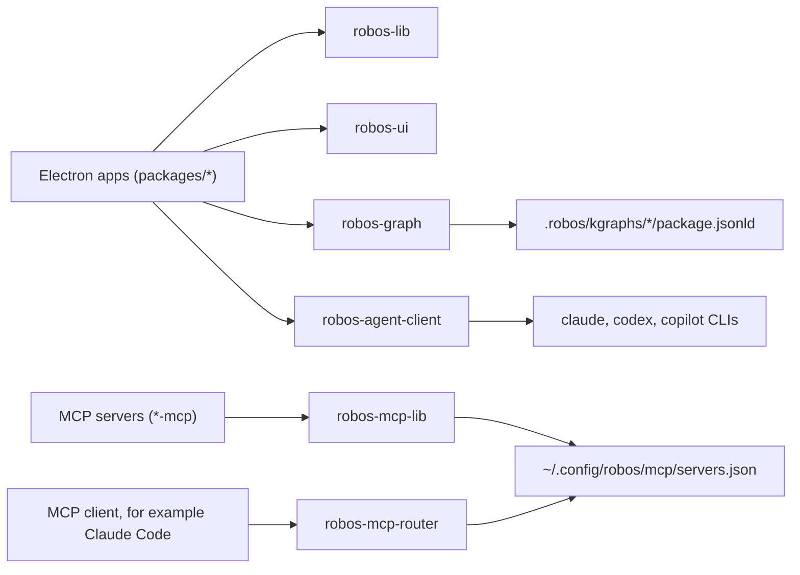

# Architecture
{: .no_toc }

How the RobOS repository is put together: Electron apps, the shared libraries they load, the `.robos` knowledge graph, the agent router and the MCP servers. Read it before you change something that crosses package boundaries.
{: .fs-6 }

<details open markdown="block">
  <summary>On this page</summary>
  {: .text-delta }
1. TOC
{:toc}
</details>

## Overview

RobOS is a set of Electron desktop apps that share libraries and one knowledge graph. The suite apps are plain JavaScript with no front-end framework. (`getemgigs` and `urban-plant-tracker` in `packages/` are Next.js web apps, not suite apps.) Agent features call out to command-line agents you install yourself.



Each arrow is a `require`, a file read or a spawned process in the source. The exception is the MCP client, which you point at the router with a generated configuration (see MCP servers below). For example `packages/app-wizard/main.js` requires `robos-lib` and `robos-graph`, its HTML loads `robos-ui`, and `packages/robos-mcp-lib/server.js` registers each server in `servers.json`. Of the MCP servers, `ekgraph-mcp` uses `robos-graph`, through its `robos_sdlc_*` tools.

## Repository layout

| Path | Contents |
|:---|:---|
| `packages/<name>/` | One folder per app, library or daemon. There is no root `package.json`; each package has its own `node_modules`. |
| `.robos/` | The knowledge graph and its catalogs. See below. |
| `games/` | Two Godot projects, `crpg-realm` and `tabletop-rpg`. See [Game development]({{ site.baseurl }}). |
| `plugins/`, `.agents/skills/` | The agent skills and the plugin marketplace. See [Skills]({{ site.baseurl }}). |
| `infra/desktop/` | Scripts that build and run the RobOS virtual machine (`build.sh`, `run.sh`, `clean.sh`). |
| `infra/docker/` | The Docker image for headless end-to-end tests (Ubuntu with Xvfb and Picom). `scripts/e2e-container.sh` runs it. |
| `installer/` | An Electron app for flashing RobOS to a USB drive. |
| `docs/`, `site/` | This documentation site and the front site. |

## Apps

Every app in `packages/` follows one layout: `main.js` (Electron main process), `preload.js`, `renderer/` (HTML, CSS, JavaScript), an icon and a `.desktop` file. Windows are created with `nodeIntegration: false`, and `preload.js` exposes the app's functions to the page with `contextBridge`. The page calls them, and `main.js` handles the calls with `ipcMain.handle`. No package under `packages/` sets `nodeIntegration: true`.

App state lives in `~/.config/robos/`. Many apps also set Electron's `userData` path to a folder there, for example `~/.config/robos/electron/app-wizard`.

Apps start a small HTTP debug server through `robos-lib/dom-snapshot`. `packages/robos-lib/snapshot-cli.js` has a `PORT_REGISTRY` that maps each app id to its port (the App Wizard uses 19183). The command `node packages/robos-lib/snapshot-cli.js <app-id> --text` returns the page's DOM as text. Tests and agents use this to see an app without a screenshot.

The desktop shell is three apps: `robos-desktop` (a full-screen taskbar that replaces the GNOME panel), `desktop-manager` (tray icon, app lifecycle and an IPC hub) and `app-launcher` (a searchable grid). Launcher entries are `.desktop` files. `robos-lib` lists the entries whose file has `X-RobOS-App=true`, and groups them by `X-RobOS-Category`.

## Shared libraries

Libraries are not npm dependencies. On a RobOS machine they are copied to `/usr/local/share/robos/<lib>`, and apps load them by path inside `try`/`catch`, trying the sibling folder in the repository first and then the installed path (`robos-lib` also honors `ROBOS_LIB_PATH`). That is why an app still starts when a library is missing.

| Package | What it is |
|:---|:---|
| `robos-lib` | `.desktop` parsing and app categories, the DOM snapshot server and CLI, logging, the prompt security guard, `ai-agent` (one-shot requests to the active agent CLI) and `quick-ask`, and other helpers. |
| `robos-llm` | Optional API mode, off by default: direct calls to Anthropic, OpenAI, Gemini or Ollama through LangChain.js, plus embeddings for semantic graph search. Its LangChain packages are installed on request from RobOS Preferences into `~/.local/share/robos/llm-deps`, not with RobOS. See [AI agents and API mode]({{ site.baseurl }}). |
| `robos-ui` | Web components for renderer pages, such as `<robos-ai-textarea>`. |
| `robos-icons` | The SVG icon registry for built-in apps. |
| `robos-graph` | The knowledge graph engine, and also the Knowledge Graph Explorer app. |
| `robos-agent-client` | Agent session management and the HarnessRouter client. |
| `robos-mcp-lib`, `robos-mcp-router` | The MCP server framework and the router. |
| `robos-event-bus`, `robos-scheduler`, `robos-rule-engine`, `robos-action-registry` | A Unix-socket pub/sub bus, a cron and event-triggered scheduler, an event-driven rule engine and a pluggable action registry. |
| `robos-task-client` | One adapter over Jira and GitHub Issues. |
| `robos-test` | The test framework, scenarios and demo recorders. |

## Knowledge graph

The graph is JSON-LD. `.robos/kgraph.yaml` lists the packages, and each lives in `.robos/kgraphs/<package>/package.jsonld`. The packages are `core-platform`, `organization`, `services`, `applications`, `devops`, `learning`, `documentation`, `testing`, `game`, `crpg`, `tabletop-game` and `infinity-engine`. `.robos/knowledge-graph.jsonld` is an aggregate of them. Other catalogs sit beside it: `packages.yaml`, `teams.yaml`, `documentation.yaml`, `elearning.yaml` and `ontology.jsonld`.

`packages/robos-graph` provides:

- An OSLC-style JSON-LD parser and the `SDLCKnowledgeGraphStore` that loads and saves the package files.
- A SHACL validator with the built-in shapes (`lib/shacl-validator.js`), including one per app archetype such as `FrontEndAppShape`. See [Schemas]({{ site.baseurl }}).
- `GraphDiffEngine`, which compares two graph documents, and `BlastRadiusAnalyzer`, which lists the services, contracts, requirements and teams affected by a diff.
- A workspace mode for an external project: set `ROBOS_GRAPH_ROOT` or pass `--graph-root`, then use the `kgraph` CLI (`init`, `inspect`, `context`, `propose`, `apply`, `recover`). Edits go through a proposal that is validated before it is applied. See `packages/robos-graph/WORKSPACES.md`.

Two limits to know about:

- The graph checked in at `.robos/` is a sample company, "Acme Enterprise Global", plus the game content packages. It exists so the apps and tests have data. It is not a model of RobOS itself. Services such as `billing-api` and `forms-api` are sample entries tied to fictional `acme` repositories; no code for them exists in this repository.
- The Explorer's branch list is in memory. Outside workspace mode it shows `main` plus three sample branches (`feature/TASK-101-auth`, `poc/v2-graphql`, `pilot/beta-billing`), and a new branch is a copy of the loaded graph. In workspace mode there is only `main`. Branches are not read from Git, so the diff and blast-radius views compare in-memory graphs, not your real branches.

## Agents

`robos-agent-client` has three backends: Claude Code (`claude`), GitHub Copilot CLI (through `gh`) and `harnessrouter`. The HarnessRouter backend speaks the Unified Harness Protocol (version `2026-08-11`) to a server at `http://127.0.0.1:3000` by default. If no server answers, `getHarnessRouter()` falls back to an embedded router that runs inside the process and stores sessions in `~/.config/robos/harnessrouter/sessions.json`.

The embedded router lists six harnesses: Claude Code, OpenAI Codex, GitHub Copilot CLI, Gemini CLI, Hermes and Oh My Pi. It runs a task only through `claude -p`, `codex exec` or Copilot. For the others, or when the CLI is not installed, it returns a placeholder response without running anything. Check the response text before you trust a result.

One-shot requests (generate buttons, the text box quick-ask, the Knowledge Graph AI Co-Pilot) do not go through `robos-agent-client`. They use `robos-lib/ai-agent`, which runs the active CLI from `~/.config/robos/ai-provider.json` (Copilot, Claude Code, Codex or Gemini CLI). If the user turned on API mode, the request goes to `robos-llm` first and falls back to that CLI when the call fails. Agent tasks never use API mode. See [AI agents and API mode]({{ site.baseurl }}).

The embedded router scans each prompt with the prompt security guard in `robos-lib` before running it. The mode is `redact` by default, or `block`, `warn`, `audit-only` or `off` from the preferences setting. Events are logged to `~/.config/robos/prompt-security-audit.json`.

Two daemons manage per-agent working state. `robos-profiled` (CLI `robos-profile`, plus `robos-run-as` to run a command) and `robos-agentd` (CLI `robos-agent`) keep their state under `~/.config/robos/` and take commands over Unix sockets. `robos-profiled` gives each agent its own home directory, mounted as a 2 GB tmpfs when the daemon runs as root and a plain directory otherwise, and forwards the host's SSH agent and Git identity into it. `robos-run-as` runs the command as the same operating-system user with `HOME` pointed at that directory. Neither daemon creates a separate Linux account or enforces isolation, so treat them as environment setup, not a security boundary.

## MCP servers

Servers are built with `robos-mcp-lib` and register themselves in `~/.config/robos/mcp/servers.json`. They are `task-manager-mcp`, `ekgraph-mcp`, `ide-bridge-mcp`, `system-mcp`, `workspace-manager-mcp`, `ci-monitor-mcp` and `dev-tools-mcp`.

`robos-mcp-router` merges the tools of every registered server behind one MCP endpoint. It speaks JSON-RPC on stdio, and `startHttp` can serve it over HTTP with `/mcp` and `/health`. To print an MCP client configuration for it:

```bash
node packages/robos-mcp-router/cli.js --claude-config
```

The output points the client at `/usr/local/share/robos/robos-mcp-router/cli.js`, so the router must be installed there. When `servers.json` does not exist, the router serves a built-in set of sample tool definitions (task manager, knowledge graph, Kubernetes, REST client and workspace manager) instead of reporting an empty list.

`ekgraph-mcp` exposes `robos_sdlc_inspect`, `robos_sdlc_query`, `robos_sdlc_propose` and `robos_sdlc_apply` against a workspace set with `ROBOS_GRAPH_ROOT`. Inspect and query are read-only; apply commits a saved proposal by its id.

## Where state lives

| Location | Contents |
|:---|:---|
| `.robos/` in a repository | The knowledge graph and catalogs for that repository. |
| `~/.config/robos/` | App settings and data: `git-projects.json`, `mcp/servers.json`, `harnessrouter/`, `profiled/`, `agentd/`, `prompt-security-audit.json`, and an Electron `userData` folder per app. |
| `/usr/local/share/robos/` | Installed apps and libraries on a RobOS machine. |
| `~/.password-store/` | Secrets, in the Unix `pass` store. The graph stores references to them, not the values. |
