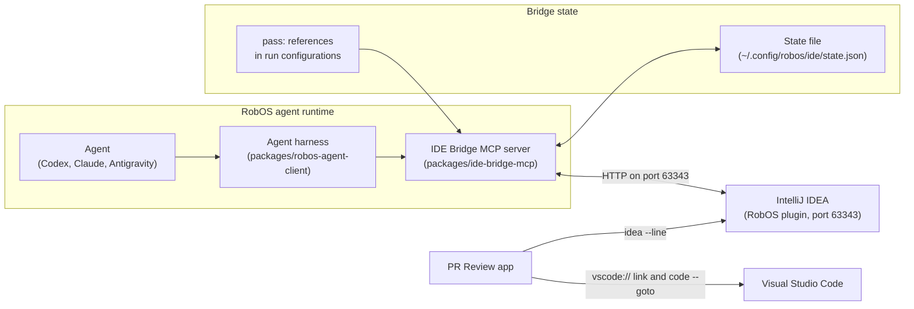

# What sets RobOS apart
{: .no_toc }

The parts of RobOS that go beyond running a coding agent in a terminal, described as they exist in the source today, including what is partial or not built.
{: .fs-6 }

<details open markdown="block">
  <summary>On this page</summary>
  {: .text-delta }
1. TOC
{:toc}
</details>

Each section names the package that implements the feature. Where a feature falls short of what you might expect, the section says so. Planned work is on the [Roadmap]({{ site.baseurl }}).

## Recorded proof of work

`packages/robos-test` can record a scripted run of a RobOS app as video. A demo script lists steps, and each step has a CSS selector, an action and a line of narration. The runner launches the app, records its window with `ffmpeg` (`x11grab`, 30 fps, scaled to 1920x1080, VP9 in a `.webm` file), writes a WebVTT caption file from the narration, and shows the narration as on-screen text. Set `audio: true` in the demo config to add a Piper text-to-speech voice (it falls back to `espeak-ng`, `espeak`, or silence if Piper is missing).

{: .robos-zoomable-img loading="lazy" }
*Concept diagram from the original design docs. The text on this page says what is built today, including that the demo script is written by a person or an agent.*

Run a demo inside the Docker test container, which starts Xvfb on `:99` at 1920x1080 and needs Docker on the host:

```bash
./scripts/e2e-container.sh node packages/robos-test/demos/notifications-demo.js
```

Each run is copied to `~/.robos/development/walkthroughs/<slug>/` as `<slug>-final.webm`, `<slug>.vtt` and a `walkthrough.md` step table, with timestamped copies under `history/`. The `record-demo` skill (`plugins/robos/skills/record-demo`) tells an agent how to write these scripts.

{: .robos-zoomable-img loading="lazy" }
*Concept diagram from the original design docs. Recording and narration exist in `packages/robos-test`; a Dev Central player and automatic video from any test run do not, so the text on this page is the guide.*

In PR Review, the evidence runner (`packages/robos-lib/evidence-runner.js`) rejects an agent result that marks a scenario as passed without a captured artifact inside the run folder. Not built yet: producing a narrated video automatically from an arbitrary test run. The demo script is written by a person or an agent. See [Walkthroughs and proof of work]({{ site.baseurl }}).

## Review gates in PR Review Theater

The [PR Review app]({{ '/apps/pr-review/' | relative_url }}) shows a review as a sequence of steps: Description, Overview, Documentation, Changes, Open in IDE, Evidence, Walkthrough and Approve. Local reviews that have no pull request yet also get a Pull Request step. For pull requests with knowledge graph context, the default team configuration adds a reviewer knowledge check in the Overview step, with a pass score of 80, that locks the diffs and sign-off until it is passed, and it marks the evidence step as required. The Walkthrough step has an agent demonstrate the change in a real browser one checkpoint at a time, and it can run the same checkpoints against a separate checkout of the base revision.

{: .robos-zoomable-img loading="lazy" }
*Look at the Overview tab and the buttons at the top right that start the staged review or open the pull request in an IDE.*

These gates live in the app. They are not GitHub branch protection rules. Local reviews, which have no pull request yet, turn the knowledge check off. Details are on [PR Review Theater]({{ site.baseurl }}).

The Open in IDE step has a VS Code path and an IntelliJ path. For VS Code, the app opens a `vscode://github.vscode-pull-request-github/open-pr?number=<n>&repo=<repo>` link, which needs the GitHub Pull Requests and Issues extension, and runs `code --goto`. For IntelliJ, the Kotlin plugin in `plugins/intellij-idea` runs a local server on port 63343 with endpoints to open a file, set a breakpoint, manage run configurations and read thread state. The app posts to `/api/robos/pull-request/open`, which that plugin does not serve, so in practice it falls back to `idea --line <n> <file>`. The step list the app prints afterwards (checking out the branch, activating the Pull Request tool window) is fixed text, not a report of what the IDE did.



*Concept diagram from the original design docs, corrected to the current code. The PR Review app reaches the IDEs through a link or command line, and only some plugin routes are implemented, as described above.*

{: .robos-zoomable-img loading="lazy" }
*Look at the bridge console on the left and the IntelliJ window on the right. The right side is the IntelliJ IDEA Bridge test app, which answers the plugin routes with in-memory data.*

{: .robos-zoomable-img loading="lazy" }
*Look at the breakpoint on line 6 and the frames and variables pane. This is the same simulated window at full size.*

## Knowledge graph diff and blast radius

`packages/robos-graph` keeps a JSON-LD knowledge graph as packages under `.robos/kgraphs/<package>/package.jsonld`, catalogued by `.robos/kgraph.yaml`, and validates nodes against SHACL shapes. In the graph app, the **Blast Radius** button on a node lists what depends on it. The CLI does the same, and it can diff two graph documents:

```bash
node packages/robos-graph/bin/kgraph-cli.js impact "urn:robos:service:auth-service" --depth 2
node packages/robos-graph/bin/kgraph-cli.js diff feature/TASK-101-auth --base main --json
```

`diff` reports added, removed and modified nodes, a risk level (high when a contract or microservice is removed), and the services, contracts, requirements and teams within three dependency hops of the changes.

{: .robos-zoomable-img loading="lazy" }
*Recorded walkthrough of the Knowledge Graph Explorer. Look at the comparison of two graph states and the list of nodes that depend on the changed ones.*

The "dual state" is only partly built. The branches that the graph app and `kgraph diff` compare are in-memory copies of the loaded graph plus a few built-in sample branches. They are not read from your Git branches, so a diff does not yet reflect a real feature branch. The plain-text output of `kgraph diff` also prints zero counts, so use `--json`. Schema drift detection is not implemented.

{: .robos-zoomable-img loading="lazy" }
*Concept diagram from the original design docs. It shows live production state compared with proposed changes. Today the compared states are in-memory copies and schema drift detection is not implemented; the text on this page says what is built.*

{: .robos-zoomable-img loading="lazy" }
*Concept diagram from the original design docs. Same idea as above: the branches the graph app compares today are in-memory copies, not your Git branches.*

Two parts are solid. Imports into an external graph workspace (`ROBOS_GRAPH_ROOT`) go through `kgraph propose` and `kgraph apply`, with hash-checked proposals, three-way conflict detection, a write lock and `kgraph recover` for interrupted writes. External knowledge graph repositories can be pinned by Git tag and are cloned shallowly into `~/.robos/cache/kgraphs/<repo>@<tag>/`, but if the clone fails the code creates a stub package with a placeholder node instead of reporting an error. See [Knowledge graph]({{ site.baseurl }}) and the [robos-graph app page]({{ '/apps/robos-graph/' | relative_url }}).

{: .robos-zoomable-img loading="lazy" }
*Concept diagram from the original design docs. The text on this page says what is built today, including the stub package created when a clone fails.*

{: .robos-zoomable-img loading="lazy" }
*Look at the package cards, such as services and organization, and the Register External repository form with its Git tag field at the bottom.*

## Sandboxes for agent runs

`packages/robos-profiled` is a daemon plus two commands. Start the `robos-profiled` app first, because the commands talk to it over `~/.config/robos/profiled/profiled.sock`. Then `robos-run-as --agent <name> [--autoclean] <command>` creates a profile named `my-agent-<name>` and runs the command with `HOME` pointing at a private folder. When the daemon runs as root, that folder is a 2 GB `tmpfs` mount with mode 0700. Otherwise it is an ordinary folder under `~/.config/robos/profiled/homes/`. `--autoclean`, or `robos-profile terminate <name>`, unmounts and deletes it.

{: .robos-zoomable-img loading="lazy" }
*Concept diagram from the original design docs. It shows a private virtual display and an instant wipe; the text on this page says what is built, and it is not a security boundary.*

This keeps stray files out of your home folder. It is not a security boundary:

- No Linux user is created. The command runs as the user who started the daemon, and the `uid` in a profile record is only a stored number.
- No cgroup or memory limit is applied, although profiles record a memory value and a scope name.
- The profile uses the host display, with a copy of your X authority file, not a private display.
- It forwards your SSH agent socket, GPG agent socket and `.gitconfig`, and writes `ANTHROPIC_API_KEY`, `OPENAI_API_KEY`, `GEMINI_API_KEY` and `GITHUB_TOKEN` into the profile's `.bashrc`. If a variable is unset, a placeholder value is written.

{: .robos-zoomable-img loading="lazy" }
*Concept diagram from the original design docs. It shows a private virtual display and a protected credential tunnel, which are not built; the list above says what a profile does today.*

For stronger isolation, run agents and tests in the Docker container (`./scripts/e2e-container.sh`, built from `infra/docker`). It mounts the repository at `/workspace` read-write and discards everything else when the container exits. See the [robos-profiled app page]({{ '/apps/robos-profiled/' | relative_url }}).

## Prompt security

`packages/robos-lib/prompt-security.js` scans the prompt text before it reaches an agent. It uses a built-in regular-expression catalog: cloud and Git tokens (AWS, GitHub, GitLab, Slack, Stripe, Anthropic, OpenAI, Google), private key blocks, passwords inside database and basic-auth URLs, JWTs, US Social Security numbers, card numbers that pass a Luhn check, emails, phone numbers, private IP addresses, and phrases typical of prompt injection and jailbreaks. A Shannon entropy check (default threshold 4.5 bits per character) catches secrets without a known prefix. The rules are modeled on Gitleaks, TruffleHog, Presidio and OWASP LLM01. Those tools are not run.

Set the mode under **Prompt Security & Guardrails** in the Preferences app: `redact` (default), `block`, `warn`, `audit-only` or `off`. It is stored as `prompt_security_mode` in `~/.config/robos/settings.json`. When a scan finds something, an entry with the finding types and counts, not the secret, is appended to `~/.config/robos/prompt-security-audit.json`, which keeps the last 200 entries.

The scan runs in `AgentSession.start()`, in the embedded router's `runTask()`, in the `ai-prompt` and `agent-chat` apps, and in the `<robos-ai-textarea>` component. It checks the prompt you send. It does not check files an agent reads later or the output of its tools.

## Agent-agnostic harness

`packages/robos-agent-client` puts several agent CLIs behind one interface. `AgentSession` runs a prompt through a backend: Claude Code (`claude`), GitHub Copilot CLI (`gh`), or the HarnessRouter backend. The task runner in `work-task/backend.js` calls `codex exec` or `claude -p`, and `providers.js` lists Codex and Antigravity (`agy`) with their model catalogs, reading each CLI's stored login. `harness-router.js` implements a client for the Unified Harness Protocol (UHP, spec version `2026-08-11`, default server `http://127.0.0.1:3000`) and an embedded in-process router. The embedded router lists Claude Code, Codex, Copilot CLI, Gemini CLI or Antigravity, Hermes and Oh My Pi, and reports whether each command is installed.

{: .robos-zoomable-img loading="lazy" }
*Concept diagram from the original design docs. The text on this page says which agent CLIs the router really starts.*

Limit: the embedded router only starts Claude Code, Codex and Copilot. For the other harnesses, or when the chosen CLI is missing, `runTask()` returns a placeholder success message instead of an error. Do not treat a Gemini or Hermes result from the embedded router as real output. How work is assigned to agent tiers is on [Agent tiers]({{ site.baseurl }}).

{: .robos-zoomable-img loading="lazy" }
*Concept diagram from the original design docs. The tier fields in Preferences are stored and nothing reads them yet.*

{: .robos-zoomable-img loading="lazy" }
*Concept diagram from the original design docs. Automatic tier dispatch is not built; Agent tiers explains what is.*

## Generating apps from the knowledge graph

The [App Wizard]({{ '/apps/app-wizard/' | relative_url }}) (`packages/app-wizard`) is where "knowledge graph first" exists today, in a narrow form. For a new app, `generateNewApp()` writes files for the chosen archetype, then registers a node in the `applications` or `services` graph package, adds an entry to `.robos/packages.yaml`, writes `catalog-info.yaml` and `dev-setup.sh`, and adds the folder to `~/.config/robos/git-projects.json`. Front-end apps get a Next.js template for Vercel with end-to-end test and evidence scripts. Desktop apps get an Electron skeleton, console apps a Node CLI skeleton, and microservices a plain Node HTTP server with an `openapi.yaml` stub and a Dockerfile.

{: .robos-zoomable-img loading="lazy" }
*Concept diagram from the original design docs. The text on this page says what is built today.*

The flow runs from wizard to files to graph, not from graph to code. TypeSpec models, API controllers, database migrations, devcontainers and consumer contract tests are not generated. The PC game, mobile app, data pipeline and library archetypes are offered in the wizard, but they receive the same Node server skeleton as microservices and no graph node. The wizard can also import existing code. See [New app wizard]({{ site.baseurl }}) and [Building apps]({{ site.baseurl }}).

{: .robos-zoomable-img loading="lazy" }
*Concept diagram from the original design docs. Typed models, controllers and migrations are not generated today; the paragraph above lists what is.*

{: .robos-zoomable-img loading="lazy" }
*Concept diagram from the original design docs. The wizard can scaffold new apps and import existing code; the text on this page says what each path writes.*

## Remote Execution Studio

`packages/remote-execution-studio` stores descriptions of Remote Execution API (REAPI v2) clusters, Buildbarn or NativeLink, and of Bazel or Buck2 build systems, and generates configuration text from them: `.bazelrc` with `build:remote` and `build:cache` profiles, `.buckconfig`, Buildbarn component configs (`bb-storage`, `bb-scheduler`, `bb-worker`, `bb-runner`, `bb-browser`) and a NativeLink config. Definitions are saved to `~/.config/robos/remote-execution.json` and as `robos:RemoteExecutionCluster` nodes in the `devops` graph package.

{: .robos-zoomable-img loading="lazy" }
*Concept diagram from the original design docs. The studio generates configuration text only; it does not deploy or monitor a cluster.*

It does not deploy or monitor a cluster. The **Test REAPI Endpoints** button returns fixed sample results (healthy, 14 ms and 11 ms) without contacting anything, and the two bundled sample clusters carry fixed sample cache hit ratios. There is no live telemetry. See the [app page]({{ '/apps/remote-execution-studio/' | relative_url }}).

## Agents that drive RobOS apps

RobOS apps load `packages/robos-lib/dom-snapshot.js`, which starts an HTTP debug server on a fixed port in the 19100 to 19199 range; `PORT_REGISTRY` in `snapshot-cli.js` lists them. The CLI reads and drives an app by CSS selector:

```bash
node packages/robos-lib/snapshot-cli.js task-servers --text
node packages/robos-lib/snapshot-cli.js task-servers --click 'button#btn-add'
node packages/robos-lib/snapshot-cli.js task-servers --fill 'input#server-name' --value 'Acme Jira'
```

The tests and demos above use the same mechanism. The debug server binds to `0.0.0.0` and has no authentication, and `--eval` runs JavaScript in the app, so use it only on a machine or VM you trust.

{: .robos-zoomable-img loading="lazy" }
*Look at the AI Prompt pop-up on top of Agent Chat, with skills listed on the left.*

{: .robos-zoomable-img loading="lazy" }
*Frame from a recorded demo run. Look at the pop-up over the Relational DB Manager and its table tree in the background.*

{: .robos-zoomable-img loading="lazy" }
*Frame from the same recorded demo run. Look at the request list on the left and the Bruno Source tab.*

{: .robos-zoomable-img loading="lazy" }
*Frame from the same recorded demo run. Look at the JSON request body and the collection list in the REST API Client.*

{: .robos-zoomable-img loading="lazy" }
*Frame from the same recorded demo run. Look at the running pod in the Kube Studio table.*

{: .robos-zoomable-img loading="lazy" }
*Look at the thread list on the left and the message box at the bottom of Agent Chat.*

The Unified MCP Router (`packages/robos-mcp-router`) is a stdio JSON-RPC server that merges the tool lists of MCP servers registered in `~/.config/robos/mcp/servers.json`. `packages/ekgraph-mcp` serves the `robos_ekgraph_*` knowledge graph tools and, for a graph workspace, `robos_sdlc_inspect`, `robos_sdlc_query`, `robos_sdlc_propose` and `robos_sdlc_apply`. The router's own built-in EKGraph, Kubernetes and REST tools are demo-grade: the EKGraph tools return fixed Acme Petshop sample data.

{: .robos-zoomable-img loading="lazy" }
*Look at the aggregated tool and resource lists and the dispatch log below them.*

## Credentials in `pass`

DevOps integrations in the graph save tokens with `pass insert` under `devops/<category>/<provider>/<account>/<key>`, and the graph stores only the `pass` path. This needs `pass` and a GPG key set up. If `pass insert` fails, the code writes a base64-encoded, unencrypted placeholder file into the password store folder instead, so confirm `pass` works before you save credentials. The [Pass Manager]({{ '/apps/pass-manager/' | relative_url }}) app is a front end for the same store.

{: .robos-zoomable-img loading="lazy" }
*Concept diagram from the original design docs. The text on this page says what is built, including the unencrypted placeholder written when pass insert fails.*

{: .robos-zoomable-img loading="lazy" }
*Look at the category filters across the top and the provider cards below them.*

## Diagrams

These diagrams belonged to features that the sections above no longer cover. Each is a concept diagram, not a description of what is built.

{: .robos-zoomable-img loading="lazy" }
*Concept diagram from the original design docs. It shows a living C4 map generated from the graph. The text on this page says what is built today.*

{: .robos-zoomable-img loading="lazy" }
*Concept diagram from the original design docs. Consumer contract tests are not generated today, as the app generation section says, and the project graph app it shows is not in the repository.*

{: .robos-zoomable-img loading="lazy" }
*Concept diagram from the original design docs. It shows rules inherited down a graph hierarchy. The text on this page says what is built today.*

## The rest of the suite

Database, API, Kubernetes, task planning and discussion tools are documented one app at a time in the [Apps catalog]({{ site.baseurl }}).

{: .robos-zoomable-img loading="lazy" }
*Concept diagram from the original design docs. The Apps catalog says what each data tool does today.*

{: .robos-zoomable-img loading="lazy" }
*Look at the connected source at the top and the table and column list in the Schema Inspector.*

{: .robos-zoomable-img loading="lazy" }
*Look at the Connection Verification dialog opened by the Test Connection button.*

{: .robos-zoomable-img loading="lazy" }
*Look at the connection tree on the left and the data grid for the pets table on the right.*

{: .robos-zoomable-img loading="lazy" }
*Concept diagram from the original design docs. The REST, gRPC and GraphQL client pages say what each client does today.*

{: .robos-zoomable-img loading="lazy" }
*Concept diagram from the original design docs. The Apps catalog says which Kubernetes and deployment tools exist today.*

{: .robos-zoomable-img loading="lazy" }
*Concept diagram from the original design docs. Same idea as above, shown as a pipeline.*

{: .robos-zoomable-img loading="lazy" }
*Concept diagram from the original design docs. Task Planner's page says what planning does today.*
