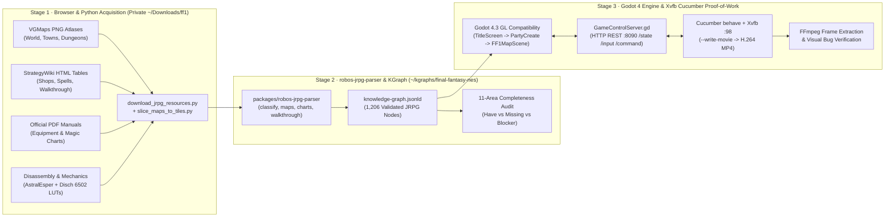

# How to Recreate a Classic JRPG Using KGraph Parsing with Automated Playthrough

> **Course Slug**: `how-to-recreate-classic-jrpg-using-kgraph-parsing-with-automated-playthrough`  
> **Published URL**: `https://rowbose.com/elearning/how-to-recreate-classic-jrpg-using-kgraph-parsing-with-automated-playthrough`  
> **Target Packages & Skills**: `packages/robos-jrpg-parser`, `jrpg-parse-assets`, `jrpg-generate-art`, `Godot 4.3 GL Compatibility`, `Cucumber (behave) + Xvfb Video Proof-of-Work`

---

## 1. Executive Architecture: Context-Engineered Classic JRPG Reconstruction

Recreating a classic 8-bit or 16-bit JRPG (such as NES *Final Fantasy* or *Dragon Warrior*) from scratch using conversational prompts alone ("vibe coding") fails as soon as the game needs authentic combat math, accurate tile walkability, multi-floor dungeon transitions, or verifiable story triggers.

In RobOS, classic game reconstruction follows a **4-Stage Context Engineering Pipeline** built around the **Dual-State Knowledge Graph (KGraph)**:

1. **Browser Discovery & Python Multi-Source Harvesting (`~/Downloads/<game-id>`)**: Use a browser and deterministic Python scripts to collect pixel-exact map atlases (`VGMaps`), community wiki tables (`StrategyWiki`), official PDF instruction manuals, `.NSF`/MP3 audio archives, and verified 6502/65816 disassembly tables into a **private local directory** outside the public Git repository.
2. **Knowledge Graph Ingestion & Completeness Gap Analysis (`packages/robos-jrpg-parser`)**: Run the `jrpg-parse-assets` skill (`node packages/robos-jrpg-parser/bin/jrpg-parse.js`) to classify every raw file and table into a formal OSLC JSON-LD Knowledge Graph (`~/kgraphs/<game-id>/knowledge-graph.jsonld`) across 11 `robos:JRPG*` ontology classes, and audit the **Completeness Matrix** to identify missing combat stats, encounter tables, or tile grids that would block gameplay.
3. **16×16 Tile Grid Slicing, Palette Decoding & Clean-Room Art Generation**: Slice map PNGs into deduplicated `16x16` tile atlases and 2D walkability matrices (`grid[y][x]`), decode indoor vs. outdoor NES background palettes (`lut_SMPalettes`), and optionally synthesize clean-room sprites and backdrops with `jrpg-generate-art`.
4. **Data-Driven Godot 4 Runtime & Headless Xvfb Cucumber Playthroughs**: Load the KGraph JSON tables into a Godot 4.3 (`GL Compatibility`) scene engine equipped with an HTTP/JSON control server (`GameControlServer.gd` on `:8090`), drive end-to-end Gherkin scenarios via `behave` inside `Xvfb`, and inspect extracted video frames with `ffmpeg` to catch and fix visual bugs (such as off-by-one tree spawns or ceiling palette masks).



<div class="doc-figure">
  
  <div class="doc-caption">Figure 1.1: Stage 1 technical schematic — harvesting VGMaps atlases, StrategyWiki HTML tables, Nintendo PDF manuals, NSF audio, and 6502 ROM LUTs into a private local workspace using Python.</div>
</div>

---

## 2. Stage 1: Using a Browser & Python Tools to Acquire Game Images and Reference Data

### 2.1 Privacy Boundary: Why Downloads Stay in `~/Downloads/<game-id>`

Before downloading a single image, RobOS enforces a strict architectural separation:
- **Raw reference materials** (copyrighted map rips, PDF manuals, wiki scrapes, `.nsf` audio, and ROM disassembly tables) are downloaded strictly to a private local folder outside the repository: `/home/ndipiazza/Downloads/ff1`.
- **The public RobOS repository** (`packages/robos-jrpg-parser`) contains only generic parsing logic and synthetic unit-test fixtures (`Crystal Saga`, commit `d27a86c3`), never copyrighted game content.

### 2.2 Identifying the 5 Essential Resource Sources in the Browser

To reconstruct an 8-bit JRPG completely, a developer or RobOS agent uses browser inspection (`Chrome DevTools MCP` or standard browser DevTools) to locate five complementary data sources:

| Category | Primary Source | What It Provides | What It Lacks |
|---|---|---|---|
| **1. Pixel-Exact Map Images** | [VGMaps NES Atlas](https://vgmaps.com/Atlas/NES/index.htm#FinalFantasy) | Direct 1:1 pixel rips (`16x16` tile grid) of the Overworld, Coneria Town, Castle Coneria, Temple of Fiends, Marsh Cave, Earth Cave, Gurgu Volcano, Ice Cave, Castle of Ordeals, Sea Shrine, Mirage Tower, Floating Castle | Walkability flags, door triggers, stair warp coordinates, and indoor vs. outdoor palette states |
| **2. Wiki HTML Tables & Walkthrough** | [StrategyWiki — Final Fantasy](https://strategywiki.org/wiki/Final_Fantasy) | Structured HTML `<table>` elements for Weapons, Armor, Shops, Spells, Enemies, and ordered story walkthrough prose | Exact monster `ATK`/`ACC`/`Hits`/`CRT`/`EVA`/`M.D`, encounter rates, and spell accuracy |
| **3. Official Pack-In Manuals** | [Nintendo Classic Mini PDF (`CLV-P-NAAAE.pdf`)](https://www.nintendo.co.jp/clv/manuals/en/pdf/CLV-P-NAAAE.pdf) | Authoritative equipment compatibility matrices, spell level tables, and manual illustrations | Internal ROM formulas and hidden NES bugs |
| **4. Music & Audio Data** | [Zophar's Domain `.NSF` Archive](https://www.zophar.net/music/nintendo-nes-nsf/final-fantasy) | Complete 6502 2A03 chiptune register program (`.nsf`) and track-split MP3 soundtrack (`1_-_the_prelude.mp3`, `7_-_town.mp3`, etc.) | Game-ready loop markers unless paired with an AudioStreamPlayer |
| **5. Mechanics & Disassembly Tables** | **AstralEsper's NES Game Mechanics Guide** (v0.85, GameFAQs 57009) & **Disch's 6502 Disassembly** (`ff1_disassembly`) | Exact combat formulas, NES pointer bugs, monster stat bytes, 8-slot encounter tables, class starting stats, and 48-byte map palettes (`lut_SMPalettes`) | Visual layout unless combined with the VGMaps PNGs |

### 2.3 Bridging Browser Discovery to Python: Extracting a Reusable `sources-manifest.json`

How do you go from browsing an index page full of map and wiki links (like `vgmaps.com/Atlas/NES/index.htm#FinalFantasy` or `strategywiki.org/wiki/<Game>/Table_of_Contents`) to downloading them with Python—**without** hand-typing 50 filenames into a single-use script?

We use a two-step **reusable discovery pattern** that works for any classic JRPG (*Final Fantasy*, *Dragon Warrior*, *Chrono Trigger*, *Phantasy Star*, *EarthBound*):

#### Method A: Browser DevTools Console One-Liner (`F12` → Console)
Open Chrome or Firefox DevTools (`F12`) on any VGMaps atlas page or wiki index, set `GAME_PREFIX`, and copy a structured JSON manifest straight to your clipboard:

```javascript
// Run in Browser DevTools Console (F12) on https://vgmaps.com/Atlas/NES/index.htm
const GAME_PREFIX = "FinalFantasy-"; // Change to "DragonWarrior-", "ChronoTrigger-", etc.
const maps = [...document.querySelectorAll("a[href]")]
  .map(a => ({ url: a.href, name: a.getAttribute("href").split("/").pop(), label: a.textContent.trim() }))
  .filter(x => x.name.startsWith(GAME_PREFIX) && /\.(png|gif)$/i.test(x.name));

console.table(maps);
copy(JSON.stringify({ gameId: "ff1", maps }, null, 2));
```

#### Method B: Reusable Python HTML Link Discovery (`harvest_jrpg_assets.py`)
Even better, our reusable Python harvester (`harvest_jrpg_assets.py`) includes an `HTMLParser` link-discovery engine (`discover_vgmaps` and `discover_strategywiki`). You pass `--vgmaps-index`, `--map-prefix`, and `--wiki-slug` on the CLI, and it automatically discovers every matching map PNG/GIF and StrategyWiki subpage, spoofs a desktop Chrome `User-Agent` (to avoid `HTTP 403 Forbidden` blocks on VGMaps and Zophar), inspects PNG `IHDR` dimensions, verifies SHA-256 digests, and writes both `sources-manifest.json` and `download-receipt.json`:

```python
#!/usr/bin/env python3
"""
harvest_jrpg_assets.py — Reusable Multi-Source Classic JRPG Asset Harvester.
Works for any classic JRPG via --vgmaps-index, --map-prefix, and --wiki-slug.
"""
import argparse, hashlib, json, os, struct, time, urllib.parse, urllib.request
from html.parser import HTMLParser

HEADERS = {
    "User-Agent": (
        "Mozilla/5.0 (X11; Linux x86_64) AppleWebKit/537.36 "
        "(KHTML, like Gecko) Chrome/128.0.0.0 Safari/537.36"
    ),
    "Accept": "text/html,application/xhtml+xml,image/avif,image/webp,*/*;q=0.8",
}

class LinkExtractor(HTMLParser):
    def __init__(self, base_url: str):
        super().__init__()
        self.base_url = base_url
        self.links = []
    def handle_starttag(self, tag, attrs):
        if tag.lower() == "a":
            href = dict(attrs).get("href")
            if href:
                self.links.append(urllib.parse.urljoin(self.base_url, href.split("#")[0]))

def fetch_bytes(url: str, timeout: int = 30) -> bytes:
    req = urllib.request.Request(url, headers=HEADERS)
    with urllib.request.urlopen(req, timeout=timeout) as resp:
        return resp.read()

def png_dimensions(data: bytes):
    if len(data) >= 24 and data[:8] == b"\x89PNG\r\n\x1a\n":
        w, h = struct.unpack(">II", data[16:24])
        return {"width": w, "height": h}
    return None

def discover_vgmaps(index_url: str, prefix: str) -> list[dict]:
    html = fetch_bytes(index_url).decode("utf-8", errors="ignore")
    parser = LinkExtractor(index_url)
    parser.feed(html)
    seen, items = set(), []
    for url in parser.links:
        fname = os.path.basename(urllib.parse.urlparse(url).path)
        if fname.startswith(prefix) and fname.lower().endswith((".png", ".gif")) and url not in seen:
            seen.add(url)
            items.append({"category": "maps", "url": url, "filename": fname})
    return items

def discover_strategywiki(wiki_slug: str) -> list[dict]:
    base = f"https://strategywiki.org/wiki/{wiki_slug}"
    subpages = ["", "Table_of_Contents", "Walkthrough", "Shops", "Weapons", "Armor", "Spells", "Enemies", "Characters"]
    return [{
        "category": "ui_shops",
        "url": f"{base}/{sub}" if sub else base,
        "filename": f"{wiki_slug.replace('/', '_')}_{sub or 'Overview'}.html"
    } for sub in subpages]

def harvest(out_dir: str, entries: list[dict], delay: float = 0.25) -> list[dict]:
    receipt = []
    for item in entries:
        subdir = os.path.join(out_dir, item.get("category", "misc"))
        os.makedirs(subdir, exist_ok=True)
        dest = os.path.join(subdir, item["filename"])
        data = fetch_bytes(item["url"])
        with open(dest, "wb") as f:
            f.write(data)
        sha = hashlib.sha256(data).hexdigest()
        dims = png_dimensions(data)
        rec = {**item, "localPath": dest, "bytes": len(data), "sha256": sha, "dimensions": dims}
        receipt.append(rec)
        print(f"[OK] {item['category']}/{item['filename']} ({len(data):,} bytes, sha256={sha[:12]})")
        time.sleep(delay)
    with open(os.path.join(out_dir, "download-receipt.json"), "w") as f:
        json.dump(receipt, f, indent=2)
    return receipt

if __name__ == "__main__":
    ap = argparse.ArgumentParser(description="Reusable Classic JRPG Asset Harvester")
    ap.add_argument("--out-dir", required=True)
    ap.add_argument("--vgmaps-index")
    ap.add_argument("--map-prefix")
    ap.add_argument("--wiki-slug")
    ap.add_argument("--extra-url", action="append", default=[])
    args = ap.parse_args()

    out_dir = os.path.expanduser(args.out_dir)
    manifest = []
    if args.vgmaps_index and args.map_prefix:
        manifest.extend(discover_vgmaps(args.vgmaps_index, args.map_prefix))
    if args.wiki_slug:
        manifest.extend(discover_strategywiki(args.wiki_slug))
    for spec in args.extra_url:
        cat, fname, url = spec.split(":", 2)
        manifest.append({"category": cat, "filename": fname, "url": url})

    os.makedirs(out_dir, exist_ok=True)
    with open(os.path.join(out_dir, "sources-manifest.json"), "w") as f:
        json.dump(manifest, f, indent=2)
    harvest(out_dir, manifest)
```

---

## 3. Stage 2: Using RobOS Agents to Run the Harvester & Fire Off `robos-jrpg-parser`

### 3.1 Orchestrating Acquisition & Parsing with RobOS Agents (`jrpg-parse-assets` Skill)

In RobOS, you do not have to run each script by hand. You can instruct a **RobOS Agent** (in **RobOS Agent Chat**, **Agents Manager**, or your signed-in coding-agent CLI: Google Antigravity `agy` / Gemini CLI, Claude Code, OpenAI Codex, or GitHub Copilot) to run the Python harvester and immediately fire off the `jrpg-parse-assets` skill (`.agents/skills/jrpg-parse-assets/SKILL.md`):

```text
Prompt to RobOS Agent:
"1. Run harvest_jrpg_assets.py to download all VGMaps PNGs (prefix FinalFantasy- from
   https://vgmaps.com/Atlas/NES/index.htm), StrategyWiki pages (Final_Fantasy), and the
   NES Classic Mini manual PDF into /home/ndipiazza/Downloads/ff1.
 2. Use the /jrpg-parse-assets skill to scan and parse /home/ndipiazza/Downloads/ff1 into
   /home/ndipiazza/kgraphs/ff1, and report the coverage matrix and any blockers."
```

When the RobOS Agent executes `.agents/skills/jrpg-parse-assets/SKILL.md`, it runs `packages/robos-jrpg-parser/bin/jrpg-parser.js` through four stages:

```bash
# 1. Scan the downloaded folder to inspect file roles, dimensions, and edition flags
node packages/robos-jrpg-parser/bin/jrpg-parser.js scan /home/ndipiazza/Downloads/ff1

# 2. Parse tables deterministically in code + invoke the active RobOS AI Agent for prose
node packages/robos-jrpg-parser/bin/jrpg-parser.js parse /home/ndipiazza/Downloads/ff1 \
  --out /home/ndipiazza/kgraphs/ff1 \
  --title "Final Fantasy" \
  --edition "NES"

# 3. Inspect coverage.json and the "Still to collect by hand" gap list
node packages/robos-jrpg-parser/bin/jrpg-parser.js coverage --out /home/ndipiazza/kgraphs/ff1

# 4. Plan and generate clean-room art with Gemini via agy (jrpg-generate-art skill)
node packages/robos-jrpg-parser/bin/jrpg-parser.js plan --out /home/ndipiazza/kgraphs/ff1
node packages/robos-jrpg-parser/bin/jrpg-parser.js art --out /home/ndipiazza/kgraphs/ff1 --limit 3
```

### 3.2 How `jrpg-parser.js` Combines Deterministic Code with Quote-Verified Agent Calls

Internally, `packages/robos-jrpg-parser/lib/pipeline.js` is a **two-tier hybrid parser**:
1. **Tier 1 — Deterministic Code (`lib/classify.js`, `lib/maps.js`, `lib/charts.js`)**: Scans all subdirectories, computes SHA-256 digests, reads PNG dimensions (`1024x1024` vs `4096x4096`), and parses HTML/Markdown tables for Weapons, Armor, Spells, Shops, Enemies, Classes, Encounters, and Chests without touching an LLM.
2. **Tier 2 — Quote-Verified RobOS Agent Extraction (`robos-lib/ai-agent`)**: For unstructured walkthrough prose, battle rules, places, and screen layouts, `pipeline.js` invokes `robos-lib/ai-agent` (`ask()`), which spawns your active CLI configured in `~/.config/robos/ai-provider.json` (`antigravity` / `agy`, `claude`, `codex`, or `copilot`).
   - **Anti-Hallucination Quote Gate**: Every record returned by the agent must carry a verbatim `quote` from the source file. If that exact substring does not exist in the source text, `jrpg-parser.js` drops the record automatically and logs the count in parser notes.
   - **Content-Addressed Agent Cache**: Verified agent responses are cached in `<out>/.cache/agent`, making reruns instantaneous and deterministic.
3. **`lib/kgraph.js` & `publish`**: Serializes the OSLC JSON-LD graph (`knowledge-graph.jsonld`), validates nodes against W3C SHACL shapes, and supports `jrpg-parser.js publish --out ~/kgraphs/ff1 --to ~/kgraphs/ff1-clean` to export a shareable clean-room graph stripped of all source filenames, hashes, and verbatim quotes.

<div class="doc-figure">
  
  <div class="doc-caption">Figure 2.1: Stage 2 architecture — how robos-jrpg-parser transforms raw folders and Markdown tables into 1,206 validated OSLC JSON-LD nodes and produces the Completeness Audit Matrix.</div>
</div>

### 3.2 The Completeness Audit: Why Initial Wiki Scrapes Are Not Enough for a Playable Game

After the initial parse of the VGMaps PNGs, StrategyWiki pages, and Nintendo manual PDF, the RobOS agent compared the resulting Knowledge Graph against the runtime requirements of a playable JRPG and produced this exact **11-Area Completeness Gap Matrix**:

| Area | Have After Initial Scrape | Missing for Playable Game | Runtime Effect |
|---|---|---|---|
| **Weapons, armor, shops** | Stats and prices for 80 pieces, 50 shops | 5 disputed numbers across ports | **Ready** |
| **Battle rules** | 37 formulas, including NES bugs | Unconfirmed author attribution & 3 NES quirks | **Usable once verified** |
| **Enemies** | 124 with HP, XP, gold, and weakness | `ATK`, `DEF`, `ACC`, `Hits`, `CRT`, `EVA`, `M.D`, `MOR`, spell lists | **Blocks battles** |
| **Encounters** | Nothing | Which enemy groups appear in which map zone (`rate/256` + 8 slots) | **Blocks battles** |
| **Classes** | 12 with upgrades | Starting stats (`HP`, `STR`, `AGI`, `INT`, `VIT`, `LCK`), level-up growth, XP table | **Blocks progression** |
| **Spells** | 64 with level, price, school, effect | Spell `Power` (`Effect`), `Accuracy`, and routine (`0x01` damage vs `0x07` heal) | **Blocks magic** |
| **Maps** | 27 real map files, 28 generated images | `16x16` tile grids, walkable tiles, doors, stairs, warps | **Blocks walking** |
| **World contents** | Partial chest locations from StrategyWiki | Exact chest `(x, y)` coordinates + contents, NPC `(x, y)` + dialogue IDs | **Blocks the story** |
| **Story** | 30 ordered milestones with rewards | Exact state flags (`garland_defeated`, `princess_rescued`, `bridge_built`) | **Partial (blocks AI playthrough)** |
| **Art** | 12 battle sprites, 5 backdrops, poster | Enemy sprites, 4-direction walking sprites, tilesets | **Generatable / extractable** |
| **Audio** | `.NSF` file and MP3 zip | Track mapping to Title, Town, Castle, and Dungeon scenes | **Minor** |

### 3.3 Resolving the 3 NES Battle Formula Quirks & Supplying Authoritative ROM Tables

To unblock battles, progression, magic, and world contents, we paired **AstralEsper's NES Game Mechanics Guide** (v0.85, GameFAQs ID 57009) and **Disch's 6502 NES Disassembly** (`ff1_disassembly`) into `/home/ndipiazza/Downloads/ff1/nes_rom_tables.md` and extended `packages/robos-jrpg-parser/lib/charts.js` to parse all five missing tables:

1. **Weapon Critical Hit Pointer Bug**: In the NES ROM, weapon critical hit rates are **not** read from the weapon table. Due to a pointer bug in the combat routine, the engine uses the weapon's **1-based Inventory Index ID (`1..40`)** as its base critical rate out of `201` (e.g., Rapier = ID `6` = `6/201`; Masamune = ID `40` = `40/201`). Unarmed Black Belts use $\text{Level} \times 2$.
2. **Level-Up HP Formula**: Characters always gain $\lfloor \text{VIT} / 4 \rfloor + 1$ base HP per level. On a designated "Strong HP" level (stored as a bitmask per class and level in the ROM), they gain an additional $20 + \text{rand}(0..5)$ HP.
3. **Magic Hit Chance (Double Damage / Status)**: Base magic accuracy is $148$ ($0\text{x}94$). If the target resists the spell element, base is $0$; if weak to the element, add $+40$:

$$
\text{Chance to Hit} = \text{Base} + \text{Spell Accuracy} - \text{Target Magic Defense}
$$

*(Roll $0..200$; $200$ always misses. For damage spells, a "hit" doubles the $E \dots 2E$ damage roll).*

Re-running `jrpg-parse.js` after adding `nes_rom_tables.md` and the ROM JSON tables expanded `/home/ndipiazza/kgraphs/final-fantasy-nes/knowledge-graph.jsonld` to **1,206 nodes** (including 128 enemies with full NES stats, 64 spells with power/accuracy, 12 classes with starting stats and level-2..50 XP tables, 8 encounter zones, and 251 treasure chests).

---

## 4. Stage 3: Slicing VGMaps PNGs into `16×16` Tile Grids & Decoding NES Palettes

### 4.1 Slicing Map Images into `16×16` Tile Atlases and 2D Walkability Grids

Standard NES town and dungeon maps in *Final Fantasy* are `64 × 64` tiles where each metatile is `16 × 16` pixels (`1024 × 1024` pixels total), while the Overworld is `256 × 256` tiles (`4096 × 4096` pixels).

Wait—what about VGMaps files like `FinalFantasy-TempleOfFiends.png` (`1024 × 1024`) vs. composite multi-floor sheets like `FinalFantasy-CastleConeria.png` (`2064 × 1024`, containing both 1F and 2F side-by-side with a 16px margin)?
We wrote a Python tile slicer (`/home/ndipiazza/Downloads/ff1/slice_maps_to_tiles.py`) that:
1. Cuts any `1024 × 1024` map region into $64 \times 64 = 4,096$ cells of `16 × 16` pixels.
2. Computes the SHA-1 hash of each `16 × 16` RGBA pixel buffer (`hashlib.sha1(tile.tobytes()).hexdigest()`) to deduplicate unique tiles into a compact `tileset.png` atlas.
3. Cross-references the 6502 ROM map decompression grid (`bank_00.dat`..`bank_0f.dat`) so every cell `(x, y)` has its exact NES `tileId` (`0..127`), `walkable` boolean, `special` flag (`treasure_chest`, `locked_door`, `close_room`, `battle_garland`), and teleport target (`targetMapId`, `targetX`, `targetY`).

```python
#!/usr/bin/env python3
"""
slice_maps_to_tiles.py
Slices a 1024x1024 (64x64 tiles of 16x16px) JRPG map PNG into a deduplicated
tileset atlas and a 2D JSON tile grid.
"""
import json
import hashlib
from PIL import Image

TILE_SIZE = 16

def slice_map_image(png_path: str, out_json_path: str, out_atlas_path: str):
    img = Image.open(png_path).convert("RGBA")
    width, height = img.size
    cols, rows = width // TILE_SIZE, height // TILE_SIZE

    unique_tiles = {}
    tile_images = []
    grid = []

    for ty in range(rows):
        row_ids = []
        for tx in range(cols):
            box = (tx * TILE_SIZE, ty * TILE_SIZE, (tx + 1) * TILE_SIZE, (ty + 1) * TILE_SIZE)
            tile_img = img.crop(box)
            digest = hashlib.sha1(tile_img.tobytes()).hexdigest()
            if digest not in unique_tiles:
                unique_tiles[digest] = len(tile_images)
                tile_images.append(tile_img)
            row_ids.append(unique_tiles[digest])
        grid.append(row_ids)

    # Save deduplicated tileset strip (16 tiles per row)
    atlas_cols = 16
    atlas_rows = (len(tile_images) + atlas_cols - 1) // atlas_cols
    atlas = Image.new("RGBA", (atlas_cols * TILE_SIZE, max(1, atlas_rows) * TILE_SIZE))
    for idx, timg in enumerate(tile_images):
        ax = (idx % atlas_cols) * TILE_SIZE
        ay = (idx // atlas_cols) * TILE_SIZE
        atlas.paste(timg, (ax, ay))
    atlas.save(out_atlas_path)

    payload = {
        "sourceImage": png_path,
        "width": cols,
        "height": rows,
        "tileSize": TILE_SIZE,
        "uniqueTileCount": len(tile_images),
        "grid": grid,
    }
    with open(out_json_path, "w") as f:
        json.dump(payload, f, indent=2)
    return payload
```

### 4.2 The Critical NES Palette Discovery: Outside-Room vs. Inside-Room Palette 0 (`lut_SMPalettes`)

When rendering standard maps directly from the NES ROM (`lut_SMPalettes` at `$A000` in `bank_00.dat`, **48 bytes per map**), a naive renderer uses only the first 16 bytes (`bytes 0..15`), which represent the **outside-room** background palettes:
- **Bytes `0..3` (Outside-Room Palette 0)**: `[0x0F, 0x30, 0x30, 0x30]` — color 0 is black (`0x0F`), and colors 1, 2, and 3 are all **solid white (`0x30`)**! Why? Because in the NES hardware, indoor rooms and treasure chests (`tsa_attr == 0`, which uses Palette 0) are masked behind a solid white roof ceiling until the player steps onto a doorway tile (`close_room` flag), at which point the game swaps in **Bytes `32..47` (`+0x20`, Inside-Room Background Palettes)**!
- **Bytes `32..35` (`+0x20`, Inside-Room Palette 0)**: `[0x0F, 0x10, 0x17, 0x0F]` — black (`0x0F`), silver/light gray (`0x10`), and rich wood brown (`0x17`). Those exact 3 colors render the `16×16` NES treasure chest graphics (`ul=0x2A, ur=0x2B, dl=0x3A, dr=0x3B`)!

```python
# Choosing the Inside-Room Palette 0 when Outside-Room Palette 0 is a solid 0x30 ceiling mask:
map_pal = list(b00[0x2000 + map_id * 0x30 : 0x2000 + map_id * 0x30 + 16])
in_room_pal = list(b00[0x2000 + map_id * 0x30 + 0x20 : 0x2000 + map_id * 0x30 + 0x30])
if map_pal[1] == 0x30 and map_pal[2] == 0x30 and map_pal[3] == 0x30:
    map_pal[0:4] = in_room_pal[0:4]  # Restores [0x0F, 0x10, 0x17, 0x0F] for treasure chests!
```

---

## 5. Stage 4: Building the Godot 4 Game & HTTP Automation Bridge

With the maps, sprites, audio tracks, and JSON tables ready in `/home/ndipiazza/Downloads/ff1/ff1-game`, the RobOS agent generated the Godot 4.3 (`GL Compatibility`) project via `/home/ndipiazza/Downloads/ff1/build_ff1_godot_game.py`:

1. **`scripts/GameState.gd` (Autoload Singleton)**:
   - Loads `res://data/classes_and_xp.json`, `res://data/enemies.json`, and `res://data/spells.json`.
   - Initializes the 4 Light Warriors (`ZEST` Fighter, `SAIL` Thief, `ROBO` White Mage, `MAGE` Black Mage) from the exact NES class templates (`HP: 35`, `STR: 20`, `400 G`).
2. **`scripts/TitleScreen.gd` & `scripts/PartyCreate.gd`**:
   - Displays the classic blue-bordered NES prologue window (`"The world is veiled in darkness..."`) with `NEW GAME` / `CONTINUE` and Prelude music (`1_-_the_prelude.mp3`).
   - Implements the 4-Light-Warrior class & name selection screen (`PartyCreate.tscn`), transitioning on completion to `Coneria.tscn` at spawn tile `Vector2i(16, 21)`.
3. **`scripts/FF1MapScene.gd` (Unified Map, NPC, Chest & Turn-Based Battle Engine)**:
   - Loads any map's JSON grid (`map_00_coneria.json`, `map_08_coneria_castle_1f.json`, `map_24_coneria_castle_2f.json`, `map_12_temple_of_fiends_present.json`) and 2×-scaled pixel map texture.
   - Enforces tile walkability (`_is_walkable(tx, ty)`), renders NPC sprites (`King of Coneria`, `Princess Sara`, `Garland`), handles `TALK` and `SEARCH` commands, and runs the turn-based NES battle overlay against `GARLAND` (`HP: 106, ATK: 15, DEF: 10, XP: 130, Gold: 250`).
4. **`scripts/GameControlServer.gd` (HTTP/JSON Automation Server on `:8090`)**:
   - Listens on `127.0.0.1:8090` (configurable via `DW_WEB_SERVICE_PORT` or `--web-service-port=8090`).
   - Exposes `GET /api/v1/health`, `GET /api/v1/state` (returning `scene_shown`, `hero_position`, `dialog_box`, `battle`, `party_create`, and `game_state`), `POST /api/v1/input` (injecting Godot `InputEventAction` presses like `ui_accept`, `move_up`, `move_left`, `move_right`), and `POST /api/v1/command` (`load_scene`, `teleport`, `select_command`).

<div class="doc-figure">
  
  <div class="doc-caption">Figure 3.1: Stage 3 technical schematic — driving Godot 4.3 headlessly inside Xvfb :98 via Cucumber (behave) over the port 8090 HTTP control bridge and verifying recorded MP4 frames with FFmpeg.</div>
</div>

---

## 6. Stage 5: Automated Cucumber (`behave`) Playthroughs & Visual Frame Debugging

### 6.1 Running Headless Xvfb + Godot Movie Maker (`--write-movie`)

In `/home/ndipiazza/Downloads/ff1/ff1-game/tests/e2e/features/environment.py`, `before_all` starts an isolated `Xvfb :98` virtual framebuffer (`512x480x24`). Before each Cucumber scenario, `before_scenario` sets `context.avi_path`, and `spawn_game()` launches Godot with `--write-movie`:

```bash
godot4 --path /home/ndipiazza/Downloads/ff1/ff1-game \
  --rendering-driver opengl3 \
  --write-movie /tmp/scenario.avi \
  res://scenes/DebugLaunch.tscn -- \
  --scene TitleScreen --tile-debug --web-service-port=8090
```

When the scenario finishes, `after_scenario` transcodes the uncompressed AVI into an H.264/AAC `.mp4` inside `tests/e2e/reports/videos/` and saves the final JSON state from `GET /api/v1/state`.

### 6.2 The 3 Initial Cucumber Scenarios (`Coneria-to-Garland` Milestone)

```gherkin
# 01_start_new_game_and_create_party.feature
Feature: Start New Game and Create 4 Light Warriors
  Scenario: Start a new game from Title Screen, create 4 Light Warriors, and enter Coneria
    Given the game is launched on "TitleScreen.tscn" in virtual display Xvfb
    When the player selects NEW GAME on the title screen
    Then the game transitions to "PartyCreate"
    When the player creates the 4 Light Warriors and begins the quest
    Then the game transitions to "Coneria"
    And the party has 4 Light Warriors and 400 Gold
    When the hero moves up 3 tiles
```

```gherkin
# 02_coneria_town_and_castle_king.feature
Feature: Coneria Town and Coneria Castle King Dialogue
  Scenario: Speak to Coneria townsfolk and the King of Coneria in the Throne Room
    Given the game is launched on "Coneria.tscn" at tile (7, 14) facing "up" in virtual display Xvfb
    When the player talks to the NPC in front of the hero
    Then dialog is displayed with text containing "Go to the King"
    When the player advances the dialog page
    And the party enters "ConeriaCastle2F" at tile (12, 6) facing "up"
    Then the game transitions to "ConeriaCastle2F"
    When the hero moves up 1 tiles
    And the player talks to the NPC in front of the hero
    Then dialog is displayed with text containing "LIGHT WARRIORS"
```

```gherkin
# 03_temple_of_fiends_garland_and_chests.feature
Feature: Temple of Fiends Treasure Chests and Garland Boss Battle
  Scenario: Open a treasure chest in the Temple of Fiends and defeat Garland
    Given the game is launched on "TempleOfFiends.tscn" at tile (3, 4) facing "up" in virtual display Xvfb
    When the hero uses the "SEARCH" command on the chest
    Then dialog is displayed with text containing "HEAL Potion"
    And the item "HEAL Potion" is present in player inventory
    When the player advances the dialog page
    And the party teleports to tile (20, 22) facing "up"
    And the player talks to the NPC in front of the hero
    Then dialog is displayed with text containing "Garland"
    When the player advances the dialog page
    Then a battle begins against "GARLAND"
    When the party fights until the battle is won
    Then Garland is defeated and Princess Sara is rescued
    And dialog is displayed with text containing "LIGHT WARRIORS"
```

### 6.3 How RobOS Agents Inspect Video Frames to Fix Visual Bugs

Passing functional assertions (`3 features passed, 29 steps passed`) is necessary but **not sufficient**—visual bugs can still hide inside a passing test! During our review of the recorded MP4 videos, we caught and fixed two visual defects by extracting frames with `ffmpeg` and cross-checking the KGraph tile data:

1. **Visual Bug #1 — Hero Stuck in a Tree at `(15, 22)` in Coneria**:
   - **Symptom**: At the end of `start_a_new_game_from_title_screen_create_4_light_warriors_and_enter_coneria.mp4`, the Fighter (`ZEST`) was standing on top of a green tree tile at `(15, 22)`.
   - **Diagnosis**: Inspecting `map_00_coneria.json` rows `y = 18..23` around `x = 12..20` showed:
     ```text
     y=21: (14:21.) (15:14X) (16:16.) (17:14X) (18:21.)
     y=22: (14:21.) (15:14X) (16:16.) (17:14X) (18:21.)
     ```
     Column `x = 16` (`tileId = 16`, walkable brick path) is Coneria's central entrance street, flanked on both sides (`x = 15` and `x = 17`) by unwalkable trees (`tileId = 14X`), matching the NES entrance LUT (`lut_EntrTele_X[1] = 16`).
   - **Fix**: Updated `default_spawn_tile` and `PartyCreate.gd` to `Vector2i(16, 21)` and added `When the hero moves up 3 tiles` so the hero spawns on the brick walkway and walks cleanly up the center road to `(16, 18)`.

2. **Visual Bug #2 — Treasure Chest Showing as a Teal Box at `(3, 3)` in Temple of Fiends**:
   - **Symptom**: In `open_a_treasure_chest_in_the_temple_of_fiends_and_defeat_garland.mp4`, the treasure chests at `(2, 3)` and `(3, 3)` appeared as solid teal squares instead of wooden-and-silver chests.
   - **Diagnosis**:
     1. `temple_of_fiends.png` had been rendered using the **outside-room** Palette 0 (`[0x0F, 0x30, 0x30, 0x30]`), turning all indoor chest pixels solid ceiling white (`0x30`).
     2. `FF1MapScene.gd` drew a semi-transparent `ColorRect` (`_chest_markers`) over every chest tile, which blended with the solid white ceiling tile into a solid teal box.
   - **Fix**: Re-rendered `temple_of_fiends.png`, `coneria.png`, `coneria_castle_1f.png`, and `coneria_castle_2f.png` using the NES **inside-room** Palette 0 (`+0x20`: `[0x0F, 0x10, 0x17, 0x0F]`), removed the `ColorRect` overlay in `FF1MapScene.gd`, re-imported textures (`godot4 --headless --path ... --import`), and verified via `ffmpeg -ss 0.5 -i ... -frames:v 1` that the crisp NES treasure chest pixel art is displayed.
