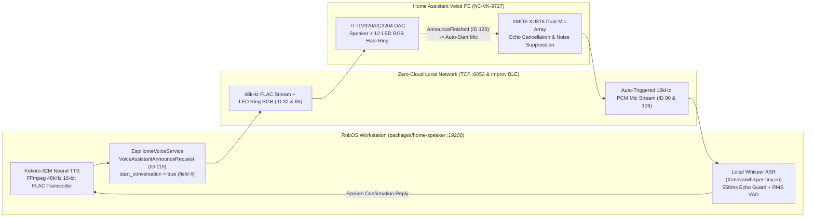

# Home Assistant Voice (`NC-VK-9727`) Two-Way Intercom
{: .no_toc }

Turn the **Nabu Casa Home Assistant Voice Preview Edition (`NC-VK-9727`)** into a zero-cloud, hands-free two-way voice intercom and developer approval terminal for **RobOS Home Speaker** (`packages/home-speaker`).
{: .fs-6 .fw-300 }

  
Table of contents

  {: .text-delta }
- TOC
{:toc}

---

## 1. Live Video Demo: Hands-Free Voice Approval

In this live recording, **RobOS Home Speaker** asks a question out loud on the **Home Assistant Voice (`NC-VK-9727`)** (*"Is it okay to push to main?"*), automatically opens the speaker's microphone as soon as the question finishes playing—**without needing to say `"Okay Nabu"` or press any button**—transcribes the spoken answer locally with Whisper (`"Yes it is."`), and replies out loud (*"Got it! You said yes. Pushing to main is approved."*):

  <iframe width="360" height="640" src="https://www.youtube.com/embed/3ZCU7gsIodg" title="RobOS Home Speaker + Home Assistant Voice PE Two-Way Voice Approval Demo" frameborder="0" allow="accelerometer; autoplay; clipboard-write; encrypted-media; gyroscope; picture-in-picture; web-share" allowfullscreen style="border-radius: 12px; border: 1px solid #30363d;"></iframe>
  
<a href="https://www.youtube.com/shorts/3ZCU7gsIodg" target="_blank" rel="noopener">Watch on YouTube Shorts: https://www.youtube.com/shorts/3ZCU7gsIodg</a>

---

## 2. Two-Way Voice Architecture

**RobOS Home Speaker** (`packages/home-speaker`, debug port `:19200`) communicates directly with the **Home Assistant Voice Preview Edition (`NC-VK-9727`)** over your local Wi-Fi network on TCP port `:6053` using the native ESPHome protobuf protocol (`packages/home-speaker/lib/esphome-voice-service.js`). No Home Assistant server or cloud account is required.

### How Hands-Free Auto-Recording Works (No Wake Word or Button Needed)

1. **Subscribe to the Speaker's Voice Pipeline (`msgType 89`)**: `EspHomeVoiceService` opens a persistent TCP `:6053` connection and sends `SubscribeVoiceAssistantRequest` (`subscribe = true`, `flags = 1` for `VOICE_ASSISTANT_SUBSCRIBE_API_AUDIO`).
2. **Announce & Auto-Open Mic (`msgType 119`, `field 4 = true`)**: When RobOS asks a question (or when you click **Record from Speaker Now**), it sends `VoiceAssistantAnnounceRequest` (`msgType 119`) with:
   - `field 1` (`media_id`): HTTP LAN URL of the 48 kHz 16-bit mono FLAC audio stream.
   - `field 2` (`text`): Text of the prompt (e.g., `"Is it okay to push to main?"`).
   - `field 4` (`start_conversation = true`): Instructs the ESP32-S3 firmware (`25.5.2`) to transition immediately from `State::RESPONSE_FINISHED` into `State::START_MICROPHONE` → `State::START_PIPELINE` the instant the audio finishes playing.
3. **16 kHz PCM Stream + 550 ms Echo Guard (`msgType 90` & `106`)**: The speaker automatically sends `VoiceAssistantRequest` (`msgType 90`, `start = true`) and streams 16 kHz, 16-bit mono PCM audio chunks (`msgType 106`) from its XMOS XU316 dual-microphone array. RobOS skips the first 550 ms of room reverberation after the speaker finishes speaking, detects voice activity (`RMS > 0.038`), and finalizes capture after 1.7 seconds of silence.
4. **Local Whisper Transcription & Spoken Reply**: The captured PCM buffer is transcribed locally via `@xenova/transformers` (`Xenova/whisper-tiny.en`) and answered out loud via Kokoro-82M neural TTS.

---

## 3. Application Walkthrough & Setup Wizard

| Two-Way Voice Intercom & Listen Mode | Add Smart Speaker Wizard (`NC-VK-9727` #1) |
|:---:|:---:|
|  |  |

### Step 1: Bluetooth Wi-Fi Provisioning (Improv BLE)
When unboxing a new **Home Assistant Voice (`NC-VK-9727`)**:
1. Plug the speaker into USB-C power (any USB-C power cable works; data lines are not required because provisioning runs over Bluetooth Low Energy).
2. Open **RobOS Home Speaker** → **Speakers & Setup** → **+ Add Device Wizard**.
3. Select **Home Assistant Voice Speaker** (#1 in the catalog), click **Scan Bluetooth**, enter your **2.4 GHz Wi-Fi** network name and password, and click **Send Wi-Fi to Speaker** (press the center button on the speaker once if prompted to authorize).
4. The speaker joins your LAN and listens on `192.168.1.64:6053` (`home-assistant-voice-0ad22c.local`).

### Step 2: Using Incoming Voice & Hands-Free Prompts
In the **Voice Walkie-Talkie** tab under **Incoming from Speaker (Listen Mode)**:
- **Record from Speaker Now**: Plays a short chime on the speaker and immediately opens its microphone—no wake word or button press required.
- **Start Listening (Wake Word / Button Mode)**: Keeps the speaker ready so you can say **"Okay Nabu"** or press the center button on top of the speaker at any time.
- **Auto-Reply Out Loud**: When enabled, RobOS automatically speaks a reply back through the speaker.

---

## 4. Hardware Entities & Protocol Reference (`NC-VK-9727`)

| Entity / Message | Key / Protobuf ID | Description |
|---|---|---|
| `media_player` | Key `2232357057` (`msgType 65`) | Hardware FLAC media & announcement pipeline (`48000 Hz`, 16-bit, mono/stereo) |
| `led_ring` | Key `1459351809` (`msgType 32`) | 12-LED RGB Halo Ring (`LightCommandRequest` with state, brightness, and RGB floats) |
| `button_press` | Key `2698747613` | Center button events (`double_press`, `long_press`, `triple_press`, `easter_egg_press`) |
| `mute` | Key `2974103762` | Hardware/software microphone mute switch state |
| `SubscribeVoiceAssistantRequest` | `msgType 89` | Subscribes RobOS to incoming voice streams (`subscribe = 1`, `flags = 1`) |
| `VoiceAssistantRequest` | `msgType 90` | Sent by speaker when mic recording starts (`start = 1`, `wake_word_phrase = 5`) |
| `VoiceAssistantAudio` | `msgType 106` | 16 kHz 16-bit signed little-endian mono PCM audio frames from XMOS XU316 mics |
| `VoiceAssistantAnnounceRequest` | `msgType 119` | Plays `media_id` (`1`) and with `start_conversation = true` (`4`) auto-opens the mic |
