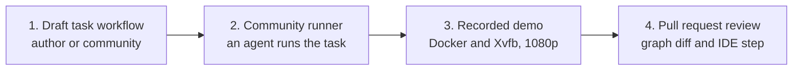

# Ideas
{: .no_toc }

Written proposals for features that are not built, or only partly built. Each page says what exists in the repository today. For a status summary of everything, see the [Roadmap]({{ site.baseurl }}).
{: .fs-6 }

The source files, including raw notes, are in the repository: [docs/ideas on GitHub](https://github.com/nddipiazza/robos/tree/main/docs/ideas).

## Proposals

None of these is built. Where part of the idea exists, the proposal page lists it under "What exists today".

| Proposal | What it would add |
|:---|:---|
| [Dev Central as an agent review hub]({{ '/ideas/specs/dev-central-ai-agent-review-development.html' | relative_url }}) | Goal dispatch, plan review and a live agent monitor in Dev Central |
| [Agent Linux accounts and live agent desktops]({{ '/ideas/specs/ephemeral-agent-user-profiles.html' | relative_url }}) | A real Linux user per agent, and agent displays you can watch |
| [Gitea forge for E2E tests]({{ '/ideas/specs/e2e-gitea-support.html' | relative_url }}) | A local Git forge in the E2E container |
| [Local task server]({{ '/ideas/specs/local-open-source-task-server.html' | relative_url }}) | An offline SQLite task tracker as a Task Servers provider |
| [Prompt lineage in the knowledge graph]({{ '/ideas/specs/prompt-knowledge-graph-logging.html' | relative_url }}) | A record of every prompt, linked to the plans and commits it produced |
| [Session context inspector]({{ '/ideas/specs/robos-session-context-waste-detector.html' | relative_url }}) | A breakdown of what fills an agent session's context |
| [Cloud file storage and sharing]({{ '/ideas/specs/robos-file-storage-and-agent-sharing.html' | relative_url }}) | An object storage browser and MCP tools to share files |
| [Linked accounts and guided OAuth]({{ '/ideas/specs/robos-people-groups-cloud-identity.html' | relative_url }}) | Several provider accounts per person, connected through in-app OAuth |
| [eLearning authoring and team assignments]({{ '/ideas/specs/robos-learning-management-system.html' | relative_url }}) | Course creation, folders and per-team completion reports |
| [Search Studio]({{ '/ideas/specs/search-engine-and-log-analytics-studio.html' | relative_url }}) | An app for OpenSearch, Elasticsearch, Solr and vector stores |
| [OpenTofu and Terraform synthesis]({{ '/ideas/specs/terraform-opentofu-iac-synthesis.html' | relative_url }}) | Cloud resources in the knowledge graph and generated HCL |

Earlier specs for features that have since been built, such as the dual-state knowledge graph, the setup wizard and the KGraph Parse Portal, were removed. The Roadmap lists them under "Built".

## Diagrams

These diagrams come from the earlier specs that were folded into this page or removed. Each is a concept diagram, not a description of what is built.

{: .robos-zoomable-img loading="lazy" }
*Concept diagram from the original design docs, for the dual-state knowledge graph. The Roadmap and What sets RobOS apart say which parts exist.*

{: .robos-zoomable-img loading="lazy" }
*Concept diagram from the original design docs, for the agent-first lifecycle idea. The Roadmap says what is built today.*

{: .robos-zoomable-img loading="lazy" }
*Concept diagram from the original design docs, for plans as knowledge graph objects. A plan is saved on a project node today; the Roadmap describes it under Built.*

{: .robos-zoomable-img loading="lazy" }
*Concept diagram from the original design docs, for the contract-driven project graph. The project graph app it describes is not in the repository.*

{: .robos-zoomable-img loading="lazy" }
*Concept diagram from the original design docs, showing the five delivery phases proposed for the contract-driven project graph. No dates were set.*

{: .robos-zoomable-img loading="lazy" }
*Concept diagram from the original design docs, for the Interactive Reviewer idea. That app was proposed and is not built.*

## Add an idea

{: .robos-zoomable-img loading="lazy" }
*Concept diagram from the original design docs. The first two steps below are what exists today; the text on this page says what is built.*

1. Write a rough note in `docs/ideas/inbox/<name>.txt`.
2. Run the `create-feature-spec` skill on it (`/create-feature-spec docs/ideas/inbox/<name>.txt`). It writes a spec to `docs/ideas/specs/<name>.md`.
3. Open a pull request. [CONTRIBUTING.md](https://github.com/nddipiazza/robos/blob/main/CONTRIBUTING.md) describes the workflow.

Before you propose something, check the Roadmap: the feature may already exist.

*Concept diagram from the original design docs, showing the prompt-driven contribution workflow. A person or agent writes and runs each step; nothing runs this workflow automatically.*
