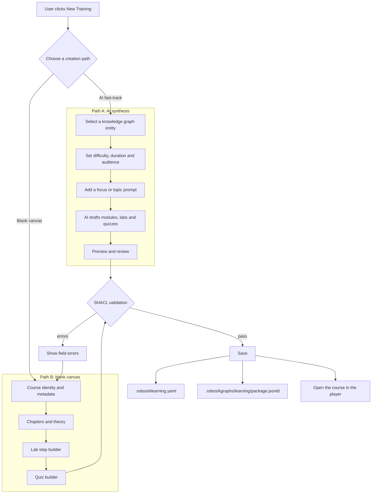
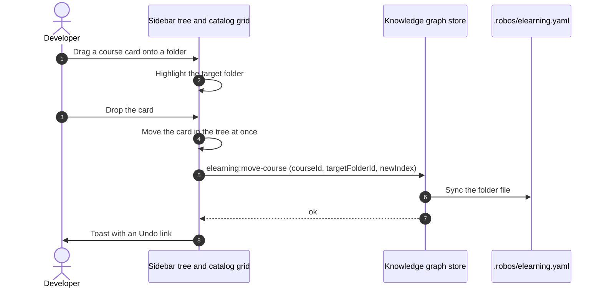
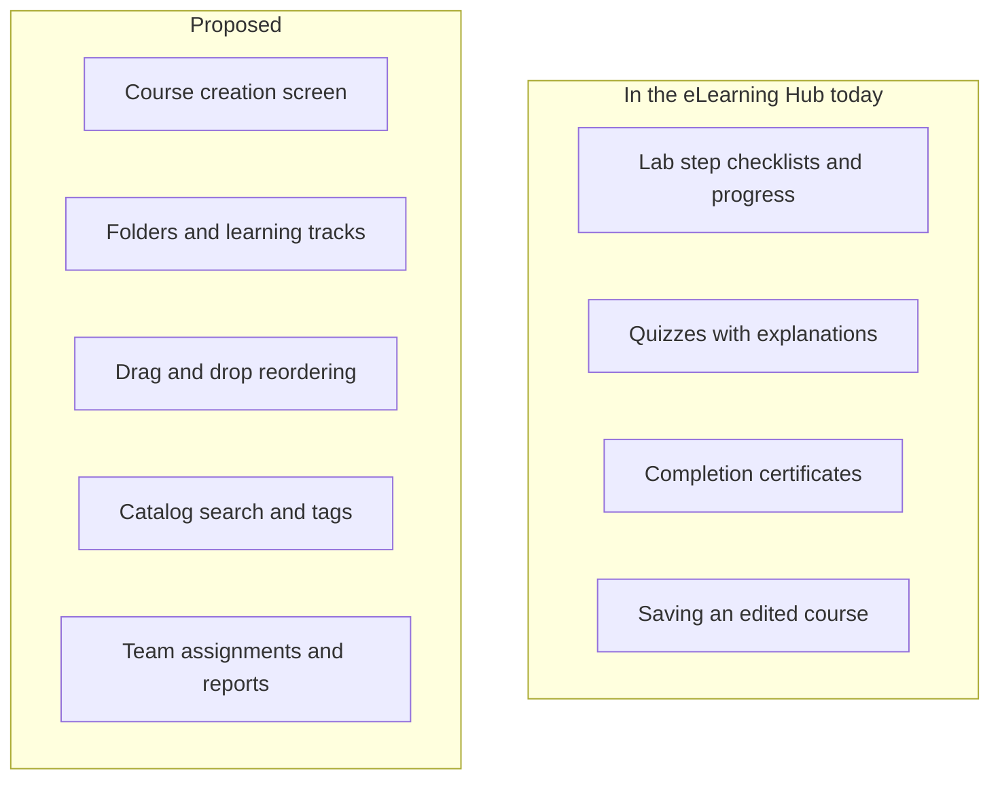

# Proposal: eLearning authoring and team assignments
{: .no_toc }

Add course creation, folders and search, and per-team assignments and completion reports to the eLearning Hub.
{: .fs-6 }

{: .important }
Proposal, not built. This page replaces two older specs, an LMS proposal and a UX audit of the eLearning Hub.

## Proposal

The older LMS spec described a new app, `packages/robos-lms`. The eLearning Hub now provides the player, so the items below would extend [RobOS eLearning Hub]({{ '/apps/robos-elearning/' | relative_url }}) instead.

{: .robos-zoomable-img }
*Concept diagram from the original design docs, for the earlier standalone LMS app. The text on this page says what is built today.*

**Authoring**

- Create a course inside the app, either blank or generated from an application in the knowledge graph, instead of only opening courses made elsewhere.
- Edit chapters, lab steps and quiz questions with a form, not raw JSON-LD.
- A link picker for the services and contracts a course teaches.

*Concept diagram from the original UX audit, for the proposed course creation screen. None of it is built.*

{: .robos-zoomable-img }
*Concept diagram from the original design docs. The text on this page says what is built today.*

**Organization**

- Folders or learning tracks, tags, and search in place of the single course dropdown.
- Drag and drop to reorder courses, modules and lab steps.

{: .robos-zoomable-img }
*Concept diagram from the original design docs. The text on this page says what is built today; the hub has no folders or drag and drop.*

*Concept diagram from the original UX audit, for moving a course between folders. None of it is built.*

**Teams**

- Assign a course to a person or group from [People Directory]({{ '/apps/people-directory/' | relative_url }}) and [Group Manager]({{ '/apps/group-manager/' | relative_url }}), with a due date.
- A completion and score report per team, and overdue alerts.
- Export completion records as xAPI or SCORM events.
- Player extras: synchronized transcript highlighting for narrated lessons and playback speed control.

```mermaid
flowchart LR
    subgraph P1["Phase 1: data and handlers"]
        P1A["elearning.yaml folder schema"] --> P1B["robos:LearningFolder in the graph"]
        P1B --> P1C["Folder and move handlers"]
    end
    subgraph P2["Phase 2: organization UI"]
        P2A["Sidebar folder tree"] --> P2B["Catalog grid view"]
        P2B --> P2C["Drag and drop"]
    end
    subgraph P3["Phase 3: creation screen"]
        P3A["AI synthesis dialog"] --> P3B["Blank canvas builder"]
        P3B --> P3C["SHACL validation"]
    end
    subgraph P4["Phase 4: verification"]
        P4A["Automated end-to-end tests"] --> P4B["Recorded video proof"]
    end
    P1C --> P2A
    P2C --> P3A
    P3C --> P4A
```

*Concept diagram from the original UX audit, showing the four delivery phases it proposed. No dates were set.*

## What exists today

The hub (`packages/robos-elearning`) already does the following:

- Lists courses from the knowledge graph in one dropdown (`course-selector` in `renderer/index.html`).
- Shows lab steps and quiz questions with feedback.
- Issues and lists completion certificates (`elearning:issue-certificate`, `elearning:list-certificates` in `main.js`).
- Exports a course website and a slide archive.
- Saves an edited course to the knowledge graph and to `.robos/elearning.yaml` (`elearning:save-course`).

It has no create-course screen, no folders, no drag-and-drop ordering, and no assignment, SCORM or xAPI code.

*Concept diagram adapted from the original UX audit, which first drew the line between what the hub has and what it lacks.*

## Source

Raw note: [`ideas/inbox/robos-learning-management-system.txt`](https://github.com/nddipiazza/robos/blob/main/docs/ideas/inbox/robos-learning-management-system.txt). The earlier LMS spec and UX audit are in the git history.
