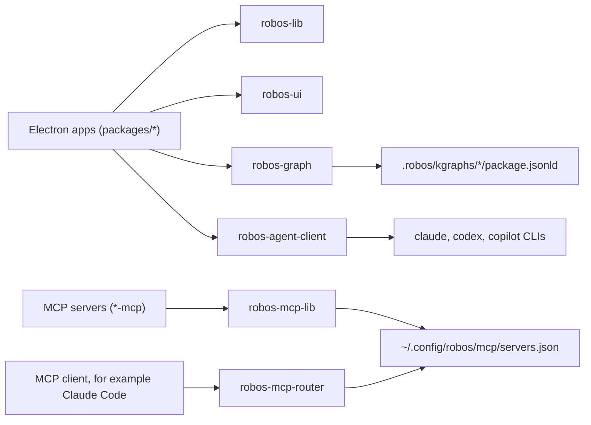

# RobOS documentation
{: .no_toc }

RobOS is a desktop suite of developer apps, a knowledge graph of your system, and review tools that show what a coding agent changed and prove it works.
{: .rb-home-lead }

  <a href="{{ site.baseurl }}" class="btn btn-primary">Get started</a>
  <a href="{{ site.baseurl }}" class="btn">Browse the apps</a>
  <a href="https://github.com/nddipiazza/robos" class="btn" target="_blank" rel="noopener">Source on GitHub</a>

## Where to start

  <a class="rb-link" href="{{ site.baseurl }}">
    <strong>Use RobOS</strong>
    Install it, tour the apps, and follow a task from idea to merged pull request.
  </a>
  <a class="rb-link" href="{{ site.baseurl }}">
    <strong>Review and governance</strong>
    PR Review Theater, recorded walkthroughs, and how agent work is checked before it merges.
  </a>
  <a class="rb-link" href="{{ site.baseurl }}">
    <strong>Build on RobOS</strong>
    Model your system in the knowledge graph, generate or import apps, and write skills.
  </a>
  <a class="rb-link" href="{{ site.baseurl }}">
    <strong>RobOS for Teams</strong>
    What RobOS is for, how it differs, and how to set it up for an organization.
  </a>

## How the pieces fit

RobOS is a set of Electron desktop apps that share libraries and one knowledge graph. Agents run through a router, and MCP servers expose the graph and the apps to other tools.

Each arrow is a `require`, a file read or a spawned process in the source. The [architecture overview]({{ site.baseurl }}) walks through each box.

## Also here

- [Roadmap]({{ site.baseurl }}): what is built, in progress and planned.
- [Training]({{ site.baseurl }}): task-oriented lessons.
- [About]({{ site.baseurl }}): the project, the license and where to ask questions.
- [rowbose.com](https://rowbose.com/): the project home page.
