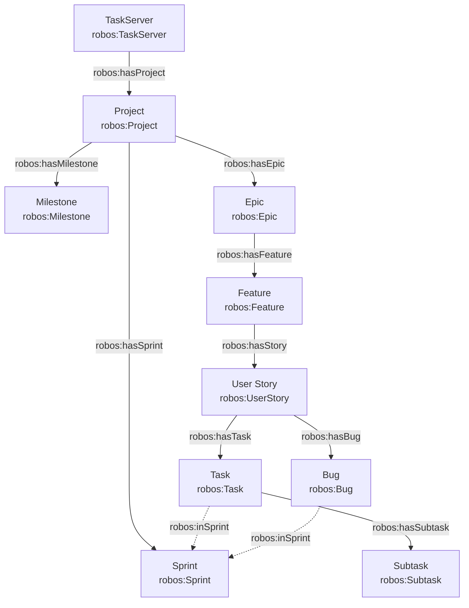

# Knowledge graph
{: .no_toc }

The knowledge graph is a set of JSON-LD files that describe a software organization: services, applications, contracts, databases, teams, pipelines and the links between them. This page covers what is in it, where the files live, and how the Knowledge Graph Explorer, the `kgraph` command and MCP tools read and change it.
{: .fs-6 }

<details open markdown="block">
  <summary>On this page</summary>
  {: .text-delta }
1. TOC
{:toc}
</details>

## What the graph holds

The graph is a list of nodes. Each node has an `@id` (a URN such as `urn:robos:service:billing-api`), one or more `@type` values, a `dcterms:title` and further properties. A property whose value is another node's `@id` is an edge. There is no separate edge list.

```json
{
  "@id": "urn:robos:service:billing-api",
  "@type": ["oslc_am:Resource", "robos:Microservice", "schema:SoftwareApplication"],
  "dcterms:title": "Billing API Service",
  "robos:package": "services",
  "robos:repository": "github.com/acme/billing-api",
  "robos:ownerTeam": "urn:robos:team:order-processing",
  "robos:usesDatabase": "urn:robos:db:acme-orders-postgres",
  "robos:publishesTo": "urn:robos:broker:acme-event-kafka",
  "robos:implementsContract": ["urn:robos:contract:orders-grpc"]
}
```

This is an excerpt of a node in `.robos/kgraphs/services/package.jsonld` in the RobOS repository. The graph checked into that repository is mostly sample data for a fictional company called Acme, plus nodes for a few RobOS components.

Types come from several vocabularies. The JSON-LD context maps the prefixes `oslc`, `oslc_am`, `oslc_cm`, `oslc_rm` and `oslc_qm` (OSLC), `c4` (C4 model), `schema` (Schema.org), `dcterms`, `pact`, and `robos`, which expands to `https://robos.dev/ns/sdlc#`. Each `robos:` class has a validation shape. See [Schemas]({{ site.baseurl }}) for the list and the properties each shape checks.

Impact analysis follows only some edges. The predicates that count as dependencies are a fixed list in `packages/robos-graph/lib/relationships.js`, for example `robos:dependsOn`, `robos:uses`, `robos:usesDatabase`, `robos:publishesTo` and `robos:implementsContract`. Ownership, containment and provenance predicates such as `robos:ownerTeam` and `robos:inRepository` stay queryable but do not count.

{: .robos-zoomable-img loading="lazy" }
*Concept diagram from the original design docs. The text on this page says what is built today.*

Work items are an example of edges between node types. A task server holds projects, which hold the planning and work-item nodes below.



## Where it is stored

The graph is split into packages. A package is one directory under `.robos/kgraphs/` with a `package.jsonld` file. The checked-in `.robos/kgraph.yaml` lists these packages:

| Package id | Namespace | Holds |
|---|---|---|
| `core-platform` | `robos.platform` | Databases, message brokers, search indexes, MCP servers, build systems, technology and protocol definitions, source artifacts |
| `organization` | `robos.org` | Teams, developers, companies, Git organizations, agent personas |
| `services` | `robos.services` | Microservices, contracts, API endpoints |
| `applications` | `robos.apps` | Front-end, desktop and console apps, voice commands |
| `devops` | `robos.devops` | Environments, Kubernetes clusters, remote-execution clusters, GitOps deployments, CI pipelines, DevOps integrations |
| `learning` | `robos.learning` | eLearning courses, completion certificates, agent skills |
| `documentation` | `robos.docs` | Documentation pages, decision records, flow diagrams, walkthroughs, code snippets |
| `testing` | `robos.testing` | Gherkin features, scenarios, test plans and suites, testing libraries |
| `game`, `crpg`, `tabletop-game` | `robos.game`, `robos.crpg`, `robos.tabletop` | Game rules and content for the cRPG and tabletop games |
| `infinity-engine` | `robos.infinity` | Architecture notes on the Infinity Engine (GemRB) |

The first eight are the standard packages that every graph workspace gets. The other four are specific to this repository.

{: .robos-zoomable-img loading="lazy" }
*Look at the header buttons and the statistics bar. The tab strip on the right is from an older Explorer.*

{: .robos-zoomable-img loading="lazy" }
*Look at the package cards: each shows a namespace such as robos.services and its node count.*

{: .robos-zoomable-img loading="lazy" }
*Look at the Registered KGraph Repositories list under the package cards.*

{: .robos-zoomable-img loading="lazy" }
*Look at the remote repository row with its Sync Tag and Remove buttons. As the known limits below explain, a registered remote repository is not yet merged into the graph.*

Next to the packages, `.robos/` holds these files:

| Path | Contents |
|---|---|
| `kgraph.yaml` | Catalog with the `packages` list. RobOS updates the list when it writes a workspace. It does not read the `repositories` or `dependencies` entries. |
| `knowledge-graph.jsonld` | All packages combined in one file, rewritten when packages are saved. It exists for tools that read a single file. |
| `ontology.jsonld` | Classes and properties with their Schema.org parents and shape ids. |
| `teams.yaml`, `packages.yaml`, `documentation.yaml`, `elearning.yaml` | YAML catalogs kept beside the graph. |

### Which graph a tool opens

| Setting | Location | Behavior |
|---|---|---|
| None | `~/.robos` | If the directory has no graph, RobOS writes a built-in sample graph (the fictional "Acme Enterprise Global SDLC Universe") there on first use. |
| `ROBOS_GRAPH_ROOT=<dir>` or `--graph-root <dir>` | `<dir>/.robos` | Workspace mode. The graph starts empty, has no sample data, and every change goes through a proposal and an apply step. |

The environment variable is read by `SDLCKnowledgeGraphStore`, so every app that loads the store follows it. In workspace mode, Data Sources, Kube Studio and Remote Execution Studio show read-only views of what the graph declares. The rules for workspaces are in [`WORKSPACES.md`](https://github.com/nddipiazza/robos/blob/main/packages/robos-graph/WORKSPACES.md).

Apps that use the default graph read and write it through `SDLCKnowledgeGraphStore`. For example, DB Manager creates database nodes, Kube Studio creates Kubernetes cluster nodes and MCP Manager creates MCP server nodes. Git Projects imports its repository list into the graph each time it saves that list.

## Read the graph

### With the kgraph command

Run the CLI from a RobOS checkout. `packages/robos-graph/package.json` also declares it as the `kgraph` binary.

```bash
node packages/robos-graph/bin/kgraph-cli.js <command> [options]
```

| Command | What it does |
|---|---|
| `search <query>` | Text search. Options: `--type`, `--package`, `--team`, `--json`. |
| `get <node-id>` | Show one node with its incoming and outgoing references. |
| `query` | Filter with `--type` and `--package`, list `--depends-on <id>`, or find a path with `--path-from` and `--path-to`. |
| `impact <node-id>` | List dependents and dependencies. `--depth` defaults to 3. |
| `validate [package-id]` | Run the shape checks. Exits non-zero when a node fails. |
| `export` | Write `--format jsonld`, `ttl` or `nt`, optionally for one `--package`. |
| `visualize [id-or-package]` | Print Mermaid text. `--direction TD` or `LR`. |
| `insert`, `update`, `delete` | Change nodes in the default graph. `insert` validates first unless you pass `--no-validate`. `delete --cascade` also removes references to the node. |

Add `--graph-root <dir>` to any command to use a workspace instead of `~/.robos`.

### With the Explorer

The Knowledge Graph Explorer is the Electron app in `packages/robos-graph`. From a checkout:

```bash
cd packages/robos-graph
npm install
ROBOS_GRAPH_ROOT=/path/to/project npm start
```

Leave out `ROBOS_GRAPH_ROOT` to open the default graph in `~/.robos`.

The left panel lists nodes. Group them by **Classification**, **Package**, **Type** or **Flat**, search them, and filter by package, type or classification. Selecting a node opens tabs on the right: **Overview**, **Topology**, **Impact**, **Query & Paths**, **JSON-LD**, and, when the node has the data, **Documentation**, **Source Evidence** and type-specific property tabs. The header has **Import & Refine**, **DevOps Integrations**, **Packages & Repos**, **Generate eLearning**, **Semantic Diff** and **Validate SHACL**. See [Inspector schema coverage]({{ '/inspector-schema-coverage.html' | relative_url }}) for which types get property tabs.

{: .robos-zoomable-img loading="lazy" }
*Look at the header buttons and the node list on the left. The tab strip on the right is from an older Explorer; today's tabs are listed above.*

{: .robos-zoomable-img loading="lazy" }
*Look at the collapsible package groups and their counts. The Explorer you run today also offers a Classification grouping.*

{: .robos-zoomable-img loading="lazy" }
*Look at the same nodes regrouped under the Type button.*

{: .robos-zoomable-img loading="lazy" }
*Look at how the search box filters nodes and keeps only the groups that match.*

{: .robos-zoomable-img loading="lazy" }
*Look at the single row of filter chips and the control that collapses or expands every group.*

### From a script

```js
const { SDLCKnowledgeGraphStore } = require('./packages/robos-graph/index.js');

const store = new SDLCKnowledgeGraphStore({ graphRoot: '/path/to/project' });
console.log(store.query({ type: 'robos:Microservice' }).map(n => n['@id']));
console.log(store.findDependents('urn:robos:service:orders-api', 2));
console.log(store.validate().conforms);
```

Require `index.js` explicitly. The package's `main` entry is the Electron app.

### From an agent

Agents reach the graph in two ways.

The `kgraph-*` skills in `plugins/robos/skills` (`kgraph-search`, `kgraph-query`, `kgraph-insert`, `kgraph-update`, `kgraph-delete`, `kgraph-validate`, `kgraph-diff`, `kgraph-export`, `kgraph-visualize` and `kgraph-impact-analysis`) tell the agent which `kgraph` command to run.

The `ekgraph-mcp` package serves the graph over the Model Context Protocol. Its tools depend on how it is started:

| Tools | Available when | Notes |
|---|---|---|
| `robos_sdlc_inspect`, `robos_sdlc_query` | `ROBOS_GRAPH_ROOT` (an absolute path) or the `graphRoot` option is set | Read-only. Results are capped at 100 nodes per page and 256 KiB. |
| `robos_sdlc_propose`, `robos_sdlc_apply` | Same | `propose` writes a draft and changes nothing. `apply` commits a draft by id. |
| `robos_schema_lookup`, `robos_schema_validate`, `robos_schema_synthesize` | Always listed | Look up Schema.org types, validate a JSON-LD payload and synthesize a type from a Schema.org class. They need the Schema Studio registry. |
| `robos_ekgraph_search`, `_get_node`, `_list_children`, `_get_linked`, `_create_node`, `_update_node` | Always listed | They use a separate older store, `~/.config/robos/ekgraph/nodes.json`, not the JSON-LD graph. With a graph root that store is turned off: reads return nothing and the write tools refuse and point to propose and apply. |

Start the server from code with `createEKGraphMCPServer({ graphRoot, port })` from `packages/ekgraph-mcp/server.js`. With a `port`, it answers JSON-RPC over HTTP at `http://localhost:<port>/mcp`.

## Change the graph in a workspace

A workspace write is two steps. `propose` computes a candidate graph and a property-level diff. `apply` commits it only if the graph has not changed since. The commands are `init`, `inspect`, `context`, `propose`, `apply` and `recover`.

1. Create the workspace.

   ```bash
   node packages/robos-graph/bin/kgraph-cli.js init --graph-root /path/to/project --title "Orders system"
   ```

   This creates `/path/to/project/.robos` with the eight standard packages and an empty graph.

2. Write the nodes to add in `import.json`. With `--require-evidence`, every node needs at least one `robos:evidence` record: a `repository`, a relative `path` and a positive `line`.

   ```json
   {
     "@context": { "robos": "https://robos.dev/ns/sdlc#", "dcterms": "http://purl.org/dc/terms/" },
     "robos:nodes": [
       {
         "@id": "urn:robos:service:orders-api",
         "@type": ["robos:Microservice"],
         "dcterms:title": "Orders API",
         "robos:package": "services",
         "robos:repository": "github.com/example/orders",
         "robos:ownerTeam": "urn:robos:team:orders",
         "robos:evidence": [{ "repository": "github.com/example/orders", "path": "package.json", "line": 1 }]
       },
       {
         "@id": "urn:robos:team:orders",
         "@type": ["robos:Team"],
         "dcterms:title": "Orders team",
         "robos:package": "organization",
         "robos:evidence": [{ "repository": "github.com/example/orders", "path": "CODEOWNERS", "line": 1 }]
       }
     ]
   }
   ```

3. Propose, review and apply.

   ```bash
   kgraph="node packages/robos-graph/bin/kgraph-cli.js"
   $kgraph propose --graph-root /path/to/project --file import.json --mode import --require-evidence --output proposal.json
   $kgraph apply --graph-root /path/to/project --file proposal.json
   $kgraph inspect --graph-root /path/to/project
   ```

   `proposal.json` holds the candidate graph, the validation result, the conflicts and the diff. When validation fails, `propose` exits with status 1 but still writes the file. The reasons are in `validation.errors`, and `apply` rejects that proposal.

To compare a candidate document with the current graph, run `diff --file candidate.jsonld --graph-root /path/to/project`. It prints the nodes that were added, changed (with before and after values per property) and removed.

`apply` and the Explorer's save action check the proposal's id, the graph revision, references and shapes. If another write happened in between, the proposal is stale and you propose again. After a crash during a write, `recover` finishes it.

## Import from source repositories

The `import-company-kgraph` skill builds a proposal from local Git checkouts. You give it a `sources.json` that names the repositories and a `local.json` that maps each name to a checkout path. The importer reads tracked files only. It does not run repository code or Git hooks, and it does not clone anything. Every extracted node carries evidence: repository, path, line, revision and a SHA-256 of the file. The importer writes a proposal that you review and apply as above. Its `SKILL.md` has the commands and the manifest format.

{: .robos-zoomable-img loading="lazy" }
*Concept diagram from the original design docs. The text on this page says what is built today: the source-backed import reads local Git checkouts.*

Older flags for importing from an S3 bucket, an HTTP catalog or a directory scan exist only in a demo mode that needs `--demo`. They are not the source-backed workflow and their output is not evidence of anything.

The [KGraph parse portal]({{ '/kgraph-parse-portal.html' | relative_url }}) is a separate service. Its `POST /api/v1/ingest` route scans a directory and adds the resulting nodes to the graph at `.robos/knowledge-graph.jsonld` in the RobOS checkout.

## Compare two versions

Two things exist in the code. Neither reads Git branches.

`GraphDiffEngine` in `packages/robos-graph/lib/graph-diff.js` compares two graph documents by node `@id` and lists added, removed, modified and unchanged nodes. It rates the result HIGH if a removed node is a contract or microservice, MEDIUM if more than three nodes changed, and LOW otherwise. `BlastRadiusAnalyzer` then walks dependents up to three hops from each changed node and collects the affected services, contracts, requirements and owner teams. Run `kgraph diff --file` in a workspace to diff a candidate against the current graph.

`BranchManager` holds named graph versions in memory. In the default graph there are four: `main` and three sample branches written into `branch-manager.js` (`feature/TASK-101-auth`, `poc/v2-graphql` and `pilot/beta-billing`). In a workspace there is only `main`, which is the current revision. The Explorer's branch selector lists these. Its **Semantic Diff** button always compares `main` with `feature/TASK-101-auth`. `kgraph diff <branch>` without `--file` works on the same in-memory branches, and its plain-text output currently prints zero counts, so pass `--json` to see the result.

{: .robos-zoomable-img loading="lazy" }
*Look at the diff summary: the Semantic Diff button compares main with the sample branch feature/TASK-101-auth and reports counts and a risk level.*

Nothing in the code builds a graph version from a Git branch or pull request. The PR review app's knowledge graph panel shows fixed sample data and does not call the diff engine.

## DevOps integrations and secrets

**DevOps Integrations** in the Explorer records an account for a provider (GitHub, AWS, Kubernetes and others, grouped into seven categories) as a `robos:DevOpsIntegration` node. Secret fields are not stored in the graph. For each secret, RobOS runs `pass insert` to write it to `~/.password-store/devops/<category>/<provider>/<account>/<field>` and adds a `robos:PassCredential` node that holds only the `robos:passPath`. The integration node links to it with `robos:hasCredential`.

{: .robos-zoomable-img loading="lazy" }
*Look at the Active Accounts and Add Integration buttons at the top of the window.*

{: .robos-zoomable-img loading="lazy" }
*Look at the seven category tabs above the provider grid.*

{: .warning }
If `pass` is missing or cannot run, the code does not stop. It writes a file at the same path whose content is `MOCK_GPG_ENCRYPTED:` followed by the base64 of the secret. Base64 is not encryption. Install and initialize `pass` and GPG before you enter real credentials.

**Test Connection** checks that the required fields are filled in. Except for Buildkite, it does not contact the provider and always reports success when the fields are present.

{: .robos-zoomable-img loading="lazy" }
*Look at the secret field and the Test Connection button. The password-store path in the form is only real when pass and GPG are set up, as the warning above says.*

{: .robos-zoomable-img loading="lazy" }
*Look at the pass credential listed under the account: the graph holds the path to the secret, not the secret itself.*

## Known limits

- The validator checks only the minimum and maximum number of values per property. It does not check datatypes or formats, and it is not a full W3C SHACL implementation. A passing result is a structural check.
- The `.robos` directory in the RobOS repository is not a strict workspace. `kgraph inspect --graph-root` on it fails because `knowledge-graph.jsonld` and the package files disagree, and `kgraph validate` on a copy of it reports violations.
- In the default graph, **Packages & Repos** records external graph repositories in `~/.robos/config/kgraph-repos.json` and clones the chosen tag into `~/.robos/cache/kgraphs/`. If the clone fails, the code writes a stub package in its place. Nothing merges those packages into the graph the Explorer shows, so a registered remote repository is not yet part of the graph. Workspaces refuse this change.
- Dependency impact covers only the modeled edges. The `impact` output says so itself: finding no dependents does not mean a change is safe.

## Diagrams

{: .robos-zoomable-img loading="lazy" }
*Concept diagram from the original design docs, showing how Git organization rules would cascade to repositories. The text on this page says what is built today.*
