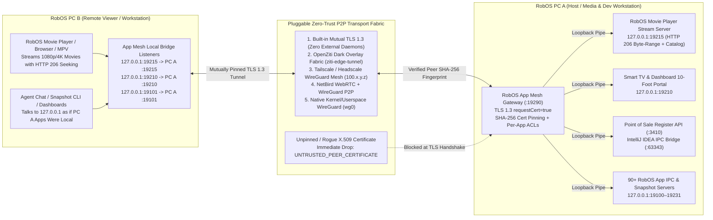

# Zero-Trust P2P App Mesh (`packages/app-mesh`)
{: .no_toc }

Connect any two or more RobOS computers—on the same LAN or across the internet—without opening unauthenticated ports or locking yourself into a single VPN vendor.
{: .fs-6 .fw-300 }

<details open markdown="block">
  <summary>Table of contents</summary>
  {: .text-delta }
- TOC
{:toc}
</details>

---

## 1. Architecture Overview

By default, RobOS desktop applications bind their IPC, DOM snapshot, and service endpoints to local loopback (`127.0.0.1`) so untrusted devices on a LAN or Wi-Fi network cannot probe or control your apps. **RobOS App Mesh** (`packages/app-mesh` + `packages/robos-lib/app-mesh-engine.js`) creates an application-layer Zero-Trust P2P mesh that mounts remote RobOS app ports onto `127.0.0.1` on peer machines over mutually authenticated TLS 1.3 tunnels.




---

## 2. Five Pluggable Zero-Trust Transport Fabrics

| Driver ID | Transport Fabric | How It Works |
| :--- | :--- | :--- |
| **`mtls`** *(Default)* | **Built-in Zero-Trust Mutual TLS 1.3** | Pure Node.js TLS 1.3 (`requestCert: true`) with ECDSA P-256 X.509 certificates and SHA-256 fingerprint pinning. Zero external daemons or root privileges required. |
| **`openziti`** | **OpenZiti Overlay Fabric** | Generates dark-network OpenZiti service/intercept definitions (`robos.ipc.<app-id>`) and integrates with `ziti` / `ziti-edge-tunnel`. |
| **`tailscale`** | **Tailscale / Headscale Mesh** | Routes RobOS IPC tunnels over authenticated `100.x.y.z` WireGuard overlay peers and exports least-privilege HuJSON ACLs. |
| **`netbird`** | **NetBird Zero-Trust P2P** | Uses WebRTC STUN/TURN + WireGuard peer-to-peer tunnels for NAT traversal across networks. |
| **`wireguard`** | **Native WireGuard Interface** | Binds App Mesh traffic strictly to `wg0` / `wg-robos0`. |

---

## 3. Pairing Two RobOS Machines & Bridging IPC Ports

1. **Launch RobOS App Mesh** on both machines:
   ```bash
   electron packages/app-mesh
   ```
2. **Exchange Zero-Trust Enrollment Tokens (`robos-mesh://…`)**:
   - Copy **PC A's** enrollment token from the top toolbar and paste it into **1. Trusted RobOS Peers** on **PC B** → click **Pin & Trust Peer**.
   - Copy **PC B's** enrollment token into **PC A** so both machines mutually pin each other's X.509 certificate SHA-256 fingerprints.
   - Click **Ping mTLS** to verify the live TLS 1.3 handshake.
3. **Mount Any Remote RobOS App Port Locally**:
   - Under **2. Cross-Machine IPC Bridges**, select the peer and the remote RobOS app port (from 95+ registered IPC and service ports), pick a local bind port (`0` = auto), and click **Bridge IPC Port**.

---

## 4. Streaming Movies from One RobOS PC to Another

Once **PC A** (Media Server) and **PC B** (Viewer PC) are paired in **RobOS App Mesh**, you have two ways to stream movies across the encrypted tunnel:

### Method 1: Bridge the Movie Player Stream Server (`:19215`) via App Mesh

1. On **PC A**, launch **RobOS Movie Player** (`electron packages/movie-player`), which starts its HTTP Range stream & cinema catalog server on `:19215` (`movie-player-stream`).
2. On **PC B**, open **RobOS App Mesh** and bridge **PC A's** `:19215 — movie-player-stream` to local port `19215` (and optionally bridge `:19210 — smart-tv-portal` to `19210`).
3. On **PC B**, browse and stream over `http://127.0.0.1:19215` with full `HTTP 206 Partial Content` byte-range seeking and watch-progress sync:

```bash
# 1. Browse PC A's movie & TV show catalog on PC B
curl -s http://127.0.0.1:19215/api/tv-library | jq '.items[] | {id, title, year, qualityBadge, streamUrl}'

# 2. Request a playable HTTP 206 stream URL for any movie
curl -s "http://127.0.0.1:19215/api/tv-play?id=<TRACK_ID>" | jq .

# 3. Sync playback progress back to PC A
curl -s -X POST "http://127.0.0.1:19215/api/tv-progress?id=<TRACK_ID>&positionSec=1840&durationSec=9300"
```

### Method 2: Link PC A as a Remote SFTP Library Folder in PC B's Movie Player

In **RobOS Data Sources** on **PC B**, add an SFTP connection to **PC A** over its Zero-Trust address and link PC A's movies folder. **RobOS Movie Player** on PC B automatically imports the linked folder (`packages/movie-player/lib/library-folders.js`) and streams movies on demand via `/cloud-stream/<trackId>.mp4`.

---

## 5. Live End-to-End Zero-Trust Verification Proof

Click **Verify Zero-Trust Proof** in the **RobOS App Mesh** header or run the automated test suite from the terminal:

```bash
node --test packages/robos-lib/app-mesh-engine.test.cjs
```
