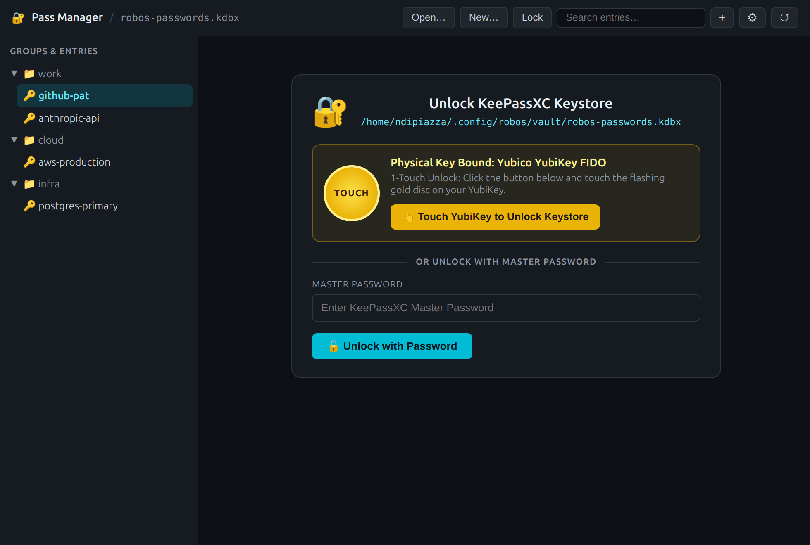
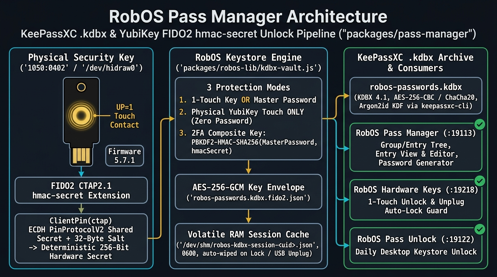
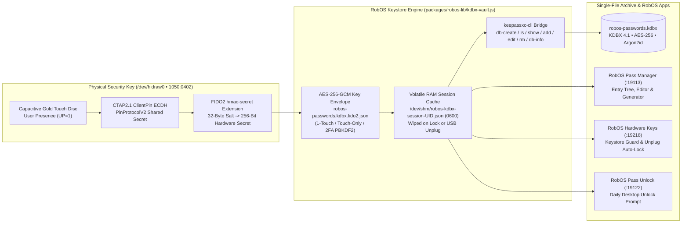

# RobOS Pass Manager — KeePassXC (`.kdbx`) Single-Archive Vault & YubiKey FIDO2 Unlock

**RobOS Pass Manager** (`packages/pass-manager`, debug port `:19113`) replaces traditional directory-based GPG `pass` stores with a single-archive **KeePassXC `.kdbx` 4.1** password studio backed by `packages/robos-lib/kdbx-vault.js` and unlocked by a physical **YubiKey / FIDO2 Security Key** via the CTAP2.1 `hmac-secret` extension.

## Architecture

## Key Capabilities

1. **Single-Archive KDBX 4.1 Container (`robos-passwords.kdbx`)**: Encrypts the entire hierarchy—group names, titles, usernames, passwords, URLs, UUIDs, and notes—inside one portable `.kdbx` file (`AES-256`, `Argon2id`).
2. **Physical YubiKey Unlock via FIDO2 `hmac-secret`**: Works with FIDO-only keys (such as the **Yubico Security Key C NFC**, Firmware 5.7.1, USB ID `1050:0402`) as well as YubiKey 5 Series keys by negotiating an ECDH shared secret (`PinProtocolV2`) and evaluating a deterministic 32-byte hardware HMAC-SHA256 secret on physical touch (`UP=1`).
3. **Three Protection Modes**:
   - **1-Touch Physical Key OR Master Password** (unlock with a single YubiKey touch; keep Master Password as backup)
   - **Physical YubiKey Touch ONLY** (zero master password)
   - **2FA Composite Key** (`PBKDF2-HMAC-SHA256` combining Master Password + Physical YubiKey Touch)
4. **Volatile `/dev/shm` Session & USB Unplug Auto-Lock**: Active unlocked session keys live only in `/dev/shm/robos-kdbx-session-<uid>.json` (`0600`) and are wiped immediately when you click **Lock** or unplug your YubiKey from USB.
