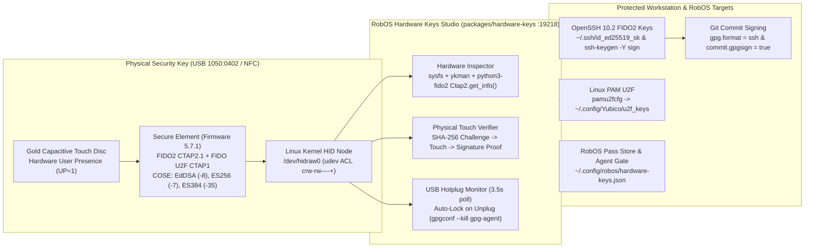

# Physical Push Keys (`packages/hardware-keys`)
{: .no_toc }

Connect physical FIDO2 and U2F authenticators—such as the **YubiKey 5 Series**, **Security Key C NFC**, **SoloKey**, and **Nitrokey**—directly to your Linux desktop, SSH keys, Git commits, `sudo` prompts, and the RobOS Pass Store.
{: .fs-6 .fw-300 }

  
Table of contents

  {: .text-delta }
- TOC
{:toc}

---

## 1. Architecture Overview

**RobOS Hardware Keys** (`packages/hardware-keys`, debug port `:19218`) combines three local Linux inspection layers—`/sys/class/hidraw` udev attributes, YubiKey Manager (`ykman`), and direct `python3-fido2` CTAP2/CTAP1 HID frames—so every hardware capability can be inspected and exercised without cloud services or browser extensions.

---

## 2. Live Application Views

| Physical Touch Verifier | FIDO2 SSH Keys (`ed25519-sk`) |
|:---:|:---:|
|  |  |

| FIDO2 PIN & Resident Passkeys | Linux PAM U2F & RobOS Guards |
|:---:|:---:|
|  |  |

---

## 3. Capabilities & Workflows

1. **Hardware Inspector**: Queries `/sys/class/hidraw/hidraw*/device/uevent`, `ykman info`, `ykman fido info`, and `Ctap2.get_info()` to report firmware version, USB/NFC applet state, FIDO2 AAGUID, supported COSE algorithms (`EdDSA / Ed25519`, `ES256 / P-256`, `ES384 / P-384`), CTAP2 extensions, and Linux udev read/write permissions.
2. **Physical Touch Verifier**: Issues a live cryptographic challenge to the key, blinks the LED, measures physical touch latency in milliseconds, and displays the resulting hardware signature and authenticator flags (`UP=1`, `UV`).
3. **Hardware-Backed OpenSSH Keys (`ed25519-sk` & `ecdsa-sk`)**: Generates FIDO2 SSH keys whose private half never leaves the YubiKey, supports `verify-required` and resident (`-O resident`) modes, tests `ssh-keygen -Y sign` signatures, and uploads `.pub` keys to GitHub.
4. **FIDO2 PIN & Passkeys**: Sets or rotates the FIDO2 PIN (`ykman fido access change-pin`) and lists or deletes discoverable resident credentials (`ykman fido credentials list`).
5. **Linux PAM U2F & RobOS Guards**: Enrolls `~/.config/Yubico/u2f_keys` via `pamu2fcfg` for touch-to-approve `sudo` and desktop login, configures Git global SSH commit signing (`gpg.format = ssh`), and can automatically lock `gpg-agent` when the YubiKey is unplugged.
