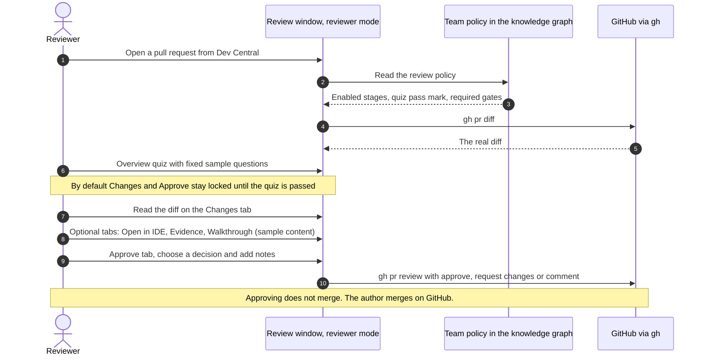

# PR Review Theater
{: .no_toc }

PR Review Theater is the review window of the Agent Code Review Platform app. It shows a branch's diff, the evidence that the change works and an agent-led walkthrough, then helps the author open a pull request or a reviewer approve one. Read this page to see what each tab does, which parts use real data, and how to open a review.
{: .fs-6 }

<details open markdown="block">
  <summary>On this page</summary>
  {: .text-delta }
1. TOC
{:toc}
</details>

## What it is

The app is [`packages/pr-review`](https://github.com/nddipiazza/robos/tree/main/packages/pr-review). It appears in the launcher as Agent Code Review Platform, and its window title is "RobOS Agent-Generated Code Review Platform". The app page is [Agent Code Review]({{ '/apps/pr-review/' | relative_url }}).

{: .robos-zoomable-img loading="lazy" }
*Concept diagram from the original design docs. The text on this page says what is built today.*

A review opens in one of two modes, and the mode decides which tabs you get.

| | Local review | Published PR, reviewer mode |
|:---|:---|:---|
| Used by | The author, before and after creating the PR | Someone reviewing a PR that has no saved local review on this machine |
| Opened from | Task Implementer (**Review branch…**) or Dev Central (**Open Code Review**) | Dev Central, **Open code review** on a pull request |
| Tabs | Description, Changes, Evidence, Walkthrough, Pull Request | Description, Overview, Documentation, Changes, Open in IDE, Evidence, Walkthrough, Approve |
| Uses real data | All tabs | Description, Changes and Approve |

{: .important }
In reviewer mode, the Overview, Documentation, Open in IDE, Evidence and Walkthrough tabs show built-in sample content about a PetStore mTLS change. It is not generated from the pull request: the quiz has three fixed questions, the REST runner falls back to a canned response, and the breakpoint and live-proof logs are fixed text. Use Description, Changes and Approve there. With the default team policy, the Changes tab shows a "Code diffs locked" overlay and the Approve step shows a lock banner until the Overview quiz is passed (pass mark 80% by default). **Review settings** can turn each lock off: clear **Lock code diffs in Stage 3 until passed** for Changes, or make the quiz optional for Approve. Local reviews do not have this lock.

## Open a review

From Task Implementer, finish a task, click **Review branch…** and choose the implementation checkout. RobOS writes a review manifest and opens the review in a new window. From Dev Central, open a saved review under "In code review" with **Open Code Review**, or open a pull request with **Open code review**. If you created the PR from a local review, Dev Central reopens that saved review instead of reviewer mode.

To launch it yourself, install the app once and pass the manifest or a PR URL in an environment variable:

```bash
cd packages/pr-review
npm install
ROBOS_LOCAL_REVIEW=/absolute/path/review.json npm start
ROBOS_REVIEW_URL=https://github.com/OWNER/REPO/pull/NUMBER npm start
```

With neither variable set, the app opens an "Open a task" picker that lists the manifests saved under `~/.robos/local-reviews/`. `npm install` also builds the Markdown editor and the Changes view. Both modes call `gh`, so the GitHub CLI must be installed and signed in.

## Review a branch before it becomes a PR

Prerequisites: a feature-branch checkout (not `main` or `master`) whose `origin` is on GitHub. Task Implementer's agent creates the branch (`codex/<task-key>` by default), implements and tests the task, commits, pushes, and does not create a PR. **Review branch…** refuses to start while that agent is still running.

The diff is `HEAD` against `baseRef`. **Review branch…** sets `baseRef` to the remote's default branch, falling back to `origin/main`. Uncommitted changes are not part of the diff.

| Tab | What it does |
|:---|:---|
| Changes | The diff, file by file. Use the filter box, **Collapse all**, **Expand all**, **Hide viewed**, the **Viewed** checkbox on each file, **Unified** or **Split**, **Wrap lines**, **Refresh** and **Copy path**. Viewed marks apply to one revision. **Suggest changes** (top right) opens the agent discussion pane, where you ask for a change in plain language. The agent edits the checkout and the diff reloads when it finishes. |
| Evidence | The task's evidence bundle for the current commit: before and after calls, screenshots or check results, depending on its template. Evidence captured at an earlier commit is marked stale. Without a bundle the tab says "No evidence bundle is linked to this task." |
| Walkthrough | An agent demonstrates the change one checkpoint at a time. See [Walkthrough](#walkthrough). |
| Description | Editor for the PR title and description in WYSIWYG, Markdown or Markdown + Preview mode. **Edit with agent** drafts text from the diff and the available evidence, and **Restore previous description** undoes it. The text is saved locally as you type. For an existing PR, **Save description** writes it to GitHub if you are the author of an open PR. |
| Pull Request | The label shows the state: Not Created, In Draft, In Review, Merged, Closed or Status Unavailable. See below. |

### Create the PR

Open the **Pull Request** tab, check the title, and optionally tick **Create as draft**. **Create PR** pushes the branch head, then runs `gh pr create`. It refuses when the checkout has uncommitted changes (a **Resolve uncommitted changes** button asks the agent to deal with them), when the branch is `main`, or when `origin` does not match the review's `repo`. If an open PR already exists for the branch, RobOS reuses it. If a messaging provider is configured, an unchecked **Send PR review notification to …** option appears; set it up in Git Projects under **Team messaging** (the tab takes the provider's name when one is configured), and edit the description template under **PR template**.

After creation the tab offers **Reload PR**, **Open pull request**, and, for the author of an open PR, **Update PR**. RobOS has no merge button. The author merges on GitHub.

### CI and moving out of draft

A banner in the review reads the PR's checks, with **Refresh CI** and **View checks**. For Buildkite checks, **Jobs & live logs** shows job states and the last 64 KiB of a job's log. When CI has failed, **Get CI back to green** starts an agent repair in an isolated checkout; you review and push its fix yourself.

**Move PR to Ready** appears on an open draft PR, and only the PR's author can use it. The dialog's **Request GitHub reviews** option takes usernames or teams, with defaults from Git Projects. RobOS re-checks the head commit, the author, the draft state and CI before it changes anything on GitHub, and refuses when CI has not passed.

## Walkthrough

The Walkthrough tab runs a project-defined demo process with a Codex CLI agent. The agent reaches one checkpoint and pauses.

- **Explain this step** keeps you on the checkpoint. **Next checkpoint** advances.
- A checkpoint the agent cannot verify does not advance. You get **Retry**, or **Recheck** and **Continue**; continuing records the step as unverified.
- A message sent while the agent is working stops its current attempt and restarts at the same checkpoint with your instructions and existing edits.
- The **More** menu holds **Start over**, **How it used to work**, **Show the change** and **Process…**. **How it used to work** runs the optional `before` checkpoints in a detached checkout of `origin/main` (or the `before.ref` you set) without touching your branch, and **Show the change** returns to the feature checkpoints. **Process…** edits the process JSON, and saving resets progress.
- After the last checkpoint the tab shows "Walkthrough complete". That does not approve or merge anything.

The conversation is saved as `conversation.jsonl` and `session.json` under `~/.robos/pr-reviews/<repo>-<hash>/pr-<number>/`, or `branch-<branch>-<hash>/` before a PR exists. **Saved history** pages through it, **Clear chat** hides the visible window only, and **Resume agent** continues an interrupted run. Opening a review does not start an agent by itself.

## Review someone else's PR

Reviewer mode shows the PR description (read-only), the real diff from `gh pr diff`, and the **Approve** tab. Choose Approve, Request Changes or Submit Comment Only, add notes and click **Submit review**. RobOS runs `gh pr review` with `--approve`, `--request-changes` or `--comment`. Approving does not merge. The message reads "The author can now merge it."

**Review settings** opens the team policy editor: enable or disable each stage, mark a stage as a Required Gate, set the quiz pass mark (50% to 100%), the default diff mode and the preferred IDE. The policy is stored as `robos:prReviewTheaterConfig` on the team's `robos:Team` node in the Knowledge Graph. It is not available in a local review.

{: .robos-zoomable-img loading="lazy" }
*Concept diagram from the original design docs, drawn for the earlier seven-stage design. The text on this page says what is built today: the stages are now tabs, and approving does not merge.*

The sequence below shows how a reviewer-mode review runs today.



## IDE integration

| Control | What it does | Needs |
|:---|:---|:---|
| **Open in IDE** (top right) | Opens a chooser of installed IDEs and opens the review's checkout in the one you pick. It looks for IntelliJ IDEA, Visual Studio Code, Cursor, WebStorm, PyCharm, GoLand, CLion, Rider, RustRover, VSCodium, Zed, Windsurf and Sublime Text. | A command-line launcher on `PATH` or in a standard install location; local reviews only |
| **IntelliJ** (header) | Posts to `http://127.0.0.1:63343/api/robos/pull-request/open` with a 1.5 second timeout, then falls back to `idea --line <n> <file>` or `idea .`. | `idea` on `PATH` |
| **VS Code** (header) | Opens `vscode://github.vscode-pull-request-github/open-pr?number=<n>&repo=<owner/repo>` and runs `code --goto <file>:<line>` or `code .`. | The GitHub Pull Requests and Issues extension, and `code` on `PATH` |

{: .note }
Nothing in this repository serves the `/api/robos/pull-request/open` path, so the **IntelliJ** button always uses the `idea` fallback. There is no VS Code plugin in the repository, only that URI link to Microsoft's extension. The IntelliJ platform plugin in [`plugins/intellij-idea`](https://github.com/nddipiazza/robos/tree/main/plugins/intellij-idea) serves a different set of paths on port 63343 (`/robos/open-file`, `/robos/set-breakpoint`, run-configuration and thread-state endpoints), which the `ide-java` skill and `ide-bridge-mcp` use. The review window does not call them.

## Reference

### Launch manifest

The manifest is a JSON file on your workstation. It is the only place an agent command can come from; RobOS never reads one from a PR body, a repository file or chat.

| Key | Meaning |
|:---|:---|
| `workspace` | Required. Absolute path of the checkout. |
| `title` | Required. Header text and default PR title. |
| `baseRef` | Required. Ref or commit the diff starts from. |
| `baseBranch` | The PR target branch. Required when `baseRef` is a commit hash. |
| `repo` | `owner/name` on GitHub. Must match `origin`. Needed to create a PR. |
| `summary` | Initial PR body. |
| `taskUrl`, `taskTitle` | Work item shown in the header. |
| `demoProcess` | Absolute path to the walkthrough process JSON. |
| `demoAgent` | `command` (absolute path), `args` (start with `exec`) and `timeoutMs` (default 600000). |
| `beforeWorkspace` | Optional prepared checkout for the before comparison: `workspace`, `ref`, `revision`. |
| `evidenceBundlePath` | Path to a `robos:EvidenceBundle` file for the Evidence tab. |
| `evidenceRoots`, `evidenceIndexes`, `evidence` | Extra screenshots, videos and reports offered to the description agent. |
| `pullRequest` | Written by RobOS when it creates the PR. |
| `runner` | Older mechanism: an absolute `command`, an `args` array, optional `cwd` and `timeoutMs` (default 120000). It prints a JSON line with `status` set to `HANDOFF_READY` once its browser is open. |

```json
{
  "workspace": "/home/me/src/pawfinder-api",
  "repo": "acme-corp/pawfinder-api",
  "title": "feat(search): species filter and relevance ranking",
  "baseRef": "origin/main",
  "baseBranch": "main",
  "taskUrl": "https://github.com/acme-corp/pawfinder-api/issues/42",
  "demoProcess": "/home/me/.robos/local-reviews/abc123/demo.json",
  "demoAgent": { "command": "/usr/local/bin/codex", "args": ["exec", "--json"], "timeoutMs": 600000 }
}
```

**Review branch…** writes this file to `~/.robos/local-reviews/<id>/review.json` together with a starter `demo.json` that has two checkpoints, "Understand the change" and "Try the changed behavior". It fills `demoAgent` only when it finds a `codex` binary (`ROBOS_CODEX_BIN`, `/usr/lib/chatgpt/resources/codex` or `PATH`).

### Demo process

| Key | Meaning |
|:---|:---|
| `instructions` | Required string given to the agent for the whole walkthrough. |
| `checkpoints` | Required list of 1 to 40 items, each with `title`, `given`, `when` and `then`. |
| `before` | Optional `ref` (default `origin/main`), `instructions` and `checkpoints` for the before comparison. |

A worked example is [`demo-processes/hermetiq-cloud-native.json`](https://github.com/nddipiazza/robos/blob/main/packages/pr-review/demo-processes/hermetiq-cloud-native.json). Adapt its URLs and expected counts to your own project.

### Evidence bundles

`packages/robos-lib/evidence-template-cli.js` has the subcommands `list`, `register`, `select`, `collect` and `refresh`. `collect` binds an agent's result to a template and writes a bundle, recording the `git` revision it was captured at. `refresh` revalidates existing captures against the current revision without rerunning any test.

## Tests

The review logic has unit tests that run without Electron:

```bash
node --test packages/robos-test/tests/pr-review/local-review.test.js \
  packages/robos-test/tests/pr-review/demo-session.test.js \
  packages/robos-test/tests/pr-review/create-review-pr.test.js \
  packages/robos-test/tests/pr-review/review-pr-state.test.js \
  packages/robos-test/tests/pr-review/review-session-store.test.js
```

They cover checkpoint pausing and retry, steering, Start over, saved sessions, PR creation guards, and the ready-for-review checks. The `*.e2e.js` files in the same folder use Playwright. For example, `local-review.e2e.js` attaches to a running review window over CDP and is skipped unless `ROBOS_THEATER_CDP` is set.

For recorded demos and the lifecycle test that backs the home-page recording, see [Walkthroughs and proof of work]({{ site.baseurl }}). For where the review fits in the delivery loop, see [Review & governance]({{ site.baseurl }}).
