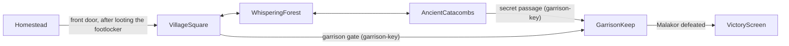

# Realm of Heroes CRPG
{: .no_toc }

*Realm of Heroes: A Night Without Memory* is a party-based, real-time-with-pause RPG in the style of the Infinity Engine games, written in GDScript for Godot 4.3 with D&D 5e SRD rules. It lives in `games/crpg-realm/` and is an early-access vertical slice. It is also the test bed for the Infinity AI scenario engine, which plays any fighter, monster or NPC, and its tests can record each run to video.
{: .fs-6 }

[Quick start]({{ '/projects/crpg-realm/quick-start.html' | relative_url }}){: .btn .btn-primary .mr-2 }
[Source on GitHub](https://github.com/nddipiazza/robos/tree/main/games/crpg-realm){: .btn }

<details open markdown="block">
  <summary>On this page</summary>
  {: .text-delta }
1. TOC
{:toc}
</details>

{: .robos-zoomable-img }
*A frame from a recorded test run in the village square. The activity log (bottom left) holds a numbered dialogue. The banner and the input stream at the top are test overlays.*

## Pages

| I want to | Read |
|:---|:---|
| Run the game or the tests | [CRPG quick start]({{ '/projects/crpg-realm/quick-start.html' | relative_url }}) |
| Look up a key or a HUD button | [CRPG controls]({{ '/projects/crpg-realm/controls.html' | relative_url }}) |
| Look up an autoload, data file, endpoint or variable | [CRPG reference]({{ '/projects/crpg-realm/reference.html' | relative_url }}) |
| Build a campaign in the visual editor | [CRPG campaign editor tutorial]({{ '/projects/crpg-realm/campaign-editor-tutorial.html' | relative_url }}) |
| Change the Godot project: scenes, items, traps, spells | [Extending the CRPG]({{ '/projects/crpg-realm/create-your-own-game.html' | relative_url }}) |
| Understand collision, pathfinding, fog of war and NPCs | [CRPG world systems]({{ '/projects/crpg-realm/world-systems-and-pathfinding.html' | relative_url }}) |
| Write or run tests, or use the Infinity AI engine | [CRPG testing and Infinity AI]({{ '/projects/crpg-realm/infinity-ai-agent-harness.html' | relative_url }}) |

The Godot project and the editor are separate programs. The editor ([`packages/crpg-editor`](https://github.com/nddipiazza/robos/tree/main/packages/crpg-editor), also listed as [RobOS cRPG Editor]({{ '/apps/crpg-editor/' | relative_url }}) in the app catalog) writes JSON-LD files into `games/crpg-realm/`, and the game plays them.

## What is in the repository

| Part | Where | What it is |
|:---|:---|:---|
| Game | `games/crpg-realm/` | Godot 4.3 project, GL Compatibility renderer, 1920x1080 viewport. Main scene: `CharacterSelect.tscn`. |
| Cartridges | `games/crpg-realm/cartridges/` | Six campaigns bundled as single JSON files, played by `CartridgeWorld.tscn`. |
| Hand-built scenes | `games/crpg-realm/scenes/` | Homestead, VillageSquare, WhisperingForest, AncientCatacombs, GarrisonKeep and TacticalBattle, with hard-coded encounters. |
| Scenario engine | `scripts/engine/ScenarioEngine.gd` | Data-driven D&D 5e rules and the Infinity AI. Used by tests and the Scenario Arena, not yet by the hand-built scenes. |
| Editor | `packages/crpg-editor/` | Electron app for campaigns, characters, items, enemies, spells, abilities and maps. |
| Bundler | `packages/crpg-builder/` | `crpg-cartridge.js` compiles a campaign and its maps, characters and items into a cartridge. |
| Blockout maps | `packages/robos-crpg-blockout/` | Python tool that renders grey-box maps and writes the 5-ft collision grid the scenario engine uses. |
| Tests | `games/crpg-realm/tests/e2e/` | Gherkin features run by `behave`. |

Characters and monsters render as 3D miniature pawns (`CharacterModel3D.gd`) in a 160x160 viewport, with sockets for a weapon, shield and helmet. Heroes pick from 9 races and 12 classes.

## The original campaign

The five hand-built scenes form the first campaign. Character Select starts a cartridge when one is selected; to play these scenes use `./debug.sh --scene Homestead` (see the [quick start]({{ '/projects/crpg-realm/quick-start.html#the-original-five-scene-campaign' | relative_url }})).



| Scene | What is in it |
|:---|:---|
| `Homestead.tscn` | You wake in the manor and meet Elora. You must loot the footlocker before the front door lets you leave. |
| `VillageSquare.tscn` | The hub. 11 buildings with collision, 12 townsfolk (including Blacksmith Brand, who gives the garrison key), a shop, ground items, and the locked Royal Garrison Gate. |
| `WhisperingForest.tscn` | Dire wolves, Goblin Peddler Griknok, Hermit Varis. |
| `AncientCatacombs.tscn` | Three placed traps, skeleton archers, the Spirit of Sir Justin, the Grand Sarcophagus (it holds a garrison key), and the secret passage to the keep. |
| `GarrisonKeep.tscn` | The fight with Captain Malakor, then `VictoryScreen.tscn`. |

The door-by-door detail is on the [scenes, doors and maps]({{ '/projects/crpg-realm/create-your-own-game/scenes-and-maps.html' | relative_url }}) page.

## How play works

Real time with pause. Space freezes the action; you can then queue moves with Shift-click, change the leader or formation, or pick a spell, and unpause. Keys and buttons are on the [controls page]({{ '/projects/crpg-realm/controls.html' | relative_url }}).

{: .robos-zoomable-img }
*Look at the edges: the portrait cards at top right, the action toolbar and the Sheet (C) button along the bottom, and the quest line above the toolbar.*

The activity log at the bottom of the screen carries combat rolls, dialogue and journal updates. It has three heights (124, 240 and 420 px; Tab or L cycles them). Dialogue replies appear as numbered lines in the log, and you pick one with the number key or a click.

{: .robos-zoomable-img }
*A conversation with Guildmaster Aldous in the village square: the numbered replies are lines in the log, with no popup.*

Combat, in the hand-built scenes, uses d20 attack rolls against AC with advantage and disadvantage, saving throws, and a threat table for enemy targeting. [Combat, party and spells]({{ '/projects/crpg-realm/create-your-own-game/combat-party-and-spells.html' | relative_url }}) covers the formulas, the six formations and the spell code.

{: .robos-zoomable-img }
*Real-time-with-pause combat in the tactical arena. The log at the bottom shows the attack rolls and the pack alert.*

## How it is tested

The tests treat the game as a black box. `behave` features drive the running game over its local HTTP API, and in human mode `ffmpeg` records each scenario from a virtual X display.

| Suite | Folder | Features | What it covers |
|:---|:---|---:|:---|
| Engine | `features/engine/` | 13 | Rules, spells, AI directives, items, traps, movement, blockout maps, fuzzed battles. Can run headless with no video. |
| Normal | `features/normal/` | 18 | One mechanic per feature in the real scenes: fog of war, shop, looting, traps, aggro, formations, pathfinding |
| Spells | `features/spells/` | 24 | One feature per spell or fighter ability |
| Scenario adventures | `features/scenarios/` | 4 | Stories loaded from a campaign file and played through the real scenes |
| Full playthroughs | `features/full_playthroughs/` | 6 | Start-to-finish runs |

```bash
cd games/crpg-realm
python3 run_cucumber_tests.py --engine --backend
```

In human mode each scenario opens with a splash card showing its name, so the video explains itself.

{: .robos-zoomable-img }
*The splash card at the start of a recorded scenario, drawn over Character Select. The step banner at top left and the input stream at top right are test overlays.*

[CRPG testing and Infinity AI]({{ '/projects/crpg-realm/infinity-ai-agent-harness.html' | relative_url }}) explains the layers and how to write a scenario.

## Interactive courses

Two quiz-style courses are published with these docs: [the cRPG course]({{ '/projects/crpg-realm/elearning/' | relative_url }}) and [Game Builder Academy]({{ '/projects/crpg-realm/create-your-own-game/elearning/' | relative_url }}). They are generated from the knowledge graph (`.robos/kgraphs/learning/package.jsonld`) by a script, not written from these pages, so check them against the pages here.

## Known limits

- **Two rule systems.** The hand-built scenes use hard-coded numbers in GDScript. For example, the Malakor fight uses 48 HP and AC 14 in `GarrisonKeep.gd`, although `monsters.json` says 58 HP and AC 16. Initiative order, death saving throws and per-level spell slots exist only in the scenario engine. [CRPG reference]({{ '/projects/crpg-realm/reference.html#data-v1-files' | relative_url }}) lists which data files each system reads.
- **Adding a spell to the hand-built scenes needs code.** Each spell is a branch in `CombatManager.gd`. A new entry in `spells.json` alone does nothing there.
- **Mods only add traps.** `DataStoreV1.gd` reads `traps_file` from a `mod.json` and nothing else.
- **The HTML test report cannot tell pass from fail.** It marks a scenario PASSED when its video exists. Use the `behave` exit code.
- **Do not regenerate the game with `packages/crpg-builder`.** It would overwrite hand-edited data and `project.godot`. See the [reference]({{ '/projects/crpg-realm/reference.html#data-v1-files' | relative_url }}).
- **Browser builds** (`export_web.sh`) have no control server, so the tests cannot run against them.
