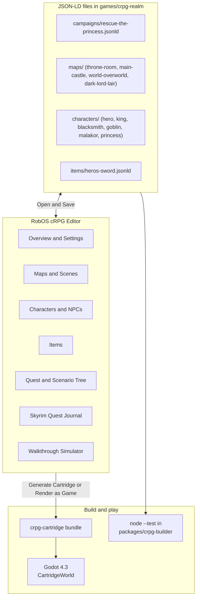
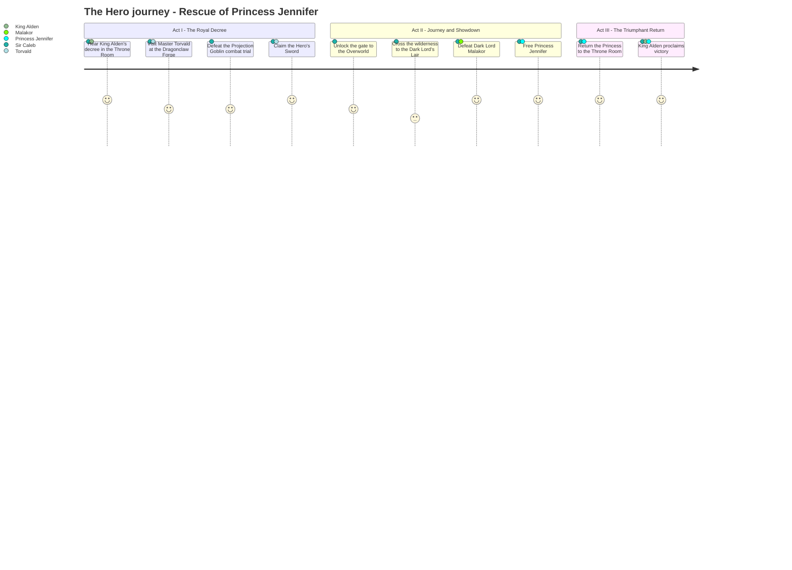
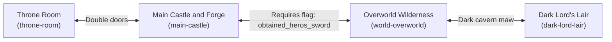
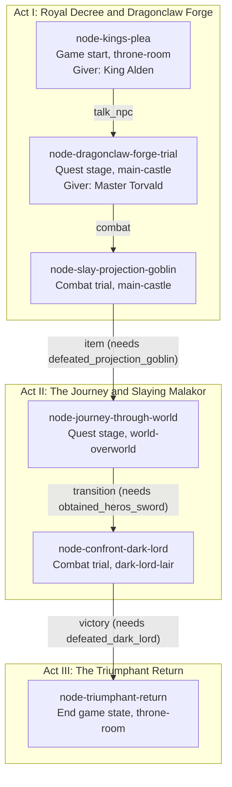
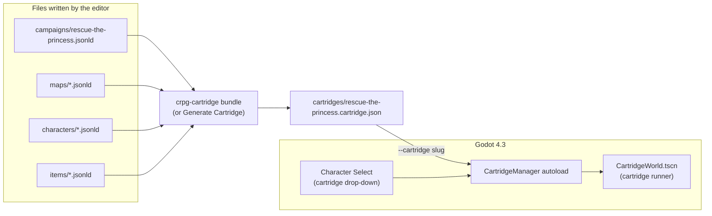

# CRPG campaign editor tutorial
{: .no_toc }

Walks through the RobOS cRPG Editor using the campaign that ships with the game, *Rescue of Princess Jennifer*. You open it, see which file each tab edits, bundle it into a cartridge and start it in Godot. The last section says what the game runtime does with a cartridge today, which decides how much of a new campaign you can play.
{: .fs-6 }

<details open markdown="block">
  <summary>On this page</summary>
  {: .text-delta }
1. TOC
{:toc}
</details>

## What the editor is

The editor is an Electron app in [`packages/crpg-editor`](https://github.com/nddipiazza/robos/tree/main/packages/crpg-editor). It reads and writes JSON-LD files directly in `games/crpg-realm/`. There is no database and no export step: Save writes the file, and the game reads the same file.

{: .robos-zoomable-img }
*Concept diagram from the original design docs. The text on this page says what is built today, for example that the cartridge runner does not play the story tree.*



| Editor tab | Folder it edits (`games/crpg-realm/`) |
|:---|:---|
| Campaign | `campaigns/<slug>.jsonld` |
| Characters & NPCs | `characters/<slug>.jsonld` |
| Items | `items/<slug>.jsonld` |
| Enemies | `enemies/<slug>.jsonld` |
| Spells | `spells/<slug>.jsonld` |
| Abilities | `abilities/<slug>.jsonld` |
| Maps | `maps/<slug>.jsonld`, and `assets/blockouts/<slug>.png` when you build |

The editor also edits `events/` and lists `scenes/`. Set the environment variable `ROBOS_CRPG_DIR` to point it at a different game folder.

Start it from the repository:

```bash
cd packages/crpg-editor
npm install
npm start
```

`npm start` runs `electron . --no-sandbox --disable-gpu --disable-dev-shm-usage`. Installed RobOS desktops also list it as the app [RobOS cRPG Editor]({{ '/apps/crpg-editor/' | relative_url }}).

## Open the shipped campaign

Pick **Rescue of Princess Jennifer** in the **Campaign:** drop-down at the top right. The status bar at the bottom shows the file that was loaded, `games/crpg-realm/campaigns/rescue-the-princess.jsonld`. The header buttons are **+ New**, **Save**, **Render as Game**, **Generate Cartridge** and a delete button.

The Campaign tab has eight sub-tabs: Overview & Settings, Quest & Scenario Tree, Skyrim Quest Journal, Maps & Scenes, Characters & NPCs, Party & Inventory, Infinity AI Tactics & Arena, and Story Flags.

The story the shipped campaign tells, act by act:



### Overview & Settings

{: .robos-zoomable-img }
*The fields on the left are the campaign's title, slug, world setting, rule system, difficulty, starting scene and synopsis. The counters on the right come from the file.*

These fields map to keys in the campaign file:

| Field | Key in `campaigns/rescue-the-princess.jsonld` |
|:---|:---|
| Campaign Title | `dcterms:title` |
| World Setting | `robos:setting` (`The High Kingdom of Eldoria`) |
| Rule System, Difficulty Mode | `robos:ruleSet` (`D&D 5e SRD`), `robos:difficulty` (`Core Rules`) |
| Starting Scene | `robos:startingMap` (`throne-room`) |
| Prologue / Story Synopsis | `dcterms:description` |

The file's type is `["robos:CRPGCampaign", "schema:CreativeWork"]` and its id is `urn:robos:crpg:campaign:rescue-the-princess`.

### Maps & Scenes

{: .robos-zoomable-img }
*The table in the middle lists the three connections between the four maps. The last row of the screenshot is the editor's simulator for walking a party through them.*

This tab sets the starting map, spawn point and facing (`robos:startingSpawn`), which maps belong to the campaign (`robos:maps`, one URN per map), and the connections between them. Use **Add Connection** to add a row and **Validate Topology** to check the graph.

The shipped campaign's three connections, all two-way, with the one gate:



A connection is an entry in `robos:mapConnections`. This is the one that gates the overworld behind the Hero's Sword:

```json
{
  "id": "conn-castle-to-world",
  "fromMap": "main-castle",
  "fromObjectId": "castle-world-gate",
  "toMap": "world-overworld",
  "toObjectId": "castle-road-entry",
  "toSpawn": [15, 20],
  "toFacing": "east",
  "transitionType": "portal",
  "bidirectional": true,
  "requiredKey": null,
  "requiredFlag": "obtained_heros_sword",
  "label": "Castle Gate to World Realm (Requires Hero's Sword)"
}
```

`fromObjectId` must match the `robos:objectId` of an object on the `fromMap`. The cartridge runner reads `fromMap`, `fromObjectId`, `toMap`, `toObjectId`, `toSpawn`, `bidirectional` and `requiredFlag`. It ignores `requiredKey`.

### Characters & NPCs, Items, Party & Inventory

{: .robos-zoomable-img }
*The roster at the left lists every character file, with filters for player characters and NPCs. The form on the right edits the selected file: here Sir Caleb, a level 1 Human Fighter.*

Characters are separate files that the campaign lists in `robos:characters`. The shipped campaign lists six: `hero-sir-caleb`, `npc-king-alden`, `npc-blacksmith-torvald`, `creature-projection-goblin`, `boss-dark-lord-malakor` and `npc-princess-jennifer`. The top-level **Characters & NPCs** tab edits them: its **File** menu has New Player Character, New NPC and Save Character. A hero file carries class, level, ability scores and equipment:

```json
{
  "@id": "urn:robos:crpg:character:hero-sir-caleb",
  "@type": ["robos:CRPGCharacter", "robos:CRPGHero", "schema:Person"],
  "name": "Sir Caleb",
  "class": "Fighter", "subclass": "Champion", "race": "Human", "level": 1,
  "hpMax": 16, "armorClass": 14, "speed": 30,
  "stats": { "str": 16, "dex": 14, "con": 15, "int": 10, "wis": 12, "cha": 13 },
  "robos:modelAssetRef": "res://assets/models/character_knight_pawn.glb",
  "robos:equipped": { "main_hand": "clothes", "body": "leather-armor" }
}
```

(Abridged. Most keys appear twice in the file, once with the `robos:` prefix and once without.) NPC files add `role`, `interactionType`, `location`, `col`, `row`, `facing` and a `dialogue` array of strings.

The **Items** tab edits one item per file. Its form has Item Name, Unique Slug, Category, Equip Slot, Gold Cost (GP), Weight (lbs), Rarity, Damage Dice, Damage Type, Base AC or Bonus, Consumable Effect and a 3D model section. The Hero's Sword is `items/heros-sword.jsonld`: category `weapon`, slot `main_hand`, rarity `rare`, cost 500, damage `1d8` slashing, and the effect text `+3 ATK, Dragonclaw Rune`.

{: .robos-zoomable-img }
*The Item Library lists one file per item. The blueprint form shows the Hero's Sword fields: slug, category, equip slot, cost, weight, rarity, damage dice, damage type and lore.*

The Party & Inventory sub-tab edits `robos:gameState`: the active party, party formation, shared purse and starting inventory (`gold: 100` and one `potion-healing` in this campaign).

### Quest & Scenario Tree and Skyrim Quest Journal

{: .robos-zoomable-img }
*Each card is a story node. The pills at the bottom of a card are its choices, labelled with what triggers them (talk to an NPC, combat trial, area transition). The panel on the right edits the selected node.*

The six story nodes in the shipped campaign, as stored in `robos:storyFlow`:



The story tree edits `robos:storyFlow`: a `robos:rootNodeId`, three `robos:flowPages` (the acts) and six `robos:storyNodes`. A node has a `robos:nodeType` (for example `game_start`, `quest_stage`), a `robos:location` map, a `robos:giver` and `robos:choices`. Each choice has a `targetNodeId` and a `robos:triggerType` such as `talk_npc` or `combat`.

The journal edits `robos:questLog`. The campaign has a main quest (`quest-rescue-princess`) and a side quest, each with `robos:questObjectives`, numbered `robos:questStages` (0, 10, 20 and so on) and `robos:questRewards`.

{: .robos-zoomable-img }
*The quest list at the left shows the main quest, Rescue of Princess Jennifer, and the side quest, The Dragonclaw Blade Trial. The main quest's checkbox objectives and numbered journal stages are on the right.*

{: .robos-zoomable-img }
*Look at the toolbar above the tree: the Walkthrough Simulator button starts a walkthrough of the story from the selected node, and the status bar at the bottom reports "Started Interactive Story Walkthrough".*

The Story Flags sub-tab edits `robos:worldFlags`. This campaign starts with `princess_kidnapped` and `talked_to_king` set to true and five more set to false, including `obtained_heros_sword`.

### Maps tab

The **Maps** tab edits one map at a time. Its toolbar has **+ New**, **Open**, **Close**, **Save**, **Build PNG & Grid** and **Export PNG**. The canvas tools are Select, Place and Pan (keys V, P and H), with Undo and Redo on Ctrl+Z and Ctrl+Y, and Ctrl+S saves.

A map is a `robos:CRPGBattleMap` with a width and height in feet, a base terrain (the editor offers stone, grass, dirt, wood, sand, snow and cave) and a list of `robos:mapObjects`. The throne room is 50 by 40 ft with three objects. This one, abridged, is the exit door to the courtyard:

```json
{
  "@type": "robos:CRPGMapObject",
  "robos:objectId": "castle-exit-door",
  "robos:objectType": "passage",
  "robos:shape": "rect",
  "robos:position": [23, 36],
  "robos:size": [4, 3],
  "robos:transition": { "targetMap": "main-castle", "targetSpawn": [25, 8],
                        "targetFacing": "south", "transitionType": "door" }
}
```

The object's `robos:transition` block is read by the navigator in `packages/crpg-builder` (and so by the editor's simulator and the bundler tests). The game takes passage destinations from the campaign's `robos:mapConnections`, not from this block, so keep the two in step.

**Build PNG & Grid** runs `python3 -m robos_crpg_blockout build` for the open map. It draws a grey-box image into `assets/blockouts/` and writes a 5-ft collision grid into the map file. The scenario engine uses that grid for tests ([testing page]({{ '/projects/crpg-realm/infinity-ai-agent-harness.html' | relative_url }})); the cartridge runner does not. It needs Python 3 and Pillow. The tool's own documentation is the [blockout README](https://github.com/nddipiazza/robos/blob/main/packages/robos-crpg-blockout/README.md).

{: .note }
The Rescue maps were not built with that tool. `throne-room`, `main-castle` and `dark-lord-lair` contain objects of type `spawn`, and `dark-lord-lair` has terrain `dungeon`. `python3 -m robos_crpg_blockout validate` rejects both. None of the four has a file in `assets/blockouts/`. They are drawn in the cartridge runner over background art (`robos:backgroundImage`).

## Build a cartridge

A cartridge bundles a campaign with the maps, characters, items, enemies, spells and quests it references into one file.



In the editor, press **Generate Cartridge**. From a shell, use the bundler:

```bash
node packages/crpg-builder/bin/crpg-cartridge.js bundle rescue-the-princess
node packages/crpg-builder/bin/crpg-cartridge.js bundle-all
node packages/crpg-builder/bin/crpg-cartridge.js list
node packages/crpg-builder/bin/crpg-cartridge.js inspect rescue-the-princess
```

Both write `games/crpg-realm/cartridges/<slug>.cartridge.json`. `bundle` accepts an output path as a third argument. `inspect` prints the header, the maps with their background images, and the ids of the characters, items and quests. For the shipped campaign the header reads 4 maps, 6 characters, 12 items, 9 enemies, 26 spells and 2 quests.

The bundler finds maps through `robos:maps`, the starting map and every `fromMap` and `toMap` in the connections. It finds characters through `robos:characters`, the active party and `robos:heroes`, and items through the heroes' equipment and inventory.

## Play it

Character Select shows every cartridge in a drop-down with **Play** and **Auto-Play** buttons. Or skip the menu:

```bash
cd games/crpg-realm
./play.sh --cartridge rescue-the-princess
```

**Render as Game** in the editor does three things. It saves the campaign, rebundles the cartridge into `games/crpg-realm/cartridges/`, and overwrites `games/crpg-realm/data/v1/active_campaign.json`. Then it starts Godot with `--path games/crpg-realm --cartridge <slug>`, looking for the binary in `$GODOT_BIN`, `~/.local/bin/godot`, `~/.local/bin/godot4`, `~/apps/godot4`, `/usr/bin/godot4`, `/usr/local/bin/godot4` and `/usr/bin/godot`, and falling back to `play.sh`.

In the cartridge map, left-click to move and click NPCs, chests, items and passages to walk to them. Space or P starts and stops auto-play. See [controls]({{ '/projects/crpg-realm/controls.html#cartridge-maps' | relative_url }}).

## What the game plays today

The cartridge runner is `scripts/CartridgeWorld.gd`. It reads these things generically from any cartridge:

- Maps. Width, height, terrain, `robos:backgroundImage` and `robos:mapObjects`. Objects of type `wall`, `pillar` and `dais` become obstacles. Type `chest` (or an id containing `chest`) becomes a chest. Types `item`, `weapon`, `pickup`, `loot` and `equipment` become pickups. Types `passage`, `door` and `portal` become map transitions through the campaign's `robos:mapConnections`.
- The campaign state. `robos:heroes`, the shared inventory, world flags and the quest log go into `GameState`.
- Items, NPCs and monsters are added to `DataStore`.

It does not read these generically:

- NPC placement and dialogue. NPCs are placed by `_spawn_map_npcs`, which tests the map slug and the character slug against fixed strings (`throne-room` with `king`, `main-castle` with `torvald`, `dark-lord-lair` with `malakor`, and the Dragon Warrior equivalents). The `location`, `col`, `row` and `dialogue` fields in a character file are not used. The lines NPCs speak are strings in `_interact_with_npc`.
- Story logic. The quest steps (accept the quest, win the goblin trial, claim the sword, defeat the boss, escort the princess, victory) are functions in `CartridgeWorld.gd` for two stories, Rescue the Princess and Dragon Warrior. The story tree in `robos:storyFlow` is bundled into the cartridge as `storyDAG` but not played.
- Chest contents are chosen from the chest's object id (`120g`, `key`, `torch`, `sword`, `herb`).

So a new campaign gets its maps, walls, chests, pickups and passages in the game. Its NPCs, dialogue and quest steps need code in `CartridgeWorld.gd` until a generic runner exists. Treat the editor as an authoring tool for the data, and the Rescue the Princess campaign as the one end-to-end example.

Some cartridges do not use the cartridge runner at all. When it starts a cartridge, `CartridgeManager.embark_cartridge` loads the hand-built `Homestead` scene if the starting map's slug contains `candlekeep` or `homestead`, `VillageSquare` for `village`, and `AncientCatacombs` for `catacomb`. The slugs `throne-room`, `main-castle`, `world-overworld`, `dark-lord-lair`, `tantegel-throne-room` and `charlock-castle` always go to `CartridgeWorld`. That is why `candlekeep-prologue` opens in the Homestead scene.

## Verify your files

The bundler package has tests for the shipped campaign: starting map and spawn, the chain of map connections and the flag gate on the overworld, the story flow, and the quest journal. They use Node's built-in runner, not Jest:

```bash
cd packages/crpg-builder
node --test tests/rescue-princess-tutorial.test.js tests/cartridge-system.test.js
```

Use `node --test tests/*.test.js` for all of the package's tests. The editor package has its own, `npm test` in `packages/crpg-editor`, which covers the map undo history.
