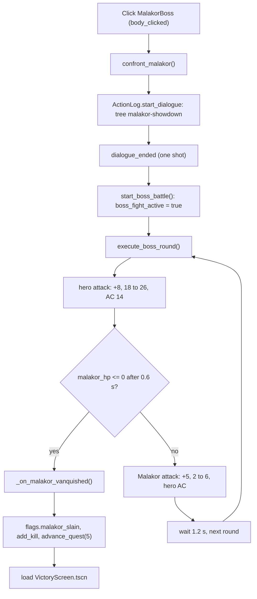

# Combat, party and spells
{: .no_toc }

How combat works in the real-time scenes of `games/crpg-realm`: the attack formula and the numbers each scene passes to it, the Malakor boss fight, party formations, enemy targeting and the spell code. The data-driven rules engine used by the tests is separate and is covered on the [testing page]({{ '/projects/crpg-realm/infinity-ai-agent-harness.html' | relative_url }}).
{: .fs-6 }

  
On this page

  {: .text-delta }
1. TOC
{:toc}

## How an attack resolves

`CombatManager.execute_attack(attacker_name, attack_bonus, damage_dice_min, damage_dice_max, target_name, target_ac, target_pos)` is the one melee roll. `execute_ranged_attack` is the same with different condition rules. The function:

1. Rolls two d20s. If the attacker has `blinded`, `poisoned`, `frightened` or `prone` (disadvantage) and not also an advantage condition, it keeps the lower roll. If the target is `blinded`, `paralyzed`, `prone`, `stunned` or `unconscious` (advantage) it keeps the higher. Both cancel out.
2. A `blessed` attacker adds 1d4 to the attack bonus. A `shield` on the target adds 5 to its AC, and `hasted` adds 2.
3. A natural 20 is a critical hit and always hits. A natural 1 always misses. Otherwise it hits if `d20 + attack_bonus >= target_ac`. A `paralyzed` or `unconscious` target is always critically hit.
4. Damage is a random integer between `damage_dice_min` and `damage_dice_max`. A critical hit rolls that range twice and adds the results. There are no dice expressions and no ability modifier.

It returns `{d20, total_attack, hit, crit, damage}`, logs the roll to the activity log and shows floating text.

The numbers come from the caller. Each scene script hard-codes them, and equipped weapons and ability scores do not feed in:

| Caller | Attacker | Bonus | Damage | Target AC |
|:---|:---|---:|:---|:---|
| `VillageSquare` melee at the hound | hero | +8 | 24 to 30 | the hound's `armor_class` |
| `VillageSquare` ranged at the hound | hero | +6 plus DEX modifier | 24 to 30 | same |
| `WhisperingForest` | hero | +7 | 20 to 30 | the beast's AC |
| `AncientCatacombs` | hero | +8 | 22 to 30 | the target's AC |
| `GarrisonKeep` | hero against Malakor | +8 | 18 to 26 | 14 |
| `GarrisonKeep` | Malakor against hero | +5 | 2 to 6 | `GameState.hero_ac` |
| `TacticalBattle` | hero | +10 | 30 to 32 | the enemy's `armor_class` |

Several callers ignore the result. `VillageSquare` calls `hound.take_damage(99)` whatever was rolled, and `TacticalBattle.execute_hero_attack_on_enemy()` applies `randi_range(30, 32)` damage even on a miss. These scenes check the flow, not balance.

`TacticalEnemy` rolls its own attack every 2.4 seconds while in the attack state: d20 plus `attack_bonus` against the target's AC, then a random integer from `damage_min` to `damage_max`. At 0 HP the hero gets `unconscious` and `GameState.check_party_defeat()` runs. The six-second round counter (`GameState.ie_round`) only timestamps events. There is no initiative order or turn order in these scenes.

## The Malakor fight

The fight is scripted entirely in `scripts/GarrisonKeep.gd`. Malakor is not a `TacticalEnemy`. He is the `MalakorBoss` node: an `Area2D` running `ClickableObject.gd`, with a sprite, label, `BossHPBar`, `BossHPText` and collision shape. His HP and AC are variables and literals in the scene script, 48 HP and AC 14, although `monsters.json` lists `captain-malakor-boss` with 58 HP and AC 16.

- A click from anywhere starts it. There is no range check.
- The `malakor-showdown` tree in `data/v1/dialogue.json` runs first. Its `node_fight` has an empty `choices` array, which makes the log show one continue button; closing the dialogue emits `dialogue_ended` and starts the loop. If you rename the tree, change the id in `confront_malakor()` too. If the tree is missing, the dialogue closes before the signal is connected and the fight never starts.
- The loop alternates a hero swing and a Malakor swing until his HP is 0, then sets `flags.malakor_slain`, calls `GameState.advance_quest(5)` and loads `VictoryScreen.tscn`, which shows name, class, kills, chests and gold, with a replay button.
- The loop ignores party defeat, and it does not stop if the `attack_malakor` API action starts a second loop beside it, which can run the victory function twice. Not built: boss phases, shields, summoned minions, initiative.

To make the fight read `monsters.json`, add a `malakor_ac` variable, set `malakor_max_hp`, `malakor_hp` and the AC from `DataStore.monsters["captain-malakor-boss"]` (a `MonsterData` with `hit_points` and `armor_class`) in `_ready()`, update the `BossHPBar` maximum (the scene hard-codes 48), and use the variable in `execute_boss_round()`. To add a phase, keep a phase variable, check `malakor_hp * 2 <= malakor_max_hp` after the hero's swing, and use phase-dependent attack numbers in his strike.

The HTTP actions for the fight are `confront_malakor`, `attack_malakor` (calls `execute_boss_round()`) and `defeat_malakor`, which sets the flag and loads the victory screen without running the fight. Full playthrough features 01 to 04 finish with `defeat_malakor`, so they do not exercise the loop. Features 05 and 06 click `MalakorBoss`, so they do.

## Party and formations

### Data and nodes

| What | Where |
|:---|:---|
| Party data | `GameState.party_members` (array of dictionaries). Index 0 is the hero. |
| Hero node | `HeroPlayer.tscn`, named `HeroPlayer`. Owns the camera and handles input. |
| Companion nodes | `PartyCompanion.tscn`, a separate and smaller class with `companion_id` and `companion_name` exports |
| Leader | `GameState.party_leader_index`, default 0 |
| Formation | `GameState.current_formation`, default `"rank"` |

`GameState.get_scene_party_nodes()` maps data to nodes: index 0 is the node named `HeroPlayer`, and each later member is the direct child `CharacterBody2D` whose `companion_id` or `companion_name` matches. `TacticalBattle.tscn` places two companions, `CompanionElora` and `CompanionThrumbar`; the location scripts add one `PartyCompanion` in `_ready()` when the party has more than one member.

`set_party_leader(idx)` is the only call that changes the leader. A left-click on a portrait calls `select_party_member(idx)` and then `set_party_leader(idx)`. The keys 1, 2 and 3 only select. The camera stays a child of `HeroPlayer` and adds the offset to `get_leader_node()` each frame.

### The six formations

`GameState.FORMATIONS` maps an id to six slot offsets, written for a party walking up the screen, so a positive y is behind the leader. Slot 0 is the leader's.

| id | Log title | Slot 0 | Slot 1 | Slot 2 | Slot 3 | Slot 4 | Slot 5 |
|:---|:---|:---|:---|:---|:---|:---|:---|
| `rank` | Rank & File | (0, 0) | (48, 0) | (0, 48) | (48, 48) | (0, 96) | (48, 96) |
| `wedge` | Wedge (V-Formation) | (0, 0) | (-48, 44) | (48, 44) | (-96, 88) | (96, 88) | (0, 75) |
| `line` | Shield Wall (Abreast) | (0, 0) | (48, 0) | (-48, 0) | (96, 0) | (-96, 0) | (144, 0) |
| `column` | Marching Column | (0, 0) | (0, 48) | (0, 96) | (0, 144) | (0, 192) | (0, 240) |
| `square` | Defensive Square | (-35, 0) | (35, 0) | (-35, 70) | (35, 70) | (0, 35) | (0, 100) |
| `scatter` | Skirmish (Scatter) | (0, 0) | (-70, 35) | (65, 50) | (-40, 85) | (80, 100) | (0, 120) |

`get_formation_offsets()` rotates each offset by the travel angle plus 90 degrees, so the shape turns to face the direction of travel. An unknown id falls back to `rank`, and a seventh member gets `(0, 48 * i)`.

A left-click that no UI control handles reaches `HeroPlayer._unhandled_input()`, which calls `GameState.move_party_formation(click_pos, is_shift)`. The leader gets slot 0 and the others get slots 1, 2 and so on in party order, skipping the leader. Each member's destination is the click plus its rotated offset. Between clicks, a `PartyCompanion` that is not the leader walks toward its slot next to the leader whenever it is more than 65 px away, except in `TacticalBattle`, where only explicit orders move it.

To add a formation, add a key with six offsets to `FORMATIONS`, add a `match` case for its log title in `set_party_formation()`, copy a formation button in `scenes/components/ActionToolbar.tscn`, and wire it in `ActionToolbar.gd` (a `find_child`, a `pressed` connection and an entry in `_update_formation_buttons`). The HTTP action `formation_<id>` works without edits.

Limits: companions do not use `Pathfinder` (they walk straight and slide on walls), `square` puts the leader 35 px off the click, and `HeroPlayer` follows slot 1 when a companion leads. Test with `normal/14_party_independent_dynamics_and_formations.feature`.

## Enemies and threat

Two enemy scripts exist.

| Script | Used in | Behaviour |
|:---|:---|:---|
| `TacticalEnemy.gd` (scene `components/TacticalEnemy.tscn`) | `TacticalBattle.tscn`: `EnemyWolfAlpha`, `EnemySkeletonArcher`, `EnemyShadowStalker` | Threat table, proximity aggro, pack alerts. Every stat is an `@export`; it does not read `monsters.json`. |
| `ShadowHound.gd` (scene `ShadowHound.tscn`) | `VillageSquare`, `WhisperingForest`, `AncientCatacombs` | Patrols and chases the hero within 190 px. No threat table or pack logic. The location script handles the fight. |

{: .robos-zoomable-img }
*From the pack-alert scenario in `TacticalBattle`. Read the log at the bottom: the wolf targets Vance with a threat value, and the archer and stalker are alerted to defend their ally.*

The rest of this section is about `TacticalEnemy`.

| Export | Default | Meaning |
|:---|---:|:---|
| `aggro_radius` | 280 | A hostile enemy on patrol targets the closest party member inside this radius |
| `pack_friend_radius` | 480 | After a proximity aggro, allies inside this radius rally |
| `pack_alert_radius` | 950 | After an enemy takes damage, allies inside this radius join in |
| `friends` | none | Enemy ids that always count as allies, at any distance, in both directions |
| `is_hostile` | true | `false` ignores proximity and alerts; damage still builds threat |
| `max_hp`, `armor_class`, `attack_bonus`, `damage_min`, `damage_max` | 28, 13, 4, 4, 10 | Stats |
| `is_ranged`, `ranged_standoff_distance` | false, 240 | Ranged enemies stop at the standoff distance |
| `waypoints` | none | Patrol route. With none, the enemy stands still. |

The state machine is `PATROL`, `CHASE`, `ATTACK`, `DEAD`. It re-checks proximity every 0.45 seconds. Chasing walks straight at the target (no pathfinding) until within 50 px (or the standoff distance), then attacks every 2.4 seconds, and falls back to chasing beyond 65 px. The corpse stays and can be looted.

**Threat.** Each enemy keeps a `threat_table` and a `direct_damage_table`, keyed by display name. A hit adds `damage * 2 + 10` threat. The enemy switches target when it has none, when its target has dealt no damage yet and the new source has, or when the new source's threat exceeds `int(current * 1.15) + 3`. Proximity aggro does not write threat, only a log value of 30, so the first party member to deal damage takes the enemy over. `force_taunt(source, threat)` switches unconditionally; `TacticalBattle.execute_taunt_on_enemy` calls it with 60, and only the HTTP action `taunt_enemy` reaches that.

**Pack alerts.** Damage from an attacker calls `_alert_friends`, which gives each living hostile `TacticalEnemy` sibling that is linked or within `pack_alert_radius` threat of `int(damage * 0.75) + 35` (linked) or `+ 20` (not). Proximity aggro calls `_alert_friends_proximity` for allies within `pack_friend_radius` or linked, with threat 25. `take_damage(amount, attacker)` needs a real attacker node to build threat and alert the pack; with `null` it only lowers HP.

To place a pack, instance `TacticalEnemy.tscn` twice as direct children of the scene root, set stats, `enemy_id`, a `sprite_texture_path` and `friends` on each, and connect `body_clicked` in the scene script so clicks do something. Do not add enemies to `TacticalBattle.tscn`: feature `normal/06_infinity_aggro_threat_and_target_switching.feature` asserts it contains 3. That feature covers threat switching, taunt, pack alerts, proximity rally and a passive enemy.

## Spells

### Where the code is

Spells in the real-time scenes are resolved by `match` blocks on the spell id in `scripts/CombatManager.gd`:

| Method | Handles |
|:---|:---|
| `execute_cast_spell(caster_name, spell_id, target_name, target_node)` | `magic-missile`, `cure-wounds`, `healing-word`, `shield`, `sleep`, `mage-armor`, `burning-hands`, `thunderwave`, `bless`, `hold-person`, `spiritual-weapon`, `fireball`, `lightning-bolt`, `blizzard`, `stinking-cloud`, `haste`, `counterspell`, `find-traps`, `knock`, `invisibility`, `dispel-magic`, `sanctuary`, `see-invisibility`, and the fighter abilities `tremor-stomp`, `crushing-cleave`, `rallying-stomp` |
| `execute_aoe_spell(caster_name, spell_id, target_center, radius = 180, save_dc = 14, save_stat = "DEX", caster_node)` | `fireball`, `burning-hands`, `thunderwave`, `lightning-bolt`, `blizzard`, `stinking-cloud`, `sleep` |

Before the `match`, `execute_cast_spell` refuses a target that is invisible (unless the caster can see invisible) or under Sanctuary (except for `cure-wounds`, `healing-word` and `sanctuary`). An id with no branch hits the default: it logs "X casts Y!" and returns `success: true` without doing anything.

`data/v1/spells.json` has 26 entries. Each now has a `mechanics` block that the scenario engine reads, but `DataStore.spells` is not read by any gameplay script. So a new spell for the real-time scenes needs a branch in `CombatManager.gd`. Add the JSON entry as well, so the scenario engine and the lists know the spell.

`TacticalBattle.execute_spell_cast()` is what the HTTP `cast_spell` action calls in `TacticalBattle`. It sends the seven area ids to `execute_aoe_spell(..., hero)` and everything else to `execute_cast_spell()`. Radius and save: `fireball` 180 px (DC 14 DEX), `burning-hands` 150 px (DEX), `thunderwave` 150 px (CON), `lightning-bolt` 450 px (DEX), and `blizzard`, `stinking-cloud` and `sleep` from `GameState.SPELL_AOE_FEET`, which is 20 ft at 9 px per foot, so 180 px (`stinking-cloud` saves with CON).

### Fireball

`fireball` rolls eight d6 once (8d6) and shares the total across all targets. Candidates are the scene's `enemies` dictionary (`TacticalBattle` has one) plus every `TacticalEnemy` that is a direct child of the scene. Each living candidate within `radius` pixels of the point rolls d20 plus its `dex_save_mod` export (default 2) against the DC, and takes half damage, rounded up, on a pass. `take_damage(dmg, caster_node)` builds threat and alerts the pack only when `caster_node` is not null. The return value has the dice, the total, the DC and a `targets_hit` list with each target's save and HP before and after. The HTTP API returns it as `telemetry`.

### Visuals

`HeroPlayer.play_cast_spell(spell_id, target_pos, on_cast_callback)` plays the cast animation. Some spells have their own effect function; the rest, fireball included, use a generic orb that flies to the target and bursts. The rules and the visual are separate: the caller invokes `CombatManager`, usually from the callback. Projectile and burst meshes come from `scripts/SpellModel3D.gd`.

### The toolbar Spell button

`ActionToolbar` uses only the first prepared spell. `cure-wounds` heals the hero. `find-traps` calls `cm.cast_spell`, which `CombatManager` does not define, so it raises an error in any scene with a `CombatManager`. Any other spell looks for a node named `BlightHound`, which no scene contains, and does nothing. Cast spells through the HTTP `cast_spell` action in `TacticalBattle` for now.

### Add a spell

1. Add an object to `data/v1/spells.json`. Include a `mechanics` block if you want the scenario engine to cast it.
2. In `CombatManager.execute_cast_spell()`, add a branch above the final `_:` branch. Follow `magic-missile`: log with `_log_combat`, play `spell_cast` and `spell_impact` through `AudioManager.play_sfx`, apply damage with `target_node.take_damage(...)`, and return a dictionary with `success`. `ShadowHound.take_damage(amount)` takes one argument and `TacticalEnemy.take_damage(amount, attacker = null)` takes two.
3. Test it with a feature under `tests/e2e/features/spells/`. Use the existing steps from `spell_01_magic_missile.feature`: `Given an isolated tactical spell encounter "combat_dummy" with hero "Ignis" class "wizard" and 35 HP`, `When the hero targets "dummy_1" and casts spell "<id>"`, `Then the spell "<id>" resolves successfully`. `resolves successfully` alone proves little, because the default branch also returns success, so add checks on damage or log text.

`sanctuary` and `see-invisibility` have no file in `spells/`. They are covered by `normal/17_invisible_enemy_and_sanctuary_targeting.feature`.
