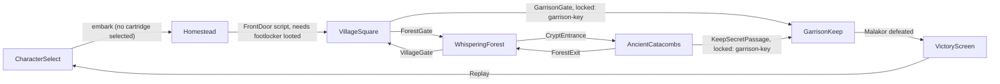

# Scenes, doors and maps
{: .no_toc }

How a hand-built location scene is put together: the node tree, the global singletons, door portals, and the collision and camera setup that click-to-move depends on. Read it before adding a location to `games/crpg-realm`.
{: .fs-6 }

## The scene tree

A `.tscn` file is a saved tree of nodes, and a script on a node adds behaviour. One scene is the current scene at a time (`get_tree().current_scene`). A location change replaces it with `change_scene_to_file("res://scenes/X.tscn")`. Each location, such as `AncientCatacombs`, is one scene in `scenes/` with a matching script in `scripts/`.

This is `scenes/AncientCatacombs.tscn`, with the repeated siblings collapsed. It is flat: there is no container node for entities.

```text
AncientCatacombs (Node2D, y_sort_enabled = true, script AncientCatacombs.gd)
  CombatManager (Node, CombatManager.gd)
  Ground (TextureRect 2560x1440, mouse_filter = 2)
  CatacombBoundaries (StaticBody2D)
    WestBorder, EastBorder, NorthBorder, SouthBorder, WallLeftVault, WallRightVault
  ForestExit, KeepSecretPassage (DoorPortal.tscn instances)
  GrandSarcophagus (Area2D, TreasureChest.gd)
  GroundItem_CryptKey, GroundItem_CryptPotion (GroundItem.tscn)
  PoisonDartTrap, GlyphOfWarding, SpikePitTrap (Trap.tscn)
  HeroPlayer (HeroPlayer.tscn, owns the Camera2D)
  SirJustinGhost (NPCCharacter.tscn)
  SkeletonArcher, CryptGuardian (ShadowHound.tscn)
  CanvasLayer
    NoticeLabel, PartyHUD (QuestLabel, BtnOptions, BtnInventory, BtnPause)
    ActionLog, InventoryWindow, SettingsModal, CharacterStatusWindow
  FogOfWar (FogOfWar.tscn)
```

Some nodes you see in play are created in code, not saved in the scene. `PartyHUD._setup_toolbars()` adds `PortraitToolbar` under the `CanvasLayer` and `ActionToolbar` under `PartyHUD`, and adds `ShopWindow` and `CharacterStatusWindow` if they are missing. A location script adds a `PartyCompanion` in `_ready()` when the party has more than one member.

The root has `y_sort_enabled = true`, so children are drawn in order of their `y` position and a node lower on screen is in front. Each actor's origin should be at its feet. `Ground` sits at (0, 0) and so draws first.

### Why the scene must stay flat

Several systems find gameplay nodes with `get_tree().current_scene.get_children()`, which returns direct children only: `GameState.get_scene_traps()`, the `battle.enemies` list that `GameControlServer` builds for `/api/v1/state`, party lookup, fireball targeting and enemy pack alerts. Put a trap or an enemy under a grouping node and these systems silently stop seeing it.

### Autoloads and what is not one

The ten autoloads are listed on the [reference page]({{ '/projects/crpg-realm/reference.html#autoloads' | relative_url }}). `CombatManager` is not one: it is a child node of each combat scene, reached as `$CombatManager`. `Pathfinder` is a `RefCounted` class with static functions, preloaded by `HeroPlayer.gd`.

### What a location script does

`AncientCatacombs.gd` shows the pattern. In `_ready()` it clamps the camera with `hero.set_camera_limits(0, 0, 2560, 1440)`, sets the quest text with `hud.update_display(...)`, adds a `PartyCompanion` if the party has more than one member, connects signals from the objects in the scene (the sarcophagus's `chest_opened` adds a `garrison-key`, each `Trap`'s `trap_detected`, `trap_disarmed` and `trap_triggered` show a notice), sets patrol `waypoints` on the enemies, and registers moving actors with `FogOfWar.register_actor()`.

Children run `_ready()` before their parent. By the time the location's `_ready()` runs, `HeroPlayer._ready()` has already moved the hero to `GameState.spawn_position`.

## How the scenes connect



Details that the graph hides:

- `Homestead`'s `FrontDoor` has no `target_scene`. `Homestead.gd` connects `door_entered` to `try_exit_to_village()`, which refuses to leave until `flags.footlocker_looted` is set.
- `VillageSquare`'s `GarrisonGate` is a `DoorPortal` locked with `required_key = "garrison-key"`. `VillageSquare.gd` also connects its `door_entered` to `try_enter_garrison()`.
- The ten building doors in the village (`DoorInn`, `DoorBlacksmith`, and so on) have a `door_id` but no `target_scene`. Clicking one only emits `door_entered`.
- `TacticalBattle.tscn` is not linked from any scene. Tests load it through HTTP actions such as `start_tactical_battle`. Its defeat screen sends you to `VillageSquare`.

## Doors

`scenes/components/DoorPortal.tscn` is an `Area2D` with `scripts/DoorPortal.gd`. It exports:

| Export | Meaning |
|:---|:---|
| `door_id`, `door_name` | Id used by tests and the HTTP API; the label shown |
| `target_scene` | `res://scenes/X.tscn` to load. Empty means "do not change scene". |
| `target_spawn` | Where the hero appears in the next scene. `Vector2(0, 0)` means "do not set one". |
| `is_locked`, `required_key` | A locked door opens when `GameState.has_item(required_key)` is true. The key is not consumed. |
| `opens_quest_stage` | If above 0, `GameState.advance_quest()` runs when the key opens the door |

`try_enter()` runs when you left-click the door: it checks the lock, emits `door_entered`, stores `target_spawn` in `GameState.spawn_position`, and calls `change_scene_to_file(target_scene)`. Walking over a door does nothing. In the next scene, `HeroPlayer._ready()` moves the hero to `spawn_position` and resets it to zero. With no spawn set, the hero starts where the `HeroPlayer` node sits in that `.tscn`.

To link two scenes, instance `DoorPortal.tscn` as a direct child of the root of each, and set `target_scene` and `target_spawn` on both. A location script can also react to `door_entered` itself, as `Homestead` does. Do not both set `target_scene` and change scene in a handler: `VillageSquare`'s `ForestGate` does that and the scene change runs twice.

`opens_quest_stage` is applied when the key opens the door, before `door_entered` is emitted.

## Map plate, colliders and camera

A location map has four parts, all direct children of the y-sorted root:

1. The plate: a `TextureRect` named `Ground` at (0, 0), 2560x1440, with `expand_mode = 1` and `mouse_filter = 2`. Buildings, trees and walls are painted into this one image.
2. Colliders: `StaticBody2D` nodes on collision layer 1. Map edges use `CollisionShape2D` rectangles. Buildings use `CollisionPolygon2D` outlines traced over the painted footprint.
3. Actors and objects: hero, NPCs, enemies, doors, traps and items.
4. `FogOfWar`, whose `map_width` and `map_height` default to 2560 and 1440. Set them to your plate size.

Because buildings are painted into the plate, the collider decides where the building "is". Trace only the base of the walls, not the roof, so the hero can walk "behind" the building. `VillageSquare.tscn` does this for each house:

```text
[node name="HouseBlacksmith" type="StaticBody2D" parent="."]
collision_layer = 1
collision_mask = 1

[node name="CollisionPolygon2D" type="CollisionPolygon2D" parent="HouseBlacksmith"]
polygon = PackedVector2Array(580, 260, 1090, 200, 1110, 400, 960, 430, 950, 400, 740, 400, 730, 340, 580, 340)
```

The camera is the `Camera2D` in `HeroPlayer.tscn`. Each location script clamps it with `hero.set_camera_limits(left, top, right, bottom)`, which also turns camera smoothing off. The viewport is 1920x1080, so a 2560x1440 plate scrolls. `TacticalBattle.gd` uses `(0, 0, 1920, 1080)`.

### Click-to-move

`HeroPlayer.move_to_point()` and `queue_move_point()` ask `Pathfinder.get_nav_path()` for a route. The pathfinder returns the target directly if a three-ray line check on layer 1 is clear. Otherwise it builds, and caches per scene, a 20 px `AStarGrid2D` of the layer-1 colliders, maps the start and target to the nearest free cells, and smooths the path. [CRPG world systems]({{ '/projects/crpg-realm/world-systems-and-pathfinding.html' | relative_url }}) has the details.

Each location script (`Homestead`, `VillageSquare`, `WhisperingForest`, `AncientCatacombs`, `GarrisonKeep`) also defines `get_nav_points() -> Array[Vector2]`. Today that is only a fallback. `Pathfinder` uses the points to build a sparse graph only when it cannot build the grid. A new scene does not need `get_nav_points()` if its colliders are on layer 1.

Only layer-1 bodies block routes. Characters are on layer 1 too, so an NPC standing in a corridor can force a detour. `Area2D` nodes (doors, traps, chests, items) never block.

### Map a new location

1. Export a 2560x1440 PNG to `assets/backgrounds/` and set it as `Ground.texture`. Keep `mouse_filter = 2`.
2. Keep the four border shapes. Add a `StaticBody2D` (layer 1, mask 1) with a `CollisionPolygon2D` for each wall, pillar or building on the plate.
3. Use your plate size in `set_camera_limits()` and on `FogOfWar`.
4. Run the scene and click on the far side of each obstacle. The cyan line from `PathVisualizer` shows the route. If the hero walks into a wall and stops, a collider is missing or off the layer.

To check collision in the tests, the feature `normal/10_house_wall_collision_pathfinding.feature` walks the hero around the village houses to a door and an item. Its item and door steps call `pickup()` and `try_enter()` after the walk even if the hero stopped short, so a pass does not prove the route. Watch the video or assert on the hero's position in `/api/v1/state`.
