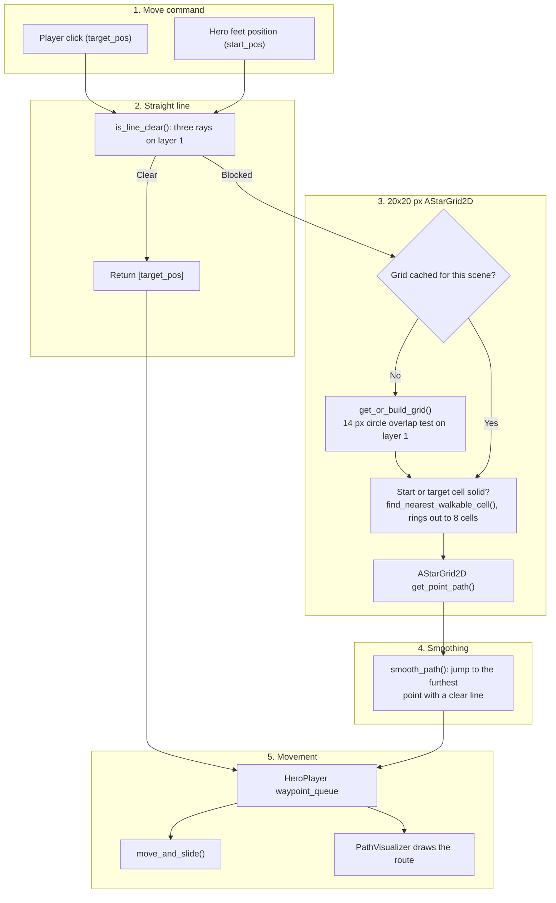
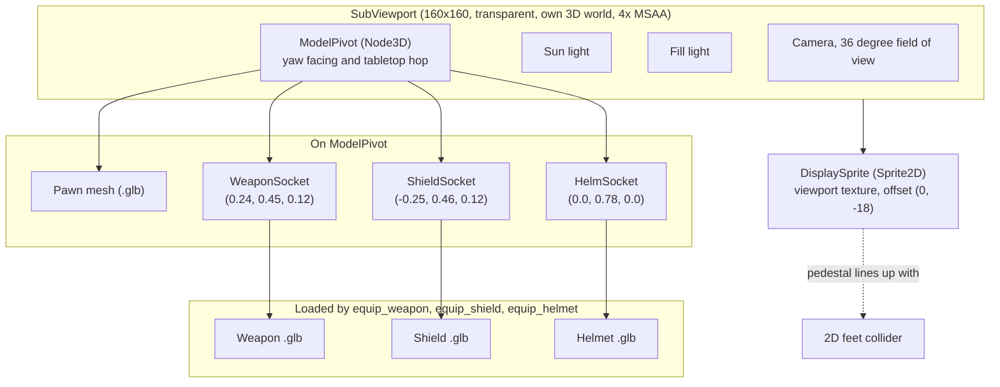
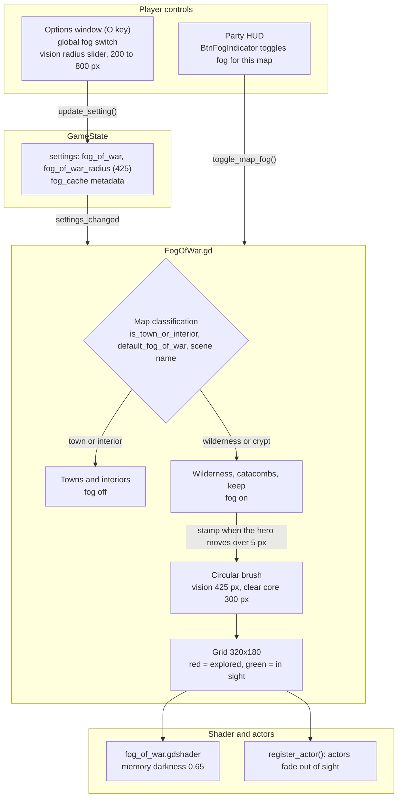

# CRPG world systems
{: .no_toc }

The systems behind click-to-move, the 3D miniature pawns, NPC dialogue and fog of war in the hand-built scenes of `games/crpg-realm`. Each section names the script and the constants that decide the behavior.
{: .fs-6 }

<details open markdown="block">
  <summary>On this page</summary>
  {: .text-delta }
1. TOC
{:toc}
</details>

## Pathfinding

`scripts/Pathfinder.gd` is a `RefCounted` class with static functions. Only `HeroPlayer` calls `Pathfinder.get_nav_path()`, from `move_to_point()` and `queue_move_point()`. Companions and enemies walk in straight lines and slide along walls.

{: .robos-zoomable-img loading="lazy" }
*Look for the cyan line from the hero and the ring at the click point: the line is the route that `PathVisualizer` draws for a click.*

`get_nav_path(world_2d, start, target, scene, exclude)` works in four steps:

1. `is_line_clear()` casts three rays against collision layer 1: one down the middle and two offset sideways by the check radius (10 px here). If none hits, the path is `[target]`.
2. `get_or_build_grid()` builds an `AStarGrid2D` over the scene bounds, with 20x20 px cells, diagonal moves allowed only when no obstacle is adjacent, and a Euclidean heuristic. It marks a cell solid when a 14 px circle at the cell centre overlaps a layer-1 body. The bounds come from the hero's camera limits, or a `RoomBG` or `Background` control, or default to 2560x1440. The grid is cached against the scene's instance id. Call `Pathfinder.invalidate_grid()` after changing collision at run time; `CartridgeWorld` does this on every map load.
3. If the start or target cell is solid (a click on a wall, say), `find_nearest_walkable_cell()` searches square rings out to 8 cells for the closest free cell.
4. `smooth_path()` walks the raw grid path and, from each point, jumps to the furthest later point with a clear three-ray line, so a staircase of cells becomes a few corner points.

If the grid cannot be built, `_legacy_nav_points_path()` falls back to an `AStar2D` over the points returned by the scene's `get_nav_points()`, or to a straight line if the scene has none.

`PartyCompanion` preloads `Pathfinder` but does not call it, and `TacticalEnemy` chases straight at its target.



{: .robos-zoomable-img loading="lazy" }
*Concept diagram from the original design docs. The text on this page says what is built today: a grid with a straight-line check and string-pulling smoothing. Theta* and a navmesh are not used.*

{: .robos-zoomable-img loading="lazy" }
*Concept diagram from the original design docs. The text on this page says what is built today: the numbers shown (grid resolution, node counts, timings) are illustrative, and only the hero is routed.*

## 3D miniature pawns

{: .robos-zoomable-img loading="lazy" }
*Concept diagram from the original design docs. The text on this page says what is built today: the viewport is 160x160 here, and the sockets are the three listed in the table below.*

Characters and monsters are 3D miniatures drawn into the 2D world by `scripts/CharacterModel3D.gd`. Each pawn owns a 160x160 `SubViewport` with a transparent background, its own 3D world and 4x MSAA, a camera with a 36 degree field of view, a sun and a fill light, and a `ModelPivot` node holding the mesh. A `Sprite2D` named `DisplaySprite` shows the viewport texture with an offset of (0, -18), which lines the pedestal up with the actor's 2D feet collider.

`ModelPivot` has three sockets:

| Socket | Position | Holds |
|:---|:---|:---|
| `WeaponSocket` | (0.24, 0.45, 0.12) | Main-hand weapon |
| `ShieldSocket` | (-0.25, 0.46, 0.12) | Shield |
| `HelmSocket` | (0.0, 0.78, 0.0) | Helmet |

`equip_weapon()`, `equip_shield()` and `equip_helmet()` replace whatever is in the socket with a `.glb` mesh. They take a path ending in `.glb`, or an item id that the script matches by substring (`greatsword`, `warhammer`, `mace`, `rapier`, and so on). `apply_armor_styling(armor_type, color)` tints the pawn's materials by armor type. The sockets are children of `ModelPivot`, so equipment turns and bobs with the pawn.

Motion is procedural. `update_facing(velocity)` and `face_point(pos)` turn the pivot toward the movement or a target. While moving, `set_moving(true)` makes the model hop (`abs(sin(t)) * 0.14`) and roll slightly, like a miniature being pushed along a table. At rest it sways gently. The attack swing animation is on `HeroPlayer`, not on the model.

The meshes are in `assets/models/`: pawns for a knight, wizard, rogue, king and princess, monsters (goblin, hound, skeleton, minotaur, skirmisher, dragon), shields, helmets and armor suits, and spell effects. `SpellModel3D.gd` renders spell projectiles and bursts the same way, through isolated viewports.



## NPCs and dialogue

`data/v1/npcs.json` has 18 records and `data/v1/dialogue.json` has 18 trees. In the village, `VillageSquare.tscn` holds 12 townsfolk: eleven `NPCCharacter` nodes named `NPC_*` and Blacksmith Brand, a `ClickableObject`. The forest has three NPC nodes and the catacombs one (`SirJustinGhost`). Elora is a `ClickableObject` in `Homestead`.

**`NPCCharacter`** (`scenes/components/NPCCharacter.tscn`) is a `CharacterBody2D`. Its exports include `npc_id`, `npc_name`, `custom_sprite_path`, `portrait_path`, `dialogue_text`, `dialogue_choices` and `waypoints`. On a click, `interact()` faces the NPC toward the hero, then looks for a dialogue tree in this order:

1. `DataStore.dialogue_trees[npc_id]`
2. `DataStore.dialogue_trees["dialogue-" + npc_id` without the `npc-id-` or `npc-` prefix`]`. This is how `npc-id-innkeeper` finds `dialogue-innkeeper`.
3. The `dialogue_tree` named by `DataStore.npcs[npc_id]`
4. A one-node tree built from the exported `dialogue_text` and `dialogue_choices`

It then calls `ActionLog.start_dialogue(tree, tree.rootNode)` and restores the idle state on `dialogue_ended`. A tree is an object with `id`, `title`, `rootNode` and a `nodes` map. Each node has `speaker`, `text` and `choices`, and each choice has `text` and `nextNode`. An empty `choices` array ends the conversation.

**`ClickableObject`** is a plain `Area2D` that emits `body_clicked`. The scene script owns the dialogue and the walking, as `VillageSquare.talk_to_blacksmith()` and `Homestead.talk_to_elora()` do.

Not built: wandering NPCs. No scene sets `waypoints` on an `NPCCharacter`, so the townsfolk stand still.

{: .robos-zoomable-img loading="lazy" }
*The activity log during a conversation: each reply is a numbered line you pick with a number key or a click.*

## Fog of war

`scripts/FogOfWar.gd` (instanced from `scenes/components/FogOfWar.tscn`) keeps a low-resolution grid of the map and draws it as a shader overlay (`shaders/fog_of_war.gdshader`).

{: .robos-zoomable-img loading="lazy" }
*Concept diagram from the original design docs. The text on this page says what is built today: the vision radius is 425 px with a slider from 200 to 800 px, and fog is classified per map.*



{: .robos-zoomable-img loading="lazy" }
*A frame from the recorded fog of war test. Look at the lit circle around the two heroes: everything outside the vision radius is shrouded.*

| Export | Default | Meaning |
|:---|---:|:---|
| `map_width`, `map_height` | 2560, 1440 | Map size in pixels |
| `grid_scale` | 8 | One cell is 8x8 px, so a 2560x1440 map is a 320x180 grid |
| `vision_radius` | 425 | Outer edge of the hero's sight, in pixels |
| `inner_vision_radius` | 300 | Fully clear core; the edge fades with a smooth curve |
| `memory_darkness` | 0.65 | Darkness over ground you have seen but cannot see now |

Each cell stores two values: red for explored (kept across visits) and green for in sight now. When the hero moves more than 5 px the script stamps a circular brush into the grid. The shader turns that into alpha: unexplored is fully dark, explored but out of sight is 0.65, in sight is clear. Actors passed to `register_actor()` fade out when their cell is not in sight. Explored cells are cached per scene in `GameState` metadata (`fog_cache`), so exploration survives scene changes.

Fog is classified per map. A scene starts with fog off if its script sets `is_town_or_interior = true`. Otherwise it uses its `default_fog_of_war` export if it has one, and otherwise fog is off only when the scene name contains homestead, village, town, interior, shop or inn. The wilderness, catacombs and keep start with fog on. The HUD has a button that toggles fog for the current area. The options window sets the global switch and a vision radius slider from 200 to 800 px (default 425); `FogOfWar` rescales `inner_vision_radius` to 300/425 of whatever you pick.

Fog interacts with traps. While fog is on, a trap in a cell you have not explored or seen cannot be detected or revealed by Find Traps.

## Test it

```bash
python3 run_cucumber_tests.py tests/e2e/features/normal/10_house_wall_collision_pathfinding.feature
python3 run_cucumber_tests.py tests/e2e/features/normal/11_dozens_npc_dialogue_and_trading.feature
python3 run_cucumber_tests.py tests/e2e/features/normal/01_fog_of_war_exploration.feature
```

`GameControlServer` clamps the cursor position for `/user_input/click_object` to the screen, so an off-screen object is "clicked" at the screen edge. Pickups ignore distance for a human click, but the agent's `pickup_item` action walks there first.
