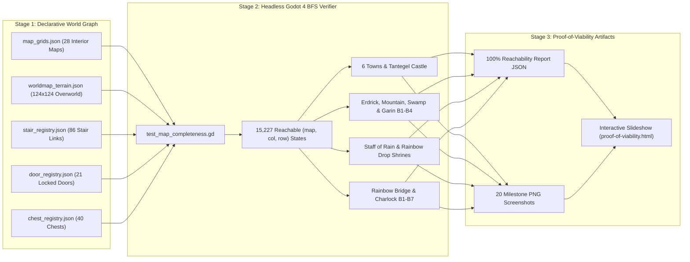

# Dragon Warrior (2D RPG Engine)
{: .no_toc }

A clean-room 8-bit 2D console RPG in Godot 4.3 (`games/dragon-warrior`), driven by declarative JSON world registries, an in-engine autonomous Stride AI (`AIEngine.gd`), chained Cucumber checkpoint E2E tests, and a headless Breadth-First Search (BFS) map completeness verifier (`tests/test_map_completeness.gd`).
{: .fs-6 }

<details open markdown="block">
  <summary>On this page</summary>
  {: .text-delta }
1. TOC
{:toc}
</details>

{: .robos-zoomable-img }

*The Dragon Warrior multi-map BFS pathfinding & completeness verification pipeline: 29 declarative maps, 86 stair links, 21 doors, and 40 chests audited across 15,227 reachable `(map, col, row)` states from `tantegel-castle-2f (3,5)`.*

## Run it

```bash
# Play interactively
godot --path games/dragon-warrior

# Watch Autonomous Demo Mode (Player AI vs Enemy AI)
godot --path games/dragon-warrior -- --demo

# Run Headless Global BFS Map Completeness & Pathfinding Audit
python3 games/dragon-warrior/tests/test_map_completeness.py

# Run Audit + Generate 20 Milestone Screenshots for the rowbose.com Slideshow
python3 games/dragon-warrior/tests/test_map_completeness.py --screenshots

# Run Chained Cucumber Checkpoint E2E Suite (King -> Key -> Door -> Castle 1F -> World Map)
xvfb-run -a behave games/dragon-warrior/tests/e2e/features/king_to_world_map.feature

# Let the robos-jrpg AI play the ENTIRE game as a user would (milestone by milestone, real inputs only)
python3 games/dragon-warrior/tests/e2e/play_full_game.py
python3 games/dragon-warrior/tests/e2e/play_full_game.py --until 18   # stop after milestone 18
python3 games/dragon-warrior/tests/e2e/play_full_game.py --record     # also record playthrough.mp4 + 12x time-lapse
python3 games/dragon-warrior/tests/e2e/play_full_game.py --stepped    # one video + checkpoint per milestone (videos/NN-<id>.mp4)
python3 games/dragon-warrior/tests/e2e/play_full_game.py --stepped --only 42   # re-record milestone 42 from its checkpoint
```

## AI Full-Game Playthrough ("Play the Game" mode)

The BFS audit proves every tile is *reachable*; the playthrough proves the game is *beatable*. `PlayGameBrain.gd`
(`src/systems/`) is a "play the game" mode of the robos-jrpg AI engine: it takes over the controller and plays from
King Lorik's throne room to the ending credits using nothing a human player does not have — real game inputs, and the
IPC web service (`GameControlServer.gd`, `/api/v1/state`) to read what is on screen.

- **Milestone registry** — `tools/gen_milestones.py` generates `data/v1/milestones.json`: an ordered list of
  objectives (every weapon, armor and shield purchase, every treasure chest, each quest item and quest, level gates
  before dangerous zones, the Dragonlord and the ending). The brain simply seeks the next milestone, forever.
- **Route planning** — `RoutePlanner.gd` plans multi-map routes (stairs, doors, bridges, the Rainbow Bridge) over the
  real walkability grids; the brain only follows them step by step.
- **Survival policy** — kill-before-die battle maths from `combat_formulas.json`, zone-aware heal thresholds (heal
  early enough to survive two worst-case hits from the local encounter pool), SLEEP/STOPSPELL use, inn trips only
  when out of heal MP and herbs, MP conservation inside Charlock and HEALMORE-only healing against the Dragonlord.
- **NES rules respected** — eight tool slots and no dropping (a full pack skips a non-gold chest), herbs are burned
  rather than wasted, Erdrick's Armor regenerates 1 HP per step and dampens fire breath.
- **Python driver** — `tests/e2e/play_full_game.py` boots the game headless, enables the mode, polls state, asserts
  invariants (hero never on water or mountains, HP never negative, no stuck loops) and writes
  `tests/e2e/reports/playthrough/playthrough.json` plus a screenshot per milestone. `--stepped` records one
  video per milestone (`videos/NN-<id>.mp4`) and saves a game checkpoint after each one, so `--only N` replays and
  re-records a single milestone from its checkpoint in seconds.
- **Recording HUD** — while the AI plays, a band under the game viewport (never over dialogs) shows the current
  milestone with a Given/When/Then summary, the brain's live objective, a wall-clock timer with the time scale, and
  the condensed hero stats, gear, pack and map tile, so videos and screenshots explain themselves; the battle
  status bar shows gold and EXP. Each new full run archives the previous run's reports and videos instead of
  overwriting them.
- **Live dashboard** — stepped/recorded runs launch `tools/playthrough-dashboard` (Electron): a tray icon with a
  progress ring and run summary menu, and a window showing live IPC game state with screenshots, the brain's event
  log and the milestone list; every finished milestone becomes a clickable card that plays its video and shows the
  checkpoint saved after it, so a two-hour run can be followed and reviewed milestone by milestone.
- **Deadlock detection** — the brain's wall-clock progress watchdog (90 s without any change in
  milestone/battles/level/gold/position/herbs/HP) drops the current objective, blacklists unreachable shops and
  after three stalls on one milestone skips it or fails the run; the driver's `--stall-timeout` (10 min) ends a
  run that has stopped making progress with a `stalled` status, a screenshot and the AI event-log tail.
- **Light in the caves** — the brain buys torches before every dark dungeon while RADIANT is unknown (and keeps a
  spare afterwards), lights up the moment the IPC `light_status` reports no light, and re-casts RADIANT as soon
  as it fades to a torch's glow; the game treats RADIANT as a step counter like the NES did, so it survives stairs
  through lit floors and the walk between caves, and the field SPELL command casts RADIANT ahead of HEAL when the
  hero is blind or the light is dim.
- **Aggressive grinding** — the brain watches how much HP the last six grind battles cost; when monsters barely
  scratch the hero it moves up to the next zone tier (as long as the worst hit there is survivable four times
  over), steps back down when fights get expensive, and drops the boost after a death. Only fights inside the
  chosen grind zone count, so random battles on the way there can no longer trigger a promotion. Grind spots are
  picked by walking distance from wherever the hero is — falling back to a nearer zone one tier up or down when
  the usual zone is a long trek away — so a death, an inn stop or a milestone on another continent no longer sends
  it trekking back through the Swamp Cave to the old spot.
- **Surviving hard hitters** — against Starwyverns and other monsters that can take a third of the hero's HP per
  turn, the brain no longer gambles on a resistible SLEEP at low HP; it casts HEALMORE when that keeps it ahead of
  the damage and runs when it cannot.
- **The Golem at Cantlin's gate** — Cantlin is ringed by an impassable brick wall with a single grass gate tile on
  its north side; stepping onto that gate before the Golem is destroyed starts the gatekeeper fight (strength 120,
  HURT bounces off). The Fairy Flute dug up in Kol works as a battle item: it puts the Golem to
  sleep every time, and the brain plays it whenever the Golem wakes and swings only while it sleeps. Winning once
  opens the town for good; fleeing shoves the hero back off the gate to try again.
- **NES-faithful ending** — the hero carries Princess Gwaelin in his arms until she is home, the Dragonlord's
  defeat hands over the Ball of Light with a flash that warps the hero outside a monster-free Charlock, every town
  celebrates, and King Lorik offers his throne; the hero declines, Gwaelin insists on coming along ("But thou
  must!"), the two walk out of Tantegel onto the overworld, "And thus the story ends…" appears and the credits
  roll before the title screen returns. The last milestone completes only when the credits finish, so the recorded
  run includes the whole epilogue.

Every bug the brain hit while learning to finish the game was a game bug: Charlock 1F's exit gate unwalkable, boss
fights not syncing the pack, chest duplicates, missing level-up curves, incorrect enemy flee factors and spell
resistances, a Cantlin item shop with no stock, Wings doing nothing on the overworld, consumables refusing to
stack. The game data is now faithful enough that the AI clears every milestone and beats the Dragonlord at
level 21–22 in one or two Charlock expeditions with at most a single death on the way.

**Live dashboard & screenshots** — the front-site page
[AI Playthrough](https://rowbose.com/games/dragon-warrior/ai-playthrough/) walks through every panel of the tray
icon and dashboard with screenshots, shows milestone screenshots and video frames from a live run, a filmstrip of
the per-milestone videos, and an architecture diagram of driver ↔ IPC web service ↔ `PlayGameBrain` ↔ dashboard.

## Global Map Completeness & Pathfinding Architecture



### Global Pathfinding Reachability Table (All 29 Maps)

Starting from the New Game origin state (`tantegel-castle-2f` at `(3, 5)`), `tests/test_map_completeness.gd` verifies that all 29 maps are reachable via valid orthogonal steps, unlocked doors, bidirectional stairs, and overworld warps:

| Map Key | Reachable | Min BFS Steps | Reachable Tiles | Shortest Multi-Map Transition Chain |
|:---|:---:|:---:|:---:|:---|
| `tantegel-castle-2f` | PASS | 0 | 44 | `tantegel-castle-2f` |
| `tantegel-castle-1f` | PASS | 11 | 549 | `tantegel-castle-2f -> tantegel-castle-1f` |
| `world-map` | PASS | 39 | 9,039 | `tantegel-castle-2f -> tantegel-castle-1f -> world-map` |
| `brecconary-1f` | PASS | 47 | 709 | `tantegel-castle-2f -> tantegel-castle-1f -> world-map -> brecconary-1f` |
| `tantegel-castle-b1` | PASS | 49 | 82 | `tantegel-castle-2f -> tantegel-castle-1f -> tantegel-castle-b1` |
| `erdricks-cave-b1` | PASS | 86 | 62 | `tantegel-castle-2f -> tantegel-castle-1f -> world-map -> erdricks-cave-b1` |
| `erdricks-cave-b2` | PASS | 105 | 63 | `tantegel-castle-2f -> tantegel-castle-1f -> world-map -> erdricks-cave-b1 -> erdricks-cave-b2` |
| `garinham-1f` | PASS | 122 | 298 | `tantegel-castle-2f -> tantegel-castle-1f -> world-map -> garinham-1f` |
| `swamp-cave-b1` | PASS | 140 | 116 | `tantegel-castle-2f -> tantegel-castle-1f -> world-map -> swamp-cave-b1` |
| `garinham-b1` | PASS | 158 | 237 | `tantegel-castle-2f -> tantegel-castle-1f -> world-map -> garinham-1f -> garinham-b1` |
| `kol-1f` | PASS | 160 | 512 | `tantegel-castle-2f -> tantegel-castle-1f -> world-map -> kol-1f` |
| `mountain-cave-b1` | PASS | 164 | 122 | `tantegel-castle-2f -> tantegel-castle-1f -> world-map -> mountain-cave-b1` |
| `mountain-cave-b2` | PASS | 180 | 121 | `tantegel-castle-2f -> tantegel-castle-1f -> world-map -> mountain-cave-b1 -> mountain-cave-b2` |
| `northern-cave-b1` | PASS | 188 | 69 | `tantegel-castle-2f -> tantegel-castle-1f -> world-map -> northern-cave-b1` |
| `hauksness-1f` | PASS | 208 | 380 | `tantegel-castle-2f -> tantegel-castle-1f -> world-map -> hauksness-1f` |
| `garinham-b2` | PASS | 209 | 111 | `... -> garinham-1f -> garinham-b1 -> garinham-b2` |
| `garinham-b3` | PASS | 212 | 235 | `... -> garinham-1f -> garinham-b1 -> garinham-b2 -> garinham-b3` |
| `rimuldar-1f` | PASS | 229 | 721 | `... -> world-map -> swamp-cave-b1 -> world-map -> rimuldar-1f` |
| `garinham-b4` | PASS | 256 | 32 | `... -> garinham-1f -> garinham-b1 -> garinham-b2 -> garinham-b3 -> garinham-b4` |
| `charlock-castle-1f` | PASS | 269 | 181 | `... -> world-map -> swamp-cave-b1 -> world-map -> charlock-castle-1f` |
| `southern-cave-b1` | PASS | 276 | 65 | `... -> world-map -> swamp-cave-b1 -> world-map -> southern-cave-b1` |
| `charlock-castle-b1` | PASS | 305 | 232 | `... -> charlock-castle-1f -> charlock-castle-b1` |
| `cantlin-1f` | PASS | 325 | 681 | `tantegel-castle-2f -> tantegel-castle-1f -> world-map -> cantlin-1f` |
| `charlock-castle-b2` | PASS | 325 | 55 | `... -> charlock-castle-1f -> charlock-castle-b1 -> charlock-castle-b2` |
| `charlock-castle-b3` | PASS | 423 | 60 | `... -> charlock-castle-b1 -> charlock-castle-b2 -> charlock-castle-b3` |
| `charlock-castle-b4` | PASS | 446 | 65 | `... -> charlock-castle-b2 -> charlock-castle-b3 -> charlock-castle-b4` |
| `charlock-castle-b5` | PASS | 456 | 59 | `... -> charlock-castle-b3 -> charlock-castle-b4 -> charlock-castle-b5` |
| `charlock-castle-b6` | PASS | 483 | 52 | `... -> charlock-castle-b4 -> charlock-castle-b5 -> charlock-castle-b6` |
| `charlock-castle-b7` | PASS | 495 | 275 | `... -> charlock-castle-b5 -> charlock-castle-b6 -> charlock-castle-b7` |

### Quest Milestone & Relic Pathfinding Table (14 Milestones)

| Quest Milestone | Map Key | Coordinate | Min BFS Steps | Status |
|:---|:---|:---:|:---:|:---:|
| King Lorik (Throne Room) | `tantegel-castle-2f` | `(3, 5)` | 0 | **PASS** |
| Throne Room Key Chest (`ttrc3`) | `tantegel-castle-2f` | `(6, 5)` | 3 | **PASS** |
| Stones of Sunlight Chest (`tbac1`) | `tantegel-castle-b1` | `(5, 6)` | 58 | **PASS** |
| Erdrick's Tablet Chest (`er2c1`) | `erdricks-cave-b2` | `(10, 4)` | 148 | **PASS** |
| Princess Gwaelin Chamber | `swamp-cave-b1` | `(6, 20)` | 172 | **PASS** |
| Fairy Flute (`kolc_ff`) | `kol-1f` | `(10, 7)` | 187 | **PASS** |
| Staff of Rain Shrine Chest (`nc1c1`) | `northern-cave-b1` | `(4, 5)` | 202 | **PASS** |
| Rainbow Bridge | `world-map` | `(66, 51)` | 217 | **PASS** |
| Fighter's Ring (`mt2c1`) | `mountain-cave-b2` | `(3, 3)` | 220 | **PASS** |
| Erdrick's Armor (Axe Knight) | `hauksness-1f` | `(19, 13)` | 233 | **PASS** |
| Silver Harp (Lyre of Ire) | `garinham-b4` | `(6, 1)` | 265 | **PASS** |
| Rainbow Drop Shrine Chest (`sc1c1`) | `southern-cave-b1` | `(6, 6)` | 284 | **PASS** |
| Erdrick's Sword (`cb2c1`) | `charlock-castle-b2` | `(6, 6)` | 470 | **PASS** |
| Dragonlord's Altar | `charlock-castle-b7` | `(20, 12)` | 560 | **PASS** |

See the full [Dragon Warrior 20-Slide Interactive Proof of Viability Report]({{ '/games/dragon-warrior/proof-of-viability.html' | relative_url }}) and the [Dragon Warrior Game Showcase Page]({{ '/games/dragon-warrior/' | relative_url }}).
