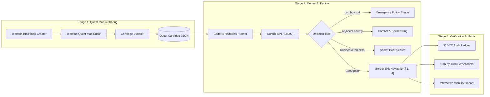

# Tabletop RPG (HeroQuest engine)
{: .no_toc }

A turn-based dungeon crawler in Godot 4.3, modelled on the HeroQuest board game, in `games/tabletop-rpg`. This page covers how to run it, what it contains, and how its parts fit together.
{: .fs-6 }

<details open markdown="block">
  <summary>On this page</summary>
  {: .text-delta }
1. TOC
{:toc}
</details>

{: .robos-zoomable-img }

*The Fan Dungeon board image, the 28x21 map used by Quest 1. Rooms are the walled areas; the open space between them is corridor.*

## Run it

You need Godot 4.3, the version `project.godot` targets (GL Compatibility renderer). The game does not bundle it. `play.sh` looks for the binary in `$GODOT_BIN`, then `~/.local/bin/godot`, `~/apps/godot4`, and `godot4` or `godot` on your `PATH`. It exits with an error if none exists.

```bash
./games/tabletop-rpg/play.sh                   # launches the verified Quest 1: Custom Dungeon
./games/tabletop-rpg/play.sh --demo            # watch Mentor AI solve the quest autonomously
./games/tabletop-rpg/play.sh --dm              # play the Game Master (Zargon) instead of the heroes
./games/tabletop-rpg/play.sh --hard --reset    # hard mode, fresh campaign save
./games/tabletop-rpg/play.sh --headless --demo
```

Other flags in `play.sh`: `--reset` starts a new game instead of resuming, `--player` selects the hero side, and `--hard` sets hard mode. By default, it loads the verified playable cartridge `custom-quest.cartridge.json`.

## What is in the game

The game loads a cartridge, a single `.cartridge.json` file that holds heroes, monsters, quests and maps. Two verified playable cartridges ship in `games/tabletop-rpg/cartridges/`:

| Cartridge | Quests | Maps | Verification |
|:---|:---|:---|:---|
| `custom-quest` | Quest 1: Custom Dungeon. Vanquish the Dungeon Boss, explore ancient chambers, and escape to border stairs `[-1, 4]`. | Classic board, 28x19 grid. | **100% Verified Playable**: 296 turns, 21 combat rounds, 315 audit transactions, 0 casualties. |
| `election-2026-quest-1` | Election 2026: Battle for the Hill. Lead the bipartisan party (Barack Obama, Donald Trump, Hillary Clinton, Bernie Sanders) through the Capitol catacombs to slay all 3 two-headed Hydras (`Talarixon`, `Brownsted`, `El-Rogers`). | Capitol Catacombs, 26x19 grid. | **100% Verified Playable**: 266 turns, 15 combat rounds, 283 audit transactions, 4/4 heroes alive. |

The rules in code:

- **Movement.** A hero rolls 2d6 for movement (`TabletopDice.gd`).
- **Combat.** Each combat die has three skulls, two white shields and one black shield. Wounds are the attacker's skulls minus the defender's shields, to a minimum of zero. A defending hero counts white shields and a defending monster counts black shields.
- **Fog of war.** Rooms stay hidden until a hero opens a door into them.
- **Spells.** `HeroQuestSpells.gd` defines 12 spells in four decks (fire, earth, water, air), plus 10 dread spells for the Game Master.

The four heroes in the Quest 1 cartridge:

| Hero | Body | Mind | Attack dice | Defend dice |
|:---|:---:|:---:|:---:|:---:|
| Barbarian | 8 | 2 | 3 | 2 |
| Dwarf | 7 | 3 | 2 | 2 |
| Elf | 6 | 4 | 2 | 2 |
| Wizard | 4 | 6 | 1 | 2 |

## How the parts fit

| Part | Location | Role |
|:---|:---|:---|
| Game | `games/tabletop-rpg` | Godot project. Main scene `TabletopWorld.tscn`; autoloads for dice, cartridges, spells, equipment and the control server. |
| Shared library | `packages/robos-gaming` | Node.js code for dice, a board grid with walls and doors, three map configurations, a cartridge bundler that validates a cartridge, and the gaming ontology with its SHACL shapes. |
| Knowledge graph | `.robos/kgraphs/tabletop-game` | The `robos.tabletop` package: heroes, monsters, spell cards, furniture, map configurations and test scenarios. Hero nodes refer to starting weapons defined in the `robos.game` package in `.robos/kgraphs/game`. |
| Cartridge editor | [RobOS Tabletop Studio]({{ '/apps/robos-tabletop/' | relative_url }}) | Electron app for editing cartridge data. |
| Map tool | [Tabletop Blockmap Creator]({{ '/apps/tabletop-blockmap-creator/' | relative_url }}) | Electron app for calibrating a grid over a dungeon image and drawing corridors and rooms. |

## Control API

While the game runs, `GameControlServer.gd` listens on `127.0.0.1:18092`. Set `TABLETOP_SERVER_PORT` to use another port.

| Request | Purpose |
|:---|:---|
| `GET /api/v1/health` | Liveness check. |
| `GET /api/v1/state` | Current game state as JSON. |
| `GET /api/v1/cartridges` | Discovered cartridges and the active one. |
| `POST /api/v1/action` | Run a game action, such as rolling movement, moving, opening a door or attacking. |
| `POST /api/v1/cartridge/insert` | Load a different cartridge. |
| `POST /api/v1/screenshot` | Save a PNG to the path in the request body. |

`rpc_ai/tabletop_qa_player.py` is a Python client for this API. `rpc_ai/tabletop_rpc_ai.py` builds on it to play whole turns.

## Tests

The library tests need only Node.js:

```bash
npm --prefix packages/robos-gaming test
```

The game has 60 `test_*.py` files in `games/tabletop-rpg/tests`. 58 of them launch the game through `play.sh`, typically with `--headless` and a dedicated port. They then drive the game through the control API with `TabletopQAPlayer` and assert on the returned state. They need a Godot binary. Run one directly:

```bash
python3 games/tabletop-rpg/tests/test_tabletop_cartridge.py
```

`tests/record_tabletop_gameplay.py` plays a scripted session in a virtual display (Xvfb at 1920x1080), records it with FFmpeg and writes an MP4 and a WebVTT caption file to `~/.robos/development/walkthroughs/tabletop-gameplay/`.

## Proof of Viability (Autonomous Quest Verification)

How do you prove a newly authored cartridge is actually winnable before shipping? RobOS uses autonomous agent governance to verify that the heroes can solve the dungeon, uncover secret passageways, survive combat balance, and reach extraction stairs.

### Pipeline Architecture




The end-to-end autonomous proof is implemented in [`games/tabletop-rpg/tests/test_demo_custom_quest_e2e.py`](file:///home/ndipiazza/source/robos/games/tabletop-rpg/tests/test_demo_custom_quest_e2e.py). It runs the four heroes autonomously on `custom-quest.cartridge.json`, verifying:

1. **Starting Healing Potions & Emergency Consumption**: All 4 heroes are provisioned with 2 healing potions each; Mentor AI monitors health and drinks a potion whenever `cur_bp <= 4` (+4 BP, `USE_ITEM` transaction).
2. **Dynamic Room & Corridor Secret Passageway Sweeping**: The engine tracks `searched_secret_rooms` and `searched_secret_corridor_tiles`. Heroes uncover hidden `door-6` in Room SE-21 (TX #121) and hidden `door-9` in Room NW-4 (TX #307).
3. **Dead-End Room Pruning**: Pathfinding prunes optional 1-door dead-end rooms (e.g. `room-nw-10`), preserving party health during extraction.
4. **Border Exit Stair Navigation (`[-1, 4]`)**: The engine treats exit stairs as an explicit exemption to border unwalkability in `is_border_tile()`, `find_path()`, and `move_hero()`, allowing heroes to step directly onto `[-1, 4]`.

The test produces an immutable 315-transaction audit ledger, 0 hero casualties (100% survival rate), and turn-by-turn visual evidence.

For **Election 2026: Battle for the Hill** (`election-2026-quest-1.cartridge.json`), the end-to-end autonomous proof in [`games/tabletop-rpg/tests/test_demo_election_2026_quest_e2e.py`](file:///home/ndipiazza/source/robos/games/tabletop-rpg/tests/test_demo_election_2026_quest_e2e.py) drives the bipartisan party (Barack Obama, Donald Trump, Hillary Clinton, Bernie Sanders) across 266 autonomous steps, 15 combat rounds, and 283 transactions to slay all three 2-square Capitol Hydras (`Talarixon` in TX #167, `Brownsted` in TX #211, and `El-Rogers` in TX #282–283) with 100% hero survival (4/4 alive).

See the complete [Custom Dungeon Proof of Viability Report]({{ '/games/tabletop-rpg/proof-of-viability.html' | relative_url }}), the [Election 2026 Proof of Viability Report]({{ '/games/tabletop-rpg/proof-of-viability-election-2026.html' | relative_url }}), and the [Game Showcase Page]({{ '/games/tabletop-rpg/#proof-of-viability' | relative_url }}).
