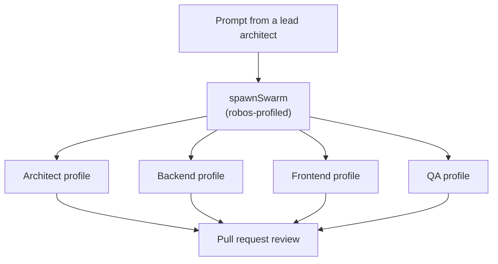
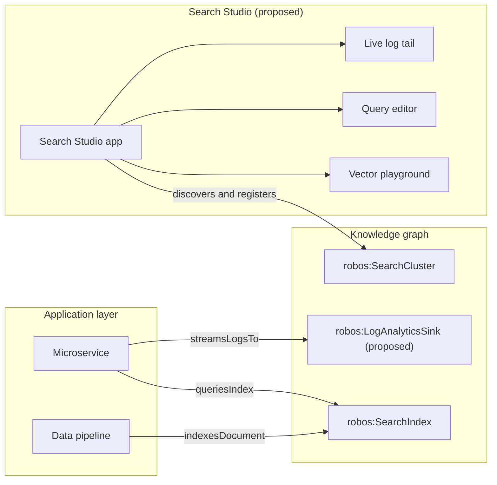
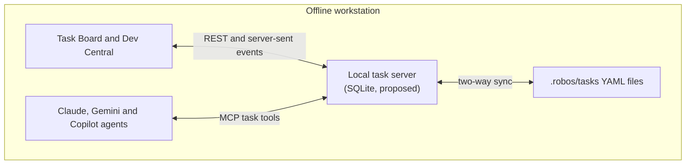
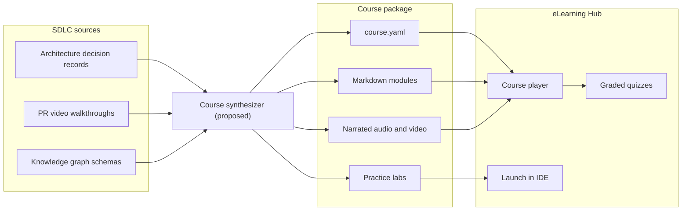

# Roadmap
{: .no_toc }

What is built, what is partly built, and what is only proposed. Read it before relying on a feature that the other pages do not describe.
{: .fs-6 }

Status comes from the code in `packages/`, checked on 2026-10-13, not from plan files. It is not a delivery schedule and no dates are promised. Written proposals are on the [Ideas]({{ site.baseurl }}) page.

| Status | Meaning |
|:---|:---|
| Built | The code is in the repository and does what the row says. |
| In progress | Part of it is in the repository. The row lists what is missing. |
| Planned | None of it is in the repository. A proposal page describes it. |

## Built

These appeared on earlier roadmaps or idea lists and now exist, sometimes in a different form from the original proposal.

| Item | Where it is | What the code does |
|:---|:---|:---|
| Offline voice assistant | `packages/voice-prompt`, [RobOS Voice]({{ site.baseurl }}) | Speech-to-text runs on the machine with the `Xenova/whisper-tiny.en` model (`lib/stt-engine.js`). Push-to-talk is `Super+V` by default (`main.js`). A separate HUD window shows live text (`renderer/hud.html`). Spoken replies use the engine set in settings: Kokoro (default), Piper, Edge TTS, speech-dispatcher or Web Speech (`lib/tts-engine.js`). An earlier roadmap named Whisper.cpp and `Super+Space`; neither is used. |
| Production and proposed-branch knowledge graph | `packages/robos-graph`, [Knowledge graph]({{ site.baseurl }}) | `BranchManager.createBranch(branchName, baseBranchName = 'main')` branches the graph (`lib/branch-manager.js`). `GraphDiffEngine.diffGraphs` compares two graphs and `BlastRadiusAnalyzer.analyzeImpact` lists what a diff touches. The `kgraph` command has `diff`, `impact` and `validate`. |
| First-boot setup wizard | `packages/robos-onboarding`, [Get started]({{ site.baseurl }}) | `main.js` has handlers for a GPG key and `pass` store, an SSH key (optionally added to GitHub), git name and email, Chrome as default browser, `gh` login and AI agent settings, then a completion step. Desktop Manager launches it on first boot and skips its password-store lock notices until it completes. Git Login Manager does not pop up its window while it is pending (`isOnboardingCompleted` in `packages/robos-lib/onboarding-state.js`). |
| Plans in the knowledge graph | `packages/task-planner/lib/project-plan.js`, `PROJECT-PLANS.md` | A plan (status `draft`, `review-required` or `approved`, owners, linked GitHub issues) is saved as JSON on a `robos:Project` node and appears on the Project Plan tab in KGraph Explorer. It is not stored under `.robos/plans/` as an earlier proposal suggested. |
| KGraph Parse Portal | `packages/kgraph-parse-portal`, [page]({{ '/kgraph-parse-portal.html' | relative_url }}) | Replaced the "KGraph Crawler" proposal. `main.js` calls a Tika service and a Luxir index, classifies files by MIME type and turns scanned paths into graph nodes. |
| Pull request review | `packages/pr-review`, [PR Review Theater]({{ site.baseurl }}) | Local review preparation, a walkthrough session (`lib/demo-session.js`), screenshot, video and report evidence attached to a review (`lib/review-evidence.js`), CI failure recovery (`lib/ci-recovery.js`) and opening a review in an IDE (`lib/open-review-ide.js`). A separate "Interactive Reviewer" app with Teach Me and Show Me actions was proposed earlier and not built. |
| eLearning hub | `packages/robos-elearning`, [app page]({{ '/apps/robos-elearning/' | relative_url }}) | Lists courses from the knowledge graph, shows lab steps and quizzes, issues and lists completion certificates, exports a website and a slide archive, and saves edited courses to `.robos/elearning.yaml`. Authoring and team features are under Planned. |

## In progress

| Item | What exists | What is missing |
|:---|:---|:---|
| Agent accounts and live agent desktops. [Proposal]({{ '/ideas/specs/ephemeral-agent-user-profiles.html' | relative_url }}) | `packages/robos-profiled` creates a profile: a home directory (a `tmpfs` mount when run as root), copied X authority, linked audio sockets and forwarded SSH, GPG and git identity. `robos-run-as --agent NAME COMMAND` runs a command in it, and `spawnSwarm` creates several profiles at once. The taskbar lists active profiles with a "Kill & Wipe" button. `packages/robos-agentd` keeps a registry of agent sessions. | A profile does not create a Linux user or set cgroup limits, so commands run as the host user with a different `HOME`. No agent gets a real virtual display. The Desktop Agents viewer draws simulated screens from sample data. |
| Dev Central as an agent review hub. [Proposal]({{ '/ideas/specs/dev-central-ai-agent-review-development.html' | relative_url }}) | `packages/dev-central` shows your issues, pull requests, review requests, notifications and saved code reviews with CI state, and has an Open Code Review button. | No goal dispatcher, plan review screen or agent monitor. The walkthrough viewer returns one hardcoded sample task. |

*Concept diagram from the original design docs, trimmed to what exists. `spawnSwarm` creates several profiles at once. Role assignment, a message bus between agents and semantic merge are not built.*

## Planned

None of these is in the repository. Each links to a proposal that says what exists today.

| Item | Note |
|:---|:---|
| [Gitea forge for E2E tests]({{ '/ideas/specs/e2e-gitea-support.html' | relative_url }}) | The Docker E2E image has no Git forge. `packages/gitea-browser` is a static page, not a forge. |
| [Local task server]({{ '/ideas/specs/local-open-source-task-server.html' | relative_url }}) | `robos-task-client` has Jira and GitHub adapters only. A minimal local task list exists in Task Manager MCP. |
| [Prompt lineage in the knowledge graph]({{ '/ideas/specs/prompt-knowledge-graph-logging.html' | relative_url }}) | AI Prompt keeps its last 50 runs. No prompt node type exists. |
| [Session context inspector]({{ '/ideas/specs/robos-session-context-waste-detector.html' | relative_url }}) | Agents Manager lists sessions but does not measure them. |
| [Cloud file storage and sharing]({{ '/ideas/specs/robos-file-storage-and-agent-sharing.html' | relative_url }}) | Data Sources has an S3 connection type and nothing that browses or shares objects. |
| [Linked accounts and guided OAuth]({{ '/ideas/specs/robos-people-groups-cloud-identity.html' | relative_url }}) | No package implements PKCE or a device-code flow. |
| [eLearning authoring and team assignments]({{ '/ideas/specs/robos-learning-management-system.html' | relative_url }}) | The hub has no create-course screen, folders or assignments. |
| [Search Studio]({{ '/ideas/specs/search-engine-and-log-analytics-studio.html' | relative_url }}) | The graph already has `robos:SearchCluster` and `robos:SearchIndex`. There is no app. |
| [OpenTofu and Terraform synthesis]({{ '/ideas/specs/terraform-opentofu-iac-synthesis.html' | relative_url }}) | No cloud resource types or HCL generator exist. |

*Concept diagram from the original design docs, for Search Studio. The app, the log sink type and the three edges are not built; `robos:SearchCluster` and `robos:SearchIndex` already exist in the graph.*

*Concept diagram from the original design docs, for the local task server. The server and the YAML sync are not built; Task Manager MCP keeps a minimal local task list today.*

*Concept diagram from the original design docs, for course authoring. The hub plays courses and quizzes today; the synthesizer, authoring screens and IDE launch are not built.*

## Removed from the earlier roadmap

The previous roadmap also listed a time-travel debugger built on `rr`, a chaos engineering studio (`packages/chaos-studio`) and an agent swarm orchestrator with AST-aware merge. There is no spec, plan or code for the first two, and the third amounts to `spawnSwarm` (see In progress). They were removed instead of carried forward.

## Suggest a feature

Check this page first, then follow "Add an idea" on the [Ideas]({{ site.baseurl }}) page.

{: .robos-zoomable-img }
*Concept diagram from the original design docs. The first steps, a note and a spec, are what exists today; no dates are promised for the rest.*
