# Security & Isolation Proofs
{: .no_toc }

End-to-end verified security architectures, Linux network namespace sandboxes, kernel kill-switch proofs, and zero-leak audits in RobOS.
{: .fs-6 .fw-300 }

<details open markdown="block">
  <summary>Table of contents</summary>
  {: .text-delta }
- TOC
{:toc}
</details>

---

## Zero-Leak OpenVPN App Sandbox & 3-Barrier Kernel Kill-Switch Proof

**RobOS VPN Servers** (`packages/vpn-servers`) and **RobOS VPN Sandbox** (`packages/vpn-sandbox`) allow any desktop or CLI executable (such as Firefox, Transmission, or `curl`) to be launched inside an isolated Linux network namespace (`ip netns`) bound to an OpenVPN provider (with **3,598** official IPVanish `.ovpn` server profiles bundled out of the box).

> [!IMPORTANT]
> Even if the OpenVPN daemon crashes or is force-killed (`SIGKILL`) mid-session while the application is actively running, three independent Linux kernel firewall barriers guarantee that **zero packets can fall back to the host's normal public IP**.

### End-to-End Application Captures


| RobOS VPN Servers (Account & 3,598 Profiles) | RobOS VPN Sandbox (Active Namespace Session) |
|:---:|:---:|
|  |  |

### 3-Barrier Kernel Kill-Switch Architecture

```mermaid
flowchart LR
  subgraph NS["Isolated Linux Network Namespace (robos_vpn_25db)"]
    APP["Sandboxed App (Firefox / Transmission)<br/>uid=1000, CAP_NET_ADMIN stripped"]
    DNS["Namespace DNS & NSS<br/>/etc/netns/robos_vpn_25db/resolv.conf<br/>nsswitch.conf: hosts: files dns"]
    IPT_NS["Barrier 1: In-Namespace iptables OUTPUT<br/>Policy: DROP<br/>1. -o lo ACCEPT<br/>2. -o tun+ ACCEPT<br/>3. -o veth_n_25db -d 216.131.74.202:443/udp -m owner --uid-owner 0 ACCEPT<br/>4. -o veth_n_25db DROP (blocks uid 1000 -> EPERM)"]
    OVPN["OpenVPN 2.7 Daemon<br/>uid=0 (--dns-updown disable)"]
    TUN0["tun0 (172.21.23.221)"]
    VETH_N["veth_n_25db (10.203.41.2/30)"]

    APP --> DNS
    APP -->|Allowed when tun0 UP| TUN0
    TUN0 --> OVPN
    OVPN -->|uid=0 encrypted UDP:443| IPT_NS
    APP -.->|When tun0 DOWN: falls back to default route| IPT_NS
    IPT_NS -->|uid=0 ONLY to 216.131.74.202:443| VETH_N
  end

  subgraph HOST["Host Kernel (enp2s0 — Normal Public IP 198.51.100.42)"]
    VETH_H["veth_h_25db (10.203.41.1/30)"]
    IPT_FWD["Barrier 2: Host FORWARD Chain (ROBOS_VPN_FWD_25db)<br/>ACCEPT only 10.203.41.2 -> 216.131.74.202:443/udp<br/>DROP all other packets from veth_h_25db"]
    IPT_NAT["Barrier 3: Host NAT POSTROUTING<br/>MASQUERADE only -s 10.203.41.2 -d 216.131.74.202:443/udp<br/>No NAT rule exists for any other destination"]
    VETH_N --> VETH_H
    VETH_H --> IPT_FWD
    IPT_FWD --> IPT_NAT
  end

  subgraph EXT["External Internet"]
    VPNSRV["IPVanish Server (atl-a01)<br/>216.131.74.202:443/udp<br/>Exit IP: 216.131.74.203"]
    REALIP["Direct Host Egress (198.51.100.42)<br/>UNREACHABLE FROM SANDBOX"]
    IPT_NAT -->|Encrypted OpenVPN Carrier| VPNSRV
    IPT_FWD -.->|0 packets allowed| REALIP
  end
```




1. **Barrier 1 — In-Namespace `iptables` Default-DROP + UID Owner Lock (`-m owner --uid-owner 0`)**:
   - The application runs as the unprivileged desktop user (`uid 1000`) with `setpriv --inh-caps=-net_admin,-net_raw`.
   - Inside `robos_vpn_<id>`, `iptables -P OUTPUT DROP` and `ip6tables -P OUTPUT DROP` reject all traffic by default.
   - Only `-o tun+` is permitted for `uid 1000`. On `veth_n_<id>`, only `uid 0` (`openvpn`) to `<vpn_server_ip>:<vpn_port>` is accepted, followed by `-A OUTPUT -o veth_n_<id> -j DROP`.
   - When OpenVPN stops and `tun0` disappears, packets from the app fall back to `default via 10.203.X.1 dev veth_n_<id>` and immediately hit `-A OUTPUT -o veth_n_<id> -j DROP` (`EPERM`).
2. **Barrier 2 — Host Kernel `FORWARD` Chain (`ROBOS_VPN_FWD_<id>`)**:
   - The host kernel only forwards packets arriving on `veth_h_<id>` (`10.203.X.2/32`) if they are addressed to `<vpn_server_ip>/32:<vpn_port>` and drops all other packets before NAT.
3. **Barrier 3 — Destination-Scoped Host `POSTROUTING` NAT**:
   - The `MASQUERADE` rule in `nat POSTROUTING` only matches `-s 10.203.X.2/32 -d <vpn_server_ip>/32 -p udp --dport 443`. No NAT translation rule exists to translate namespace packets to the normal host IP (`198.51.100.42`) for any other destination.

### Reproducing the Live 5-Phase Kill-Switch E2E Proof

```bash
ROBOS_VPN_LIVE_E2E=1 node --test tests/e2e/vpn-sandbox-killswitch-proof.test.cjs
```

| Phase | Verification Step | Result |
|:---|:---|:---|
| **1. Host Baseline** | Query `https://api.ipify.org` outside the sandbox | Normal public IP is `198.51.100.42` |
| **2. Tunnel UP Egress** | Query `https://api.ipify.org` inside `robos_vpn_25db` as `uid 1000` while `tun0` is UP | Returns VPN exit IP `216.131.74.203` (`tun0 = 172.21.23.221`) |
| **3. Force-Kill OpenVPN** | `kill -9` OpenVPN PID while keeping `robos_vpn_25db` and `veth_n_25db` default route UP | `tun0` destroyed (`true`), `default via 10.203.41.1 dev veth_n_25db` still UP (`true`) |
| **4. Post-Kill Egress Probes** | Attempt HTTPS (`api.ipify.org`), direct TCP (`1.1.1.1:80`), direct UDP (`8.8.8.8:53`), and direct UDP to VPN server IP as `uid 1000` | All 4 blocked (`EAI_AGAIN`, `ETIMEDOUT`, `EPERM`, `EPERM`) — `ipLeakedAfterDrop: false` |
| **5. Kernel Packet Counters** | Inspect `ip netns exec robos_vpn_25db iptables -L OUTPUT -v -n -x` | `14` packets (`1,070` bytes) dropped by `-A OUTPUT -o veth_n_25db -j DROP`; `0` leaked |
