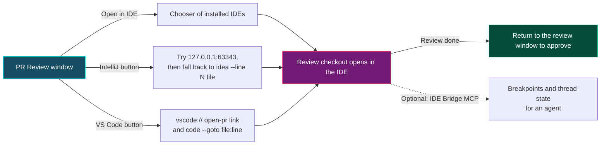

# Training
{: .no_toc }

Short lessons for the RobOS tools that plan work, run coding agents, and control what agents send and run. Each lesson uses commands and screens that exist in the repository and says where a feature is limited.
{: .fs-6 }

## Lessons

| Track | Lesson | You will | Needs |
|:---|:---|:---|:---|
| [Plan and run agent tasks]({{ '/training/agent-tasks/' | relative_url }}) | [Plan a feature in Task Planner]({{ '/training/agent-tasks/plan-a-feature.html' | relative_url }}) | Turn a template form or a description into an epic with tasks and create the issues. | A GitHub or Jira task server, `gh` |
| | [Check impact with the kgraph CLI]({{ '/training/agent-tasks/check-impact-with-kgraph.html' | relative_url }}) | Find what depends on a component and validate a graph change before an agent starts. | Node.js 20 or later, a checkout |
| | [Run an agent on a task]({{ '/training/agent-tasks/run-an-agent.html' | relative_url }}) | Start Claude Code from Task Implementer on an issue and review the branch it pushes. | A task server, `claude`, `gh` |
| | [Choose and customize agent personas]({{ '/training/agent-tasks/agent-personas.html' | relative_url }}) | Pick the role prompt an agent gets and add your own. | Task Implementer or Task Planner |
| [Agent harness and security]({{ '/training/harness-and-security/' | relative_url }}) | [Configure the prompt security guard]({{ '/training/harness-and-security/prompt-security-guard.html' | relative_url }}) | Redact or block secrets, card numbers and injection phrases in prompts. | Node.js 20 or later |
| | [Run tasks through the harness router]({{ '/training/harness-and-security/harness-router.html' | relative_url }}) | Send a task to Claude Code, Codex or Copilot through one interface, and tell a real run from a simulated one. | The agent CLIs you want to use |
| | [Run commands in an ephemeral agent profile]({{ '/training/harness-and-security/agent-profiles.html' | relative_url }}) | Give an agent a throwaway home directory, and know what that does and does not isolate. | Linux, `python3`, Electron |

{: .robos-zoomable-img }
*Concept diagram from the original design docs, drawn for the earlier four-phase course. The text on this page says what is built today.*

## Where the rest is documented

These lessons stop where another page already covers the topic.

| Topic | Page |
|:---|:---|
| Creating a project from a template | [New app wizard]({{ site.baseurl }}) |
| Reviewing an agent's branch, the quiz and evidence stages, signing off | [PR Review Theater]({{ site.baseurl }}) |
| What the knowledge graph stores and how packages are laid out | [Knowledge graph]({{ site.baseurl }}) |
| Which models and agent tiers RobOS uses for which job | [Agent tiers]({{ site.baseurl }}) |
| Installing RobOS and opening the first app | [Get started]({{ site.baseurl }}) |

## Running the apps

Open an app from the App Launcher, or run it from a checkout with Electron:

```bash
electron packages/task-planner
```

Replace `task-planner` with the package folder of the app. Every lesson names the apps it uses and links to their app pages.

## Diagrams

{: .robos-zoomable-img }
*Concept diagram from the original design docs, drawn for the earlier five-stage review. The PR Review Theater page says what is built today.*

Why a long diff gets a reflexive approval, and the review path RobOS offers instead:

```mermaid
graph TD
    subgraph TheTrap["The rubber-stamp spiral"]
        A["Agent generates 1,200 lines of code"] --> B["Reviewer opens a massive diff"]
        B --> C["Attention saturation after 45 minutes"]
        C --> D["Reflexive LGTM"]
        D --> E["Undetected contract mismatch reaches production"]
    end

    subgraph TheRobOSWay["Review with evidence"]
        A2["Agent pushes a feature branch"] --> B2["Open the branch in PR Review"]
        B2 --> C2["Read the diff and check the evidence"]
        C2 --> D2["Walk through the change checkpoint by checkpoint"]
        D2 --> E2["Approve or request changes"]
    end

    style TheTrap fill:#7f1d1d,stroke:#ef4444,color:#fff
    style TheRobOSWay fill:#064e3b,stroke:#10b981,color:#fff
```



How the review window hands a branch to your IDE:


