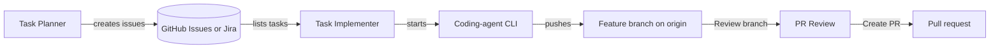

# Plan and run agent tasks
{: .no_toc }

Four lessons on the path from an idea to a pushed branch: split the work into issues, check what a change touches, run an agent on one issue, and choose the role prompt it gets.
{: .fs-6 }

## How the pieces connect

Task Planner and Task Implementer both read the active task server from `~/.config/robos/settings.json`, which you edit in the Task Servers app. Task Implementer starts the coding-agent CLI you pick in `<robos-agent-selector>` (Codex, AGY, Claude Code or GitHub Copilot) and streams its output. It does not create a sandbox, clone the repository or open the pull request. [Run an agent on a task]({{ '/training/agent-tasks/run-an-agent.html' | relative_url }}) lists exactly what it does.

## Lessons

| Lesson | Apps used |
|:---|:---|
| [Plan a feature in Task Planner]({{ '/training/agent-tasks/plan-a-feature.html' | relative_url }}) | [Task Planner]({{ '/apps/task-planner/' | relative_url }}), [Task Servers]({{ '/apps/task-servers/' | relative_url }}) |
| [Check impact with the kgraph CLI]({{ '/training/agent-tasks/check-impact-with-kgraph.html' | relative_url }}) | [Knowledge Graph Explorer]({{ '/apps/robos-graph/' | relative_url }}) (the same graph, as a CLI) |
| [Run an agent on a task]({{ '/training/agent-tasks/run-an-agent.html' | relative_url }}) | [Task Implementer]({{ '/apps/task-implementer/' | relative_url }}), [PR Review]({{ '/apps/pr-review/' | relative_url }}) |
| [Choose and customize agent personas]({{ '/training/agent-tasks/agent-personas.html' | relative_url }}) | Task Implementer, Task Planner |

Reviewing the branch an agent pushes is covered on the [PR Review Theater]({{ site.baseurl }}) page.
