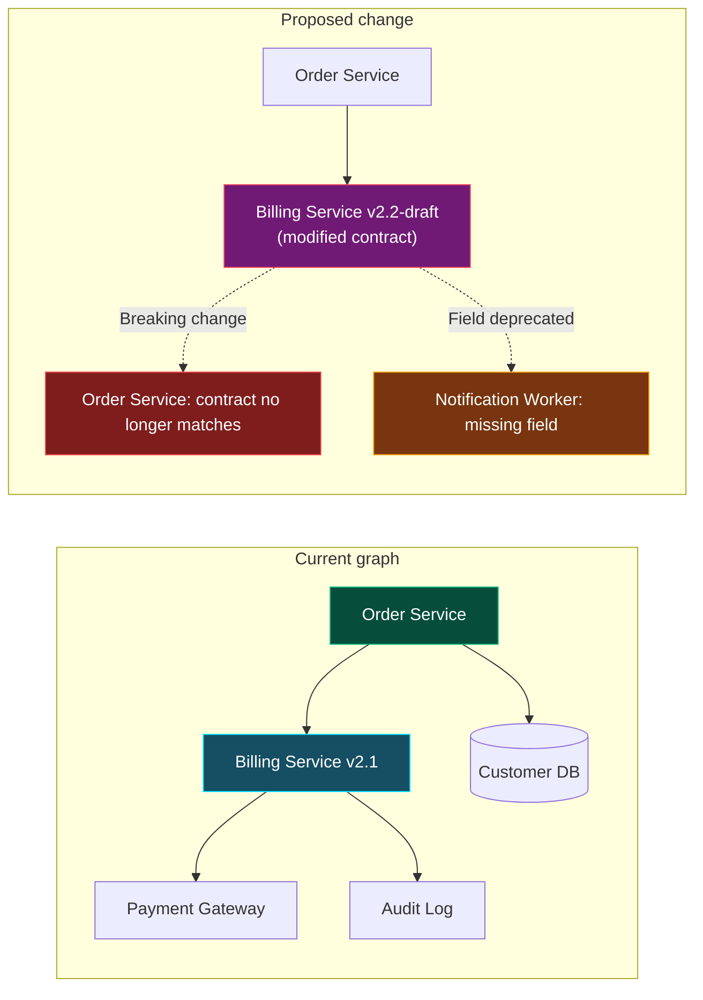
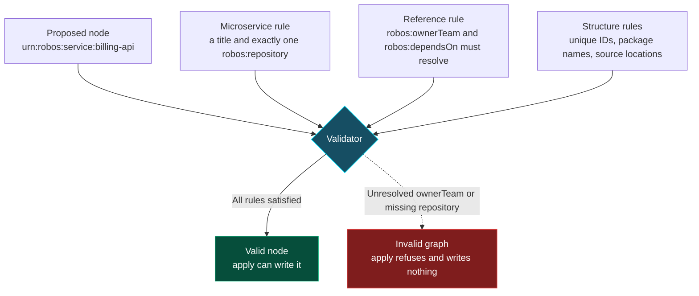
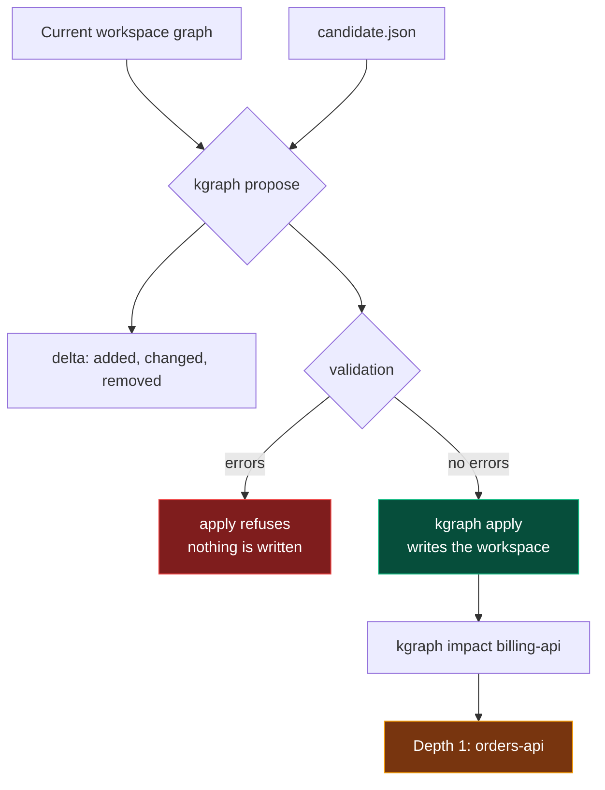
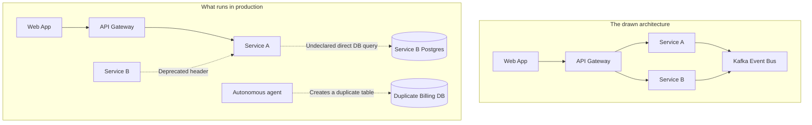

# Check impact with the kgraph CLI
{: .no_toc }

The knowledge graph that Knowledge Graph Explorer shows can also be queried from a terminal. This lesson uses the CLI to list what depends on a component, to validate a graph, and to propose a change that the validator can reject before anything is written. Use it before you hand an agent a task that changes a shared service or contract.
{: .fs-6 }

<details open markdown="block">
  <summary>On this page</summary>
  {: .text-delta }
1. TOC
{:toc}
</details>

## Before you start

You need Node.js 20 or later and a checkout of the repository. The CLI is `packages/robos-graph/bin/kgraph-cli.js` (the package's `bin` name is `kgraph`) and has no npm dependencies. Define a shell function so the examples are short:

```bash
kgraph() { node packages/robos-graph/bin/kgraph-cli.js "$@"; }
```

Without `--graph-root`, the commands read `~/.robos/knowledge-graph.jsonld` and the packages beside it. In a home directory that has no graph, the first command creates `~/.robos/` with a small sample graph. The examples below use that sample graph. Your own IDs will differ, so list them first with `kgraph query --type robos:Microservice`.

Pass `--graph-root DIR`, or set `ROBOS_GRAPH_ROOT`, to work on a separate graph. `DIR` is the folder that contains a `.robos` directory. The last section of this lesson uses one.

## Find what depends on a component

List nodes by RDF type:

```bash
kgraph query --type robos:Microservice
```

```text
Query returned 4 node(s):

  urn:robos:service:forms-api - Forms API Service
  urn:robos:service:tasks-service - Tasks Backend Service
  urn:robos:service:petstore-api-k8s - K8s Deployment: petstore-api
  urn:robos:service:vaccine-gateway-k8s - K8s Deployment: vaccine-gateway (mTLS)
```

Show one node with its incoming and outgoing references:

```bash
kgraph get urn:robos:service:forms-api
```

List the transitive dependents, which is the blast radius of changing it. `--depth` defaults to 3:

```bash
kgraph impact urn:robos:service:forms-api --depth 2
```

```text
Impact Analysis & Blast Radius for urn:robos:service:forms-api:
   Direct & Transitive Dependents: 1 (Max Depth: 2)

  [Depth 1] urn:robos:service:tasks-service (Tasks Backend Service) via urn:robos:service:forms-api
```

Two related queries use the same graph:

```bash
kgraph query --depends-on urn:robos:service:forms-api
kgraph query --path-from urn:robos:service:tasks-service --path-to urn:robos:contract:forms-api-v1
```

The second prints the chain of references between two nodes, here tasks-service to forms-api to the contract. Add `--json` to any of these for machine-readable output.

The blast radius of a change is every node that reaches the changed one through declared dependencies. This example shows a breaking edit to one service, and the nodes it would affect:



## Validate the graph

```bash
kgraph validate
```

When the graph is clean it prints that it passes the SHACL shape constraints with 0 violations. Otherwise it lists each violation and exits with status 1, so you can use it in a script. The command checks the whole graph. It accepts a package name, but ignores it.

The default graph is checked against the shapes built into `packages/robos-graph/lib/shacl-validator.js`. For example, a `robos:Microservice` must have a title and exactly one `robos:repository`. A graph under `--graph-root` is checked by the workspace validator, which covers structure, unique IDs, internal references, package names, source locations and the cardinality rules of the built-in shapes. Both are a subset of SHACL, not a full implementation. The shapes are documented on the [Schemas]({{ site.baseurl }}) page.



## Propose a change before applying it

A workspace is a separate graph that you change through reviewed proposals. Nothing is written until `apply`, and `apply` re-validates.

{: .robos-zoomable-img }
*Concept diagram from the original design docs, showing a graph before and after a proposed change. The text on this page says what is built today: `propose` reports the `delta` and any validation errors.*

1. Create the workspace:

   ```bash
   kgraph init --graph-root ./demo-workspace --title "Demo workspace"
   ```

2. Write a candidate document to `candidate.json`. This one adds two services and the team that owns them:

   ```json
   {
     "document": {
       "@context": {},
       "@id": "urn:robos:graph:demo",
       "dcterms:title": "Demo workspace",
       "robos:nodes": [
         {
           "@id": "urn:robos:team:payments",
           "@type": ["robos:Team"],
           "dcterms:title": "Payments",
           "robos:package": "organization"
         },
         {
           "@id": "urn:robos:service:billing-api",
           "@type": ["robos:Microservice"],
           "dcterms:title": "Billing API",
           "robos:package": "services",
           "robos:repository": "github.com/example/billing-api",
           "robos:ownerTeam": "urn:robos:team:payments"
         },
         {
           "@id": "urn:robos:service:orders-api",
           "@type": ["robos:Microservice"],
           "dcterms:title": "Orders API",
           "robos:package": "services",
           "robos:repository": "github.com/example/orders-api",
           "robos:ownerTeam": "urn:robos:team:payments",
           "robos:dependsOn": "urn:robos:service:billing-api"
         }
       ]
     }
   }
   ```

3. Propose it and read the result:

   ```bash
   kgraph propose --file candidate.json --graph-root ./demo-workspace --output proposal.json
   node -e "const p = require('./proposal.json'); console.log(p.validation.errors, p.validation.warnings, p.delta.added.length)"
   ```

   With the file above, this prints two empty arrays and `3`: no errors, no warnings, three added nodes. `p.delta` also has `changed` and `removed` lists.

4. Apply it, then check the dependency:

   ```bash
   kgraph apply --file proposal.json --graph-root ./demo-workspace
   kgraph impact urn:robos:service:billing-api --graph-root ./demo-workspace
   ```

   `impact` now lists `urn:robos:service:orders-api` at depth 1.



To see the validator reject a change, repeat steps 1 to 3 with a new `--graph-root` and with the Payments team node deleted from `candidate.json`. The proposal reports `unresolved robos:ownerTeam -> urn:robos:team:payments` for both services, and `apply` refuses with `Invalid graph: ...` and writes nothing. Removing a service's `robos:repository` gives `Microservice must define exactly one repository. (robos:repository)`. A missing owner is only a warning, `ownership unresolved`.

The workspace commands are `init`, `inspect`, `context`, `propose`, `apply` and `recover`. Proposals can also be refinement edits instead of a whole document. See `packages/robos-graph/WORKSPACES.md` for the format and the import workflow.

## Limits

- `kgraph diff` compares knowledge-graph branches that the store builds in memory. In the current code those are sample branches named `main`, `feature/TASK-101-auth`, `poc/v2-graphql` and `pilot/beta-billing`. It does not read your Git branches. Its text output prints zero added, modified and removed nodes because it reads the wrong fields, so run it with `--json` and read `diff.summary` and `blastRadius`. For a real before and after comparison, use `propose` and read `delta`.
- `kgraph insert` runs a validator before writing, but its error output currently prints `undefined` instead of the message. Prefer `propose` and `apply`, which report each error.
- The graph is only as accurate as what was put into it. A dependency that no node declares does not appear in `impact`.


*The dotted edges are dependencies no node declares. `kgraph impact` cannot see them until someone adds them to the graph.*
