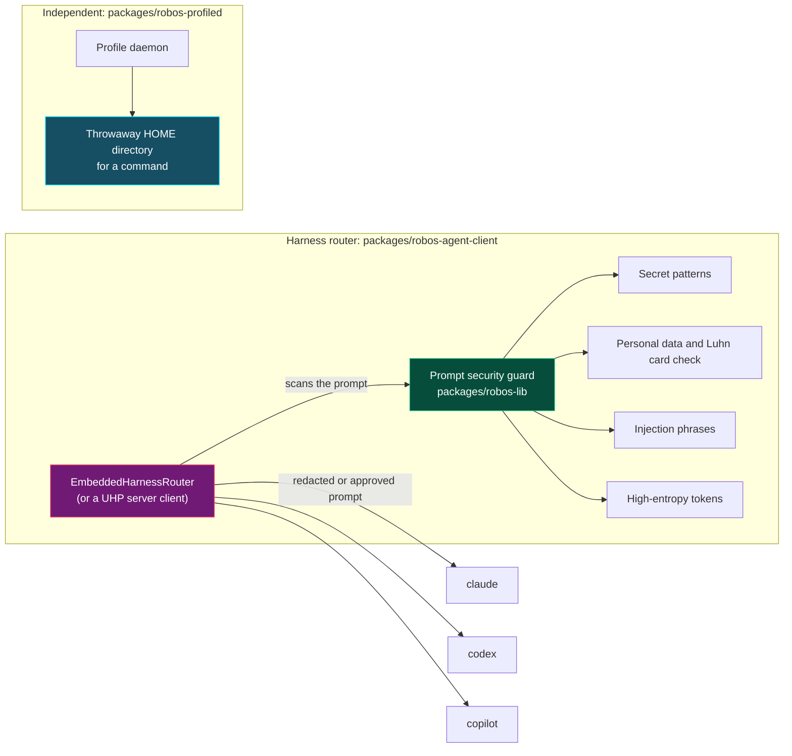

# Agent harness and security
{: .no_toc }

Three lessons on the parts of RobOS that sit between you and a coding agent: a guard that scans prompts, a router that sends a task to an agent CLI, and a daemon that gives an agent a separate home directory.
{: .fs-6 }

These are three separate pieces of code. The in-process router calls the guard, and the profile daemon is independent of both. None of them is a filesystem or network sandbox. Each lesson says what it checks, where it runs and where it stops.

{: .robos-zoomable-img loading="lazy" }
*Concept diagram from the original design docs. The text on this page says what is built today: the guard runs inside the router, and the profile daemon is a separate piece that does not sandbox the agent.*

| Lesson | Code | What it is |
|:---|:---|:---|
| [Configure the prompt security guard]({{ '/training/harness-and-security/prompt-security-guard.html' | relative_url }}) | `packages/robos-lib/prompt-security.js` | A regex and entropy scanner that redacts or blocks prompt text before it is sent. |
| [Run tasks through the harness router]({{ '/training/harness-and-security/harness-router.html' | relative_url }}) | `packages/robos-agent-client/harness-router.js` | A client for the Unified Harness Protocol (UHP), with an in-process fallback that runs local agent CLIs. |
| [Run commands in an ephemeral agent profile]({{ '/training/harness-and-security/agent-profiles.html' | relative_url }}) | `packages/robos-profiled` | A daemon that creates a throwaway home directory and environment for a command. |

For how RobOS picks models for different jobs, see [Agent tiers]({{ site.baseurl }}). For the role prompts given to agents, see [Choose and customize agent personas]({{ '/training/agent-tasks/agent-personas.html' | relative_url }}).
