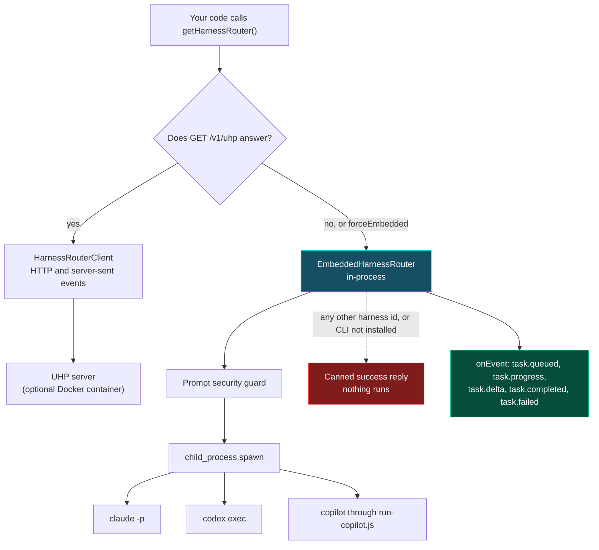

# Run tasks through the harness router
{: .no_toc }

`packages/robos-agent-client/harness-router.js` gives RobOS one interface for starting an agent CLI. It speaks the Unified Harness Protocol (UHP, version `2026-08-11`) to a server if one is running, and otherwise runs the CLIs itself in-process. This lesson shows how to list harnesses, run a task, and tell a real run from a simulated one.
{: .fs-6 }

<details open markdown="block">
  <summary>On this page</summary>
  {: .text-delta }
1. TOC
{:toc}
</details>

## Two implementations

| Class | What it does |
|:---|:---|
| `HarnessRouterClient` | HTTP and server-sent-events client for a UHP server. The default URL is `http://127.0.0.1:3000`. It sends the header `UHP-Version: 2026-08-11`, and `Authorization: Bearer <token>` when you give it a token. |
| `EmbeddedHarnessRouter` | In-process implementation of the same methods. It starts local agent CLIs with `child_process.spawn` and stores sessions in `~/.config/robos/harnessrouter/sessions.json`. |

`getHarnessRouter()` asks `GET /v1/uhp` on the server. If it answers, you get a `HarnessRouterClient`. Otherwise you get an `EmbeddedHarnessRouter`. Pass `{ forceEmbedded: true }` to skip the probe. The server is an optional Docker container: the Software Center entry **HarnessRouter CE** and `scripts/install-dev-deps.sh` use `docker run -d --name harnessrouter --restart unless-stopped -p 127.0.0.1:3000:3000 -v harnessrouter:/data harnessrouter/harnessrouter`. That image is not built from this repository.

Agents Manager lists **HarnessRouter (UHP)** as a provider. Its detail page shows the **Runtime Mode** (`service` or `embedded`), the **Configured Agent Harnesses** and the stored sessions, each with a **Delete** button.



## List the harnesses

From a checkout:

```bash
node -e "
const { getHarnessRouter } = require('./packages/robos-agent-client/harness-router');
(async () => {
  const router = await getHarnessRouter({ forceEmbedded: true });
  const res = await router.listHarnesses();
  for (const h of res.data.data) console.log(h.id, h.command, h.status);
})();
"
```

On a machine that has only `claude`, the embedded router prints:

```text
chrn_claude claude ready
chrn_codex codex not_installed
chrn_copilot copilot not_installed
chrn_gemini gemini ready
chrn_hermes hermes not_installed
chrn_omp omp not_installed
```

The six entries are Claude Code, OpenAI Codex, GitHub Copilot CLI, Gemini CLI or Antigravity, Hermes Agent and Oh My Pi. The status is `ready` when the command is on your `PATH`. The Gemini entry always reports `ready`, even when neither `gemini` nor `agy` is installed.

## Run a task

This starts Claude Code with your prompt in the current directory. It uses your own `claude` login and quota. The input is wrapped in single quotes on purpose; see the warning below.

```bash
node <<'EOF'
const { getHarnessRouter } = require('./packages/robos-agent-client/harness-router');
(async () => {
  const router = await getHarnessRouter({ forceEmbedded: true });
  const res = await router.runTask({
    input: "'Summarize the README in one sentence'",
    harnessId: 'chrn_claude',
    cwd: process.cwd(),
    onDelta: text => process.stdout.write(text),
  });
  console.log('\n', res.ok, res.status, res.data.session_id);
})();
EOF
```

The result has `ok`, an HTTP-style `status`, and `data` with the response `id`, `session_id`, `status` and `output`. Pass the same `sessionId` on later calls to keep the turns in one session. The embedded router reports progress through `onEvent` with the event names `task.queued`, `task.progress`, `task.delta`, `task.completed` and `task.failed`.

Before it starts anything, the embedded router runs the [prompt security guard]({{ '/training/harness-and-security/prompt-security-guard.html' | relative_url }}) on the input. In `block` mode a violating input returns `ok: false`, status 400 and the error code `prompt_security_violation`, and the turn is stored as failed. In `redact` mode the redacted text is what the agent receives.

## What really runs

The embedded router only knows how to start three CLIs:

| Harness id | Command it starts |
|:---|:---|
| `chrn_claude` | `claude -p <input> --output-format text` |
| `chrn_codex` | `codex exec <input>` |
| `chrn_copilot` | `node packages/robos-lib/run-copilot.js -p <input>` |

For every other harness id, and for these three when the CLI is not installed, the router does not run anything. It returns a canned success that starts with `[RobOS Embedded UHP Router] Executed task via` followed by the harness id and model, and ends with `Task processed successfully conforming to UHP 2026-08-11 standard.` The result has `ok: true` and status 200. If a script treats that as a finished task, nothing was done. Check `output` for that prefix.

The agent session backend named `harnessrouter` (`createSession('harnessrouter')`) defaults to `chrn_gemini`, so it returns the canned reply unless you pass `harnessId: 'chrn_claude'`. With a real harness it calls `runTask` with the prompt unquoted, so the shell warning below applies to it as well.

Other limits of the embedded router:

- The `model` argument is returned in the result but is not passed to the CLI. The router's model list is a fixed list, not a query of what is installed.
- `usage` in the result is an estimate, not a count from the agent.
- It sets no sandbox, container or working-directory limit. The CLI runs as your user in `cwd`.

{: .warning }
`claude` and `codex` are started with `shell: true` and the input as an argument. Node does not escape arguments in that mode, so `/bin/sh` splits and interprets the prompt. Unquoted, `Summarize the README` reaches the CLI as three arguments, and `hello $(echo INJECTED) world; echo SECOND` runs both `echo` commands. Wrapping the whole input in single quotes keeps it as one argument, but a single quote inside the text ends the quoting. Do not pass issue text or other untrusted input through `chrn_claude` or `chrn_codex` on the embedded router. The prompt guard does not look for shell syntax. `chrn_copilot` passes the input as a separate argument and is not affected.

## The server API

`HarnessRouterClient` calls these endpoints on a UHP server. The embedded router implements the same methods without HTTP.

| Method | Endpoint |
|:---|:---|
| `getUHPInfo()` | `GET /v1/uhp` |
| `listHarnesses()`, `getHarness(id)` | `GET /v1/harnesses`, `GET /v1/harnesses/:id` |
| `listModels(harnessId?)` | `GET /v1/models`, `GET /v1/harnesses/:id/models` |
| `runTask({ input, model, harnessId, stream, sessionId, previousResponseId, idempotencyKey })` | `POST /v1/responses` with `metadata.harness_id`; streams with `Accept: text/event-stream` |
| `cancelTask(id)` | `POST /v1/responses/:id/cancel` |
| `listSessions()`, `getSession(id)`, `getSessionTurns(id)` | `GET /v1/sessions`, `GET /v1/sessions/:id`, `GET /v1/sessions/:id/turns` |
| `cancelSession(id)`, `deleteSession(id)` | `POST /v1/sessions/:id/cancel`, `DELETE /v1/sessions/:id` |

To check a server by hand:

```bash
curl -s -H 'UHP-Version: 2026-08-11' http://127.0.0.1:3000/v1/uhp
```

The client test suite uses a mock server and covers these calls:

```bash
HOME=$(mktemp -d) node --test packages/robos-test/tests/robos-agent-client/harness-router.test.js
```
