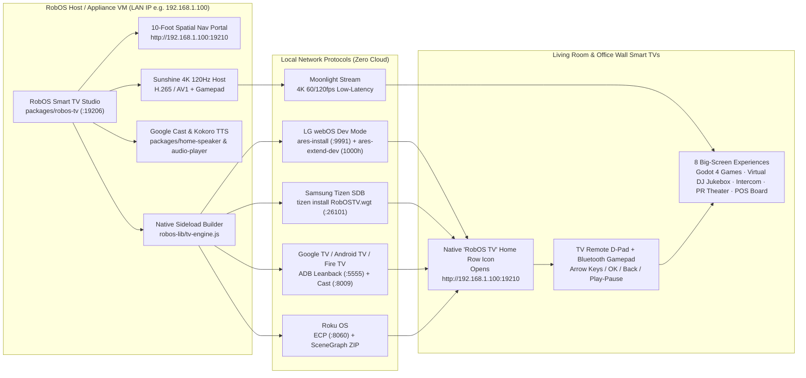

# RobOS on Your Smart TV
{: .no_toc }

Turn any LG webOS, Samsung Tizen, Google TV / Android TV, Fire TV, or Roku Smart TV into a first-class RobOS display via Developer Mode sideloading, the 10-Foot Big-Screen Portal (`:19210`), and 4K 120Hz Moonlight/Sunshine game streaming.
{: .fs-6 .fw-300 }

<details open markdown="block">
  <summary>Table of contents</summary>
  {: .text-delta }
- TOC
{:toc}
</details>

---

## Architecture Overview

**RobOS Smart TV Studio** (`packages/robos-tv`) and the shared TV engine (`packages/robos-lib/tv-engine.js`) bridge your RobOS workstation or appliance VM to any Smart TV on your local network without cloud dependencies.




## Developer Mode Sideloading By TV OS

| TV Platform | Developer Mode Activation | Generated Sideload Artifacts | Transport & Port |
|:---|:---|:---|:---|
| **Google TV / Android TV / Fire TV** | **Settings → System → About → Build** (press 7x) → enable **Network Debugging** | `AndroidManifest.xml` (`LEANBACK_LAUNCHER`), `assets/index.html`, `sideload-android-tv.sh` | Wireless ADB (`:5555`) & Google Cast (`:8009`) |
| **LG webOS** | Install **Developer Mode** from LG Content Store → enable **Dev Mode Status** & **Key Server** | `appinfo.json` (`com.robos.tv`), `index.html`, `sideload-webos.sh` (`ares-install` + `ares-extend-dev`) | webOS Dev SSH (`:9991`) & SSAP (`:3000`) |
| **Samsung Tizen** | Open **Apps** panel → press `1-2-3-4-5` → toggle **Developer Mode ON** & enter RobOS Host IP | `config.xml` (`robostv001.RobOSTV` + `tv.inputdevice`), `index.html`, `sideload-tizen.sh` | Tizen SDB (`:26101`) & TV REST (`:8001`) |
| **Roku OS** | Press `Home 3x, Up 2x, Right, Left, Right, Left, Right` on remote | `manifest`, `source/Main.brs`, `components/MainScene.xml`, `sideload-roku.sh` | Roku ECP (`:8060`) & Dev Installer (`:80`) |
| **Moonlight / Sunshine** | Install **Moonlight** on TV & pair 4-digit PIN with Sunshine in RobOS | Full 4K 120fps H.265/AV1 Desktop & Godot 4 Game Stream | RTSP / ENet (`:47984` / `:47989`) |

## Running & Verifying

```bash
# Launch RobOS Smart TV Studio
electron packages/robos-tv

# Run the automated E2E verification suite
node --test tests/e2e/robos-tv.test.cjs
```
