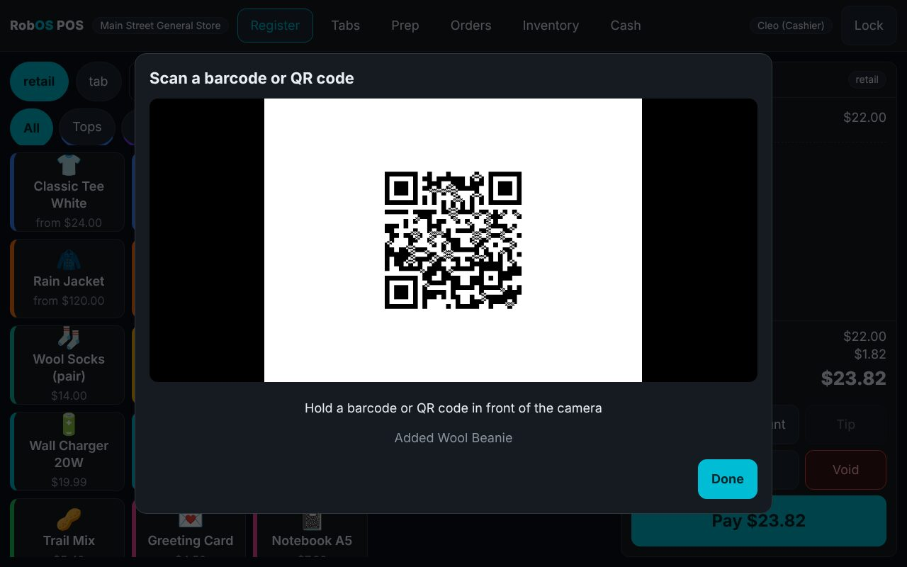
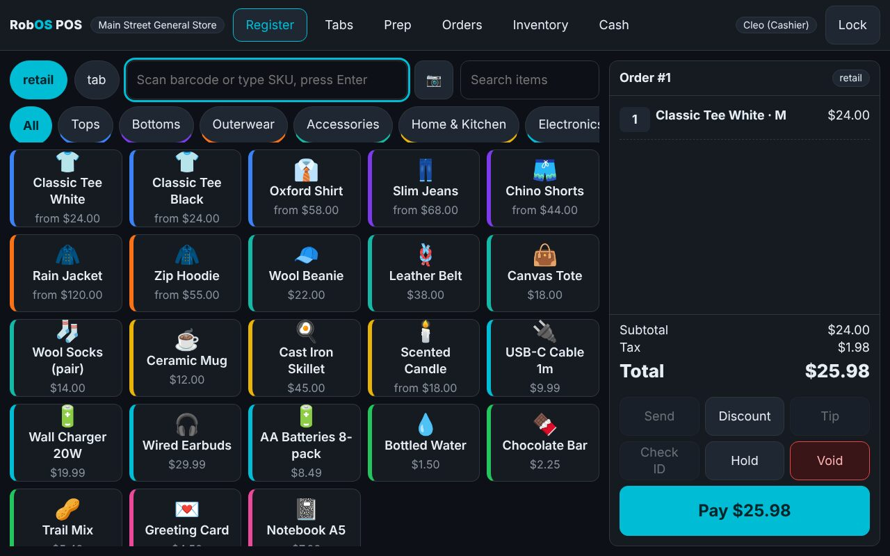

# RobOS Point of Sale

An open-source cash register for retail shops, cafés and bars. Zero runtime dependencies (Node.js built-ins only; Electron is just the desktop shell), data kept in one JSON file on your own machine.

```bash
npm install
npm start                      # desktop app (Electron)
node serve.js                  # or: headless server on http://127.0.0.1:3410
node serve.js --host 0.0.0.0   # let shop tablets open /kiosk (trusted network only; there is no TLS)
npm test                       # unit + HTTP API end-to-end suites (node:test)
npm run test:e2e               # touch-driven browser suites (needs playwright-core and Chromium)
```

On first launch pick a sample business (a general retail store, a coffee shop, a bar or an auto parts counter) or start empty. Sample PINs: owner `1111`, manager `2222`, cashier `3333`.

## Screens

| URL | Who | What |
|---|---|---|
| `/` | Staff (PIN) | Register, tabs, prep queue, orders/refunds, inventory, menu & catalog, cash, reports, team & API keys, settings |
| `/kiosk` | Customers | Self-checkout: menu, basket, tip, pay by card or at the counter |
| `/ready` | Customers | "Now ready" board for pick-up numbers |

All screens use large touch targets (56px minimum for buttons and inputs, 72px on the self-checkout) and an on-screen number pad for PINs, cash and quantities. Free-text fields (names, notes) use the device's own on-screen keyboard.

## Scanning: barcode guns, webcams, 1D and 2D codes

- **Hardware scanners** that behave like a keyboard type straight into the scan box (Enter submits).
- **Webcam** (or any camera): press the 📷 button on the Register, the self-checkout or the item form. It uses the browser's native `BarcodeDetector` when available and otherwise the bundled [ZXing](renderer/vendor/README.md) decoder, loaded only on first use.
- **Formats decoded:** UPC-A/E, EAN-8/13, Code 128/39/93, ITF, Codabar, **QR**, **Data Matrix**, **Aztec**, PDF417. Automated camera tests cover UPC-A, EAN-13, EAN-8, QR, Data Matrix and Aztec; the other formats come from the same library but are not exercised by the tests.
- **What a code can mean** (`lib/scancode.js`): a SKU, a UPC/EAN/GTIN in any zero padding (UPC-A = EAN-13 with a leading 0 = GTIN-14), a UPC-E (expanded), a **GS1 Digital Link** URL such as `https://id.gs1.org/01/09506000134352/10/LOT7`, or a GS1 element string (`(01)…` or a raw Data Matrix payload). Entering such a code in the item form stores the plain GTIN.
- **Holding an item steadily in view counts once**; it counts again after it leaves the view.
- Browsers only allow the camera on `localhost` or HTTPS. A tablet opening the till over plain `http://<ip>:3410` cannot use its camera: use a hardware scanner there, or serve the app over HTTPS. The desktop app grants camera access (video only) to its own pages and nothing else.





*Screenshots come from the automated tests, which play generated codes into a test webcam.*

## Roles

| Role | Can additionally |
|---|---|
| Cashier | Sell, hold tabs, take cash/card, small discounts (default up to 10%), open/close their drawer within the over/short limit, work the prep queue |
| Manager | Refund, comp, void sent items, large discounts, paid in/out, receive and count stock, reports, **cash payment settings** |
| Admin | Menu and catalog, taxes, promo codes, team, API keys, settings, load samples |

A cashier can get a one-off approval by having a manager type their PIN (`managerPin` in the API).

## Open checkout API

Modelled on the Agentic Commerce Protocol checkout-session flow. Integer minor units (cents). Create an API key in *Team & API*, then:

```bash
curl -s -X POST http://127.0.0.1:3410/api/v1/checkout_sessions \
  -H "Authorization: Bearer $POS_KEY" -H "Content-Type: application/json" \
  -d '{"items":[{"id":"<item id | sku | barcode>","quantity":2}],"fulfillment_option_id":"takeout"}'
# POST   /api/v1/checkout_sessions/{id}            update items, buyer, fulfillment_option_id
# POST   /api/v1/checkout_sessions/{id}/complete   {"payment_data":{"token":"tok_...","provider":"mock"}}
# POST   /api/v1/checkout_sessions/{id}/cancel
# GET    /api/v1/checkout_sessions/{id}
```

The full contract is at `/api/openapi.json`. This is *modelled on* the protocol, not a certified implementation: check field-level compatibility before wiring a third-party agent to it.

### Card providers

Cash is built in. Cards go through a provider object `{ authorize({amount, currency, order, token, reference}), refund({reference, amount}) }`, sync or async. Two ship in the box: `manual` (a standalone terminal; the worker keys in its approval code) and `mock` (test gateway, no real charges, `tok_decline` declines). Add a real gateway by passing `providers: { stripe: {...} }` to `new PointOfSale(...)` and choosing it in *Settings > Card payments*. The app never sees or stores card numbers.

## Selling from a shared inventory

On its own, the register keeps stock records in its own `store.json`. Another RobOS app can embed it and hand it a [RobOS Inventory](../robos-inventory/README.md) instead:

```js
const pos = new PointOfSale({ dir, inventory: createInventory({ store, allowNegative: true }) });
```

The register then sells from the business's shared stock (`lib/inventory-store.js`):

- **Movements:** a sale is an *issue* movement and a returned item is an *adjust* movement. Receiving, counting and CSV import also become movements, each with the sale number and the cashier.
- **Back office:** stock edits update the shared items, and removing a stock item retires it.
- **SKU links:** a catalog item created with opening stock and a SKU the business already stocks is linked to that item, and is not counted twice.
- **Moving an existing register over:** a register that kept its own stock moves it into the shared inventory once, matched by SKU. Its catalog then points at the shared items.

The register still checks stock against its own *allow negative stock* setting before a sale. RobOS Auto Center's parts counter uses this, so the counter, repair jobs and purchase orders share one shelf count. Without `inventory`, nothing changes.

## Standards used

Integer cents and ISO 4217 currency codes; GS1 GTIN check digits for barcodes (UPC-A, EAN-8/13, GTIN-14); GS1 Digital Link and element strings from QR and Data Matrix codes; schema.org `Order` JSON-LD receipts (`/api/orders/{id}/receipt.jsonld`); plain-text receipts that print to ESC/POS thermal printers; CSV import/export; OpenAPI 3.1.

## What it does not do yet

Gift cards and loyalty, multi-location sync, employee time clocks, hardware drivers for cash drawers and printers (scanners that type into a text box and webcams work; printing uses the system print dialog), ESC/POS direct printing, and online ordering UI (the API is there). Tax is a flat rate per item; there is no jurisdiction lookup, so check your local rules before using it for real sales.

## Layout

```
lib/        pos.js (catalog, inventory, auth) · inventory-store.js (own or shared stock) · orders.js · cash.js · reports.js · checkout.js (kiosk + open API) · scancode.js
            providers.js · receipt.js · samples.js · server.js · openapi.js · money.js · gtin.js · store.js
renderer/   index.html (staff) · kiosk.html · ready.html · register.js · backoffice.js · camera.js · common.js · vendor/ (ZXing)
tests/      *.api.test.js (HTTP, per business) · *.e2e.js (touch-driven Chromium, per business)
```

### Business tutorials and videos

The [Point of Sale introduction](https://rowbose.com/point-of-sale/) leads to separate
[retail](https://rowbose.com/point-of-sale/retail/),
[coffee shop](https://rowbose.com/point-of-sale/coffee/) and
[bar](https://rowbose.com/point-of-sale/bar/) tutorials, each with its own embedded video.
Edit `guide/businesses.json` for the tutorial steps and published YouTube IDs, then run
`node scripts/build-guide.js` from this package. Existing screenshots are preserved;
set `POS_PROOF_DIR` to refresh screenshots from a new test run.

To record the three real sample workflows, set `POS_DEMO_RECORD=1` and `POS_VIDEO_DIR`
when running their first browser scenarios. The recordings have step captions and
use sample data and demo payments. Upload those files, then update the video IDs
before regenerating the guide. The builder rejects missing or duplicate video IDs.
