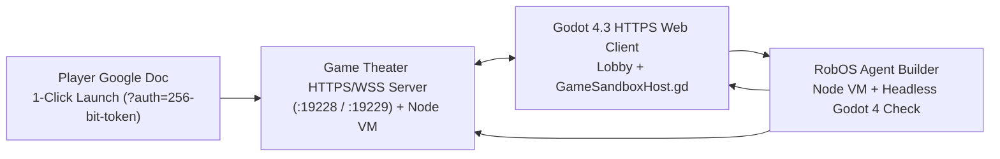

# RobOS AI Multiplayer Game Theater

**RobOS AI Multiplayer Game Theater** (`packages/game-theater`) starts with a blank multiplayer stage and lets any authenticated RobOS Game User dynamically create, play, and evolve multiplayer games on the fly using the RobOS Agent.




## How it works

1. **Per-Player Google Doc Launchers**: Using the same Google Drive v3 capability-token launcher architecture as [RobOS Google Calendar]({{ '/google-calendar/' | relative_url }}) and [RobOS Shopping Lists]({{ '/shopping-lists/' | relative_url }}), each RobOS player gets their own personal Google Doc (`RobOS Game Theater — <Player> (Player Launch Doc)`) with a 1-click Launch Button (`?auth=<256-bit-token>`). Clicking it authenticates them straight into the lobby as a verified RobOS Game User.
2. **Godot 4 HTTPS Web Client & Multiplayer Lobby**: Players connect over HTTPS/WSS (`:19229` on LAN or an outbound `cloudflared` HTTPS tunnel fronting `:19228`) into a Godot 4.3 Web Client with real-time lobby presence, player seats, strict `minPlayers`/`maxPlayers` enforcement, and lobby chat.
3. **Dynamic AI Game Generation & Live Modification**: Any game user in the lobby can describe a new game or request changes to the active game. The RobOS Agent generates both the authoritative Node.js multiplayer game server (`server.js`) and the Godot 4 GDScript scene (`client.gd`), validates both in a Node VM and headless `godot4` compiler check, and hot-loads the stage live across all connected browsers.

## CLI & Server Commands

```bash
# Start the HTTP (:19228) + Native HTTPS (:19229) server + Outbound HTTPS Tunnel
node packages/game-theater/serve.js

# List RobOS Game Users & launch URLs
node packages/game-theater/bin/game-theater.js players

# Sync per-player Google Launch Docs to Google Drive
node packages/game-theater/bin/game-theater.js sync-docs

# Dynamically generate or modify a multiplayer game via the RobOS Agent
node packages/game-theater/bin/game-theater.js generate "Create a 2-player Hangman game..." --title "Hangman"
node packages/game-theater/bin/game-theater.js modify hangman "Add a round streak counter..."
```

## Validation

```bash
node --test packages/robos-test/tests/game-theater/unit.test.js
```
