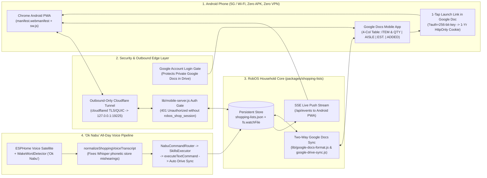

> **Full Interactive Walkthrough & Engineering Blog Posts:** See the flagship landing page at [`/shopping-lists/`]({{ '/shopping-lists/' | relative_url }}) and the engineering blog posts [RobOS Shopping Lists: Grocery, Target & Costco with Two-Way Google Docs and Mobile Form Controls]({{ '/blog/robos-shopping-lists-google-docs-and-mobile-form/' | relative_url }}) and [Exposing RobOS Shopping Lists to Android Without a Custom App or VPN: Google-Gated PWA, Outbound HTTPS Tunnel & "Ok Nabu" Voice Sync]({{ '/blog/robos-shopping-lists-android-pwa-google-gated-voice-sync/' | relative_url }}).

**RobOS Shopping Lists** (`packages/shopping-lists`) is part of the **RobOS Household & Personal Finance** suite alongside [RobOS Household]({{ '/household/' | relative_url }}) and [`robos.tax`]({{ '/robos-tax/' | relative_url }}). It comes pre-loaded with three store-tailored lists—**1) 🥬 Grocery**, **2) 🎯 Target**, and **3) 📦 Costco**—and lets you create additional lists whenever your household needs them.




## Three ready-made household lists

| List | Theme & Focus | Built-in Aisles & 1-Tap Staples |
|---|---|---|
| **1) 🥬 Grocery** | Weekly fresh market, produce, dairy & pantry | Produce, Dairy & Eggs, Bakery, Meat & Seafood, Pantry & Dry Goods, Frozen, Beverages, Snacks, Household — with 1-tap chips for milk, pasture-raised eggs, avocados, apples, sourdough, spinach, yogurt and coffee. |
| **2) 🎯 Target** | Household essentials, pharmacy, personal care & home run | Household Essentials, Personal Care & Beauty, Health & Pharmacy, Kitchen & Dining, Home & Storage, Kids & Pets, Electronics & Tech, Market & Snacks — with 1-tap chips for laundry pods, dishwasher pacs, hand soap, toothpaste, Ziploc bags and batteries. |
| **3) 📦 Costco** | Wholesale club bulk pantry, Kirkland favorites & freezer stock-up | Kirkland Signature, Rotisserie & Deli, Bulk Produce, Meat & Poultry, Freezer Bulk, Pantry & Oils, Paper & Cleaning, Beverages & Cases, Bakery & Sweet — with 1-tap chips for rotisserie chicken, Kirkland paper towels & bath tissue, 2L olive oil, Kerrygold butter and croissants. |

## Form-like item entry and per-row controls

Rather than editing plain bullet text by hand while carrying a basket, every list gives you form controls on both desktop and mobile:

- **Structured Add Item form**: enter an item name, adjust quantity with `−` / `+` buttons, pick a unit (`ea`, `pack`, `lb`, `oz`, `gal`, `case`, `bag`, `box`, `bunch`), let the store's keyword rules auto-select the aisle (or choose one explicitly), add an optional unit price (`$`) or coupon note, and attach a highlight badge (`🔥 Must Have`, `🏷️ Sale / Coupon`, `🌿 Organic`, `⭐ Store Brand / Fav`).
- **1-Tap Quick-Add staples**: tap any frequent item pill to add it immediately—or increment its quantity if it is already on the list.
- **Per-item row buttons**: every item has a circular check-off button (updating the live cart progress ring and estimated remaining cost), inline `−` and `+` quantity steppers, an inline **Edit** dialog, and a **Remove** button backed by **Undo** and **Clear Checked**.
- **Multi-store smart paste & optional AI**: paste a recipe or comma-separated list (`2 gal milk, 4 avocados, laundry pods @target, olive oil @costco`) to route items to the right store offline; if an AI CLI is configured, the optional **✦ Parse with Active RobOS AI Agent** button can also parse free-form notes through `robos-lib/ai-agent`.
- **Household finance CSV export**: **Export Household CSV** formats items, merchants, categories, quantities and line totals as CSV ready for reconciliation workflows in [RobOS Household]({{ '/household/' | relative_url }}).

## Viewing and editing on mobile in Google Docs & Google Drive

1. **Native Google Docs in Google Drive (`application/vnd.google-apps.document`)**:
   - Sign in once through [RobOS Cloud Accounts]({{ '/cloud-accounts/' | relative_url }}) (or click **Sign In** inside the app) and click **Sync All 3 Lists to Google Docs & Drive**.
   - RobOS creates (or updates) a `RobOS Household Shopping Lists` folder in your Google Drive containing **three native Google Docs**—`Grocery — RobOS Shopping List`, `Target — RobOS Shopping List`, and `Costco — RobOS Shopping List`—plus `shopping-lists.json`.
   - **Two-way Google Docs pull**: if you check off `☑` / `[x]` or type a new `☐ Item — 2 pack` line directly inside the Google Docs mobile app, syncing with **Pull mobile edits from Google Docs** merges those changes back into RobOS.
2. **Interactive Mobile Form (LAN QR + Serverless Google Drive Apps Script)**:
   - On home Wi-Fi or [RobOS Private Networks]({{ '/private-networks/' | relative_url }}), scan the built-in QR code to open the live mobile web companion (`:19225`), which syncs in real time via Server-Sent Events.
   - For cellular 5G inside the store when your home computer is off, RobOS generates and uploads `Mobile-Form-Apps-Script/Code.gs` and `Index.html` into your Google Drive folder.

## CLI & `/shopping-lists` AI Skill

```bash
# View lists or print a fridge checklist
node packages/shopping-lists/bin/shopping-lists.js list
node packages/shopping-lists/bin/shopping-lists.js print all

# Add items across Grocery, Target, and Costco in one line
node packages/shopping-lists/bin/shopping-lists.js add "2 gal organic milk $4.89 (whole), 4 avocados, tide pods @target, rotisserie chicken @costco"

# Check off, adjust quantity, remove, undo, or print the command guide
node packages/shopping-lists/bin/shopping-lists.js check "avocados"
node packages/shopping-lists/bin/shopping-lists.js qty "avocados" +2
node packages/shopping-lists/bin/shopping-lists.js guide
```

## Where data lives

- Local state: `~/.config/robos/household/shopping-lists.json` (honors `ROBOS_CONFIG_DIR` and syncs under `config/household/**` in [Config Sync]({{ '/robos-preferences/' | relative_url }})).
- Ports: mobile form, printable guide (`/guide`), & Google Doc preview HTTP server on `:19225` (`SHOPPING_LISTS_WEB_PORT`), DOM snapshot debug server on `:19224`.
- Source: [`packages/shopping-lists`](https://github.com/nddipiazza/robos/tree/main/packages/shopping-lists). Tests live in `packages/robos-test/tests/shopping-lists/`.
